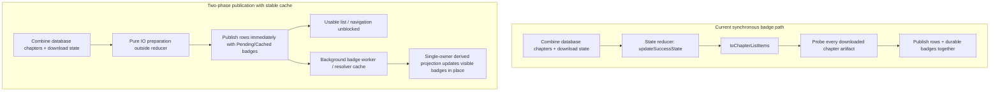

# Scope and success behavior

This work covers `MangaScreenModel`, its chapter-row projections, durable status lookup and progress-detail subscription policy. It should make a chapter list usable before every downloaded chapter's artifact has been opened, and avoid reopening unchanged translations during unrelated state updates.

It does not change translation execution, provider retries, page-stage ownership or durable artifact format. Existing live queue/request precedence remains in `TranslationUiProjection`; resolved disk badges are a presentation input, not permission to mutate files.

Return to the [overall plan](..). See also [reader entry](../reader-entry) and [validation](../validation-and-delivery).

# Current and proposed flow



# Phase L0 — Loading diagnostics

Capture baseline timings and structural counters on the existing branch before code changes:

- Trace `MangaScreenModel.init` to first `Success` emission.
- Separate database chapter collection, download-status mapping, translation-status lookup and UI row mapping.
- Record the count of disk probes and `ChapterTranslationStore` creations per screen open.
- Measure repeated navigation back to the same manga and to an unchanged sibling manga.

# Phase L1 — Remove I/O from atomic state updates

**Primary files:** `MangaScreenModel.kt`, `ChapterTranslationSnapshotRegistry`, its existing test.

1. Separate the expensive derived-row computation from `updateSuccessState { ... }` at the combined-flow collector.
2. Capture a structural input revision for the manga/chapter identity, filters and ordered keys.
3. Build the derived inputs on IO without mutating UI state or starting observer jobs from the reducer.
4. Publish through a cheap pure atomic merge. During that merge, read the latest row selection, live queue/request state and translation progress snapshots rather than restoring a stale copied `Success`.
5. Reject the result if the manga or structural revision changed while computation was suspended. **Latest-wins coalescing (P2-2):** under rapid filter, sort, search or download churn, supersede older in-flight mappings immediately so stale computations do not starve or flicker the UI.
6. Move progress-observer subscription changes into an explicit reconciliation step after a valid publication, outside the atomic callback.
7. Ensure the initial `awaitManga/awaitChapters` path and the combined collector use one shared mapping pipeline, avoiding duplicate initial work.

**Exit check:** running concurrent UI state updates across a mock slow chapter list executes the expensive row mapping once per structural change and executes zero disk probes inside the atomic reducer.

# Phase L2 — Per-document status caching and invalidation

**Primary files:** `DurableChapterStatusResolver.kt`, `TranslationManager.kt`, `ChapterDataResetController.kt`, `ActiveChapterStoreRegistry.kt`, registry/lifecycle mutation callbacks and `DurableStatusWipeGateTest.kt`.

## Identity and ownership

Reuse the resolver's existing status/document caches. Define a canonical cache identity tied to source, translation storage revision and the chapter artifact location/registry key. The existing logical chapter key maps to that canonical identity after positive location resolution.

**Bounded alias mapping (P2-3):** Retain an LRU-bounded alias mapping (max 500 entries) so alternate chapter IDs/names referring to the same document invalidate together. On chapter rename or identity migration, immediately purge the obsolete alias; cache misses on an obsolete alias cannot corrupt or poison the new canonical identity.

Do not key only by chapter title, transient `UniFile` object identity or page count. Global translation-storage root replacement increments a storage revision and invalidates location aliases as well as statuses. Keep directory-location cache policy separate from a chapter-content mutation: a status update need not cause another manga-directory walk if the location is unchanged.

## Cache contract and observed revisions

Conceptual result:

```kotlin
sealed interface DurableStatusResult {
    data class Known(val state: Translation.State, val documentVersion: Long) : DurableStatusResult
    data object Absent : DurableStatusResult
    data class Unavailable(val safeReason: String) : DurableStatusResult
}
```

`Absent` is a proven missing document, not a catch-all null. The initial phase caches only Known results; untranslated/absent chapters stay uncached by design until LP-X1 (the warm-cache gate guarantees zero new probes specifically for unchanged Known entries, per P2-1). Presentation uses the typed result so storage errors do not become NOT_TRANSLATED.

### Store-supplied observed revision (Named LP-02 deliverable, resolving P1-1)

Status/version coherence cannot rely on reading an epoch after projecting an old snapshot, nor on the diagnostic-only writer registry (`ActiveChapterStoreRegistry.kt:237-279`). To ensure atomic coherence:

1. Expose an atomic accessor on `ChapterTranslationStore`:
     ```kotlin
      fun observedArtifactStatus(): Pair<Translation.State, Long>
     ```
    returning the projected `Translation.State` and its monotonic mutation revision, captured under the same lock that publishes page/display state.
2. The probe status projection returns `(state, revision)` atomically.
3. The resolver records and checks this version against the canonical identity: it installs into the status cache only if the document identity's current version still matches the observed revision at installation time. Any commit or mutation landing during status projection increments the identity's version, preventing stale status installation.

Maintain one mutation version per canonical identity. A lookup:

1. Consults queue/active-store authority where applicable.
2. Returns an already valid Known cache entry without disk work.
3. Coalesces concurrent misses for the same identity through one in-flight job.
4. Opens the current probe and performs existing recovery/status projection.
5. If recovery/seeding changed that identity, refreshes its version before capturing the projected result/version pair.
6. Publishes to cache only if the version still matches at installation. A mutation during status projection prevents installation; retry or return a pending refresh rather than caching the old value under a new version.

### Shared probe reference counting (Named LP-02 deliverable, resolving P1-2)

Today `getOrCreateProbe` in `ActiveChapterStoreRegistry.kt:124-127` returns `owned = true` for reused probes, creating a close-while-in-use race where the first releaser calls `store.closeAndFlush()` while a concurrent `withProbeStore` or `withDurableStore` caller is still executing inside `block()`.

Fix in LP-02:

- Introduce reference-counted probe lease tracking in `ActiveChapterStoreRegistry`.
- `releaseProbe` decrements the active user count and executes `closeAndFlush()` only when the count reaches zero and the probe has not been adopted as an active store.
- Extend the resolver-managed in-flight probe lifecycle to cover all `withDurableStore` (terminal snapshot reconstruction, `DurableChapterStatusResolver.kt:158-185`) callers as well as status probe callers, ensuring shared callers never suffer unexpected store closure.

### Narrowing TranslationManager queue-state cache wipe (Named LP-02 deliverable, resolving P0-1)

Currently `TranslationManager.kt:291-302` wipes the entire durable status cache on **every** `translator.queueState` emission:

```kotlin
translator.queueState.collect { durableStatusResolver.clearDurableStatusCache() }
```

This voids the warm cache under active batch workloads across any manga.

Fix in LP-02:

- Replace the blanket wipe with targeted, identity-scoped durable transition signals emitted when a translator job changes status (queued, translating, committed, failed, canceled).
- Only the specific chapter undergoing mutation is invalidated.
- Combine this with the identity-scoped observed revision check at install time to safely handle conflated remove-then-re-add transitions without needing a global cache wipe.

## Invalidation matrix

| Event | Required action |
| --- | --- |
| Translator `queueState` emission (batch progress / enqueue / state transition) | Targeted invalidation of the affected chapter identity; no global cache wipe for unrelated chapters/manga (P0-1) |
| Probe creation/recovery or journal seed | Invalidate/revise the affected document's status; preserve unrelated documents |
| Page translation/render/commit changes badge truth | Bump affected document version and refresh/push its active projection |
| Chapter reset/delete | Invalidate affected status, cancel/drop its in-flight installation, clear location only if deleted/moved |
| Download rekey/identity migration | Invalidate old and new document aliases; purge old alias from LRU; preserve the existing joined-release protocol |
| Active-store open, adoption or eviction | Refresh affected identity from its current authority; do not assume eviction deletes durable output |
| Storage root or permission capability change | Invalidate the affected storage namespace/location aliases and report unavailable until a safe lookup succeeds |
| Full import/restore or unknown legacy callback | Retain a conservative namespace/global invalidation fallback |

Audit all current `clearDurableStatusCache()` sites. Replace a call with targeted invalidation only when its affected identity is known; retain conservative invalidation for genuinely broad events. Do not delete the existing recovery wipe without a replacement protocol.

## In-flight lookup lifecycle

Tie shared resolution to a resolver-owned bounded scope, not the first row observer's cancellation token. Canceling one subscriber removes its delivery but does not destroy a lookup another subscriber still needs. Bound worker count, outstanding keys and cache size; remove terminal jobs from the in-flight map. On screen exit, cancel screen requests; on resolver shutdown/storage reset, cancel or invalidate owned work and wait for existing store-release rules as appropriate.

Probe release behavior relies on the reference-counted lifecycle above. A resident full-store pool is not necessary to fix status invalidation and has a separate memory/lifecycle cost. Registry adoption during a lookup must remain safe: never close an adopted active store.

## Required tests

- **Sequential A/B/C:** Resolve A/B/C sequentially, then again: unchanged Known statuses survive and the second sweep creates zero new probes for those entries.
- **Mixed-activity batch test (P0-1 / P2-7):** An active batch on Manga B emits queueState events; Manga A's unchanged Known entries retain cached status and require zero disk probes.
- **Targeted invalidation:** Recover/update/delete B: B becomes invalid; A/C remain valid. Recovery still changes B's status correctly.
- **Alias tracking and LRU eviction (P2-3):** Same document under two logical aliases: one invalidation affects both. Eviction of old alias on rename prevents obsolete key resurrection.
- **Interleaving commit-held race (P1-1 test):** Hold status projection, mutate/commit the document under lock, then complete probe projection: old result cannot be installed into cache.
- **Probe refcounting concurrent use (P1-2 test):** Overlap a status lookup and a `withDurableStore` read on one probe; both complete successfully on a live store with exactly one close.
- **Subscriber cancellation:** Two subscribers share one miss; cancel one and verify the other still receives the result; both canceled work stays bounded.
- **Root replacement:** Permission/root replacement is not hidden by a cached location/status.
- **Absence safety:** Repeated missing/corrupt reads remain retryable and do not poison a Known/Absent cache.

# Phase L3 — Two-phase rows and badges

## Presentation state and single-owner architecture

Add a presentation-only resolution field to the chapter item/projection:

```kotlin
sealed interface ChapterBadgeResolution {
    data object Pending : ChapterBadgeResolution
    data class Known(val state: Translation.State, val version: Long) : ChapterBadgeResolution
    data object NotApplicable : ChapterBadgeResolution
    data class Unavailable(val safeReason: String) : ChapterBadgeResolution
}
```

### Single-owner resolution derivation (Resolving P1-5)

Currently `ChapterList.Item.translationState` defaults to `NOT_TRANSLATED` (`MangaScreenModel.kt:1957`) and is written by four competing live paths, while UI composables read it directly. Having two independent fields creates synchronization races where late enrichment can overwrite fresh queue events or leave false-untranslated defaults.

Design decision for L3:

1. **Single projection authority:** `translationState` is converted into a strictly derived property computed from `(liveInputs, badgeResolution)` inside one unified projection function (`TranslationUiProjection`), OR all UI readers (`MangaScreen.kt:313-314`, `translationStateProvider` `MangaScreen.kt:831`, `TranslationProgressProjection.kt`) are migrated to consume `badgeResolution` directly in one atomic changeset.
2. **Explicit non-downloaded handling:** Since durable status is only probed for downloaded chapters (`MangaScreenModel.kt:723-733`), non-downloaded rows immediately receive `ChapterBadgeResolution.NotApplicable` rather than remaining in `Pending` indefinitely.
3. **Reconciled aborted batch state:** Interplay between `reconcileAbortedBatchState` and `badgeResolution` is explicit: aborted batch status overlays the item as a live request input; durable lookup only proceeds if no live aborted state is active.
4. **Enforce with test:** Add a unit test asserting no UI component reads raw un-projected state without resolution completeness.

Display precedence: current live queue/request activity first; current active-store projection next; valid Known cached/durable state next; Pending/Unavailable/NotApplicable last.

Opening a chapter is available while the badge is pending. State-dependent destructive/reset/delete actions and translation retry/start admission revalidate through current authoritative state; cached badge state is never the mutation gate.

## Scheduling and stale-result fences

- Build structural rows without durable lookup and publish them first.
- Peek valid cache entries synchronously; enqueue only unresolved downloaded rows.
- Start with one disk-resolution worker. Bound the pending set to current-screen chapter IDs and deduplicate by canonical document identity.
- Use stable list order first; add viewport prioritization later if plumbed.
- Use a structural list token plus a per-document version for each response. Merge only if that chapter is still present, its artifact identity still matches and the version is current.
- Queue/progress/dialog changes do not invalidate structural work; they are overlaid from the latest state at delivery.
- A filter/reorder change reprioritizes existing requests; it does not reread all valid status entries. Removed chapter requests are dropped.
- Screen disposal stops its requests and observers. A result for manga A cannot alter a later manga B screen.

## Progress subscriptions and removing eager terminal store opens (Resolving P2-8)

- Keep live queued/requested chapter progress subscriptions.
- **Remove eager terminal store opens:** Currently `observeTranslationProgress` eagerly opens a full active store from the list path for terminal chapters (`MangaScreenModel.kt:578-586`). In L3, this eager open is completely removed from the list path. Summary state is supplied by badge projection; detailed progress and run histories are lazily materialized only when the chapter details/drawer sheet actually opens.
- Preserve retry actions after restart; never remove terminal error presentation merely to avoid opening a store.

## Global flow fan-out

Separate structural chapter/download inputs from translation/request/progress overlays. A global queue event concerning another manga should not trigger disk resolution for this manga. Use per-chapter/manga projections or diff relevant ID sets. Keep row identity, list sorting/filtering and selection stable.

## Tests and exit criteria

- Slow/hanging badge lookup cannot prevent base rows from appearing or navigation from working.
- Non-downloaded rows immediately resolve to `NotApplicable` and never hang in `Pending`.
- A pending badge never flashes a definitive untranslated icon/action.
- Current queue/request state wins over a late durable status result.
- Failed permission lookup produces unavailable presentation and a safe retry path.
- Return to a warm unchanged screen performs no repeated full store opens for retained Known statuses.
- No eager full store opens occur from the list path for terminal chapters.
- Progress/selection survives badge updates and a latest-only structural refresh.
- Terminal details still open correctly when loaded on demand after app restart.
- Unrelated queue events cause no new artifact lookup or store open.

# Conditional phase L4 — Cheaper durable summaries

If badge completion remains costly after L1—L3, design a separate versioned status summary from acknowledged journal inventory and committed artifact identities. A manifest-only shortcut is not automatically correct: `StoreStatusProjector` depends on hydrated state/display, durable failures, trusted expected inventory and verified run records.

Any persistent summary needs schema/version/checksum, an atomic update owner, storage identity, recovery reconciliation and fallback on missing/stale/unsupported data. Do not add this format before measurements show it is worthwhile; the initial plan has no migration requirement.
