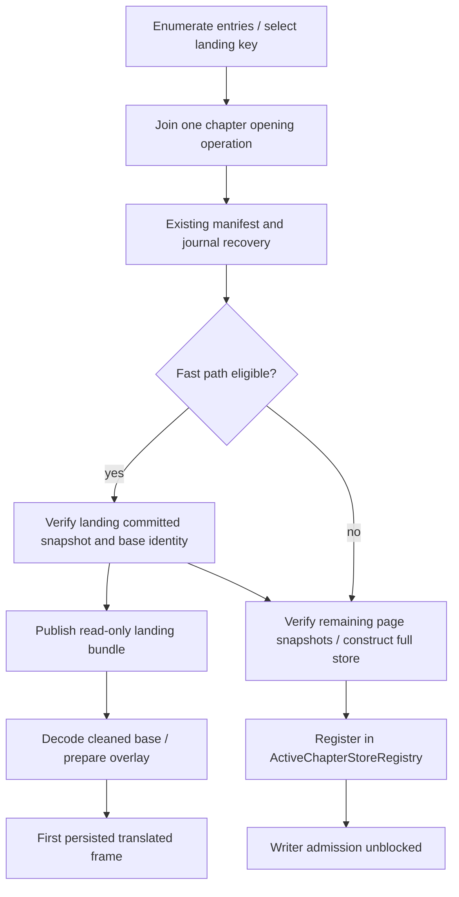

# Objective and limits

Reduce time from chapter tap to the landing page's existing translated image and matching text. Preserve the current recovery rules and last committed output. Publishing an original image sooner, starting new AI work, or declaring an unverified candidate readable does not satisfy this objective.

Return to the [overall plan](..). The [source audit](../../pipeline-efficiency-audit/reader-entry) distinguishes Activity loading-shell installation, original-page content, translated image, translated text and chapter-switch teardown.

# Existing dependency to change

Today the reader does not begin binding translated page display until `ChapterTranslationStore.open` finishes its entire multi-step process:

1. Opens the translation storage root and locates the chapter directory.
2. Replays the acknowledged journal, verifies recovery invariants and reconciles tombstones/invalid records.
3. Loops through every page key in the manifest, loading snapshots, computing expected fingerprints and verifying cleaned-image references.
4. Registers the store in the active registry.

Only then does `observePageView` bind `CleanedPageImageFactory` and `currentTranslationStore`. For a 50-page translated chapter, this means 49 unrelated pages are snapshot-hydrated and verified before the first page can draw.

# Phase R0 — Establish accurate milestones

Capture reader-entry milestones and counters on representative translated chapters:

| Milestone / counter | Measurement point |
| --- | --- |
| Chapter tap | User gesture or programmatic open |
| Activity resume | `ReaderActivity.onResume` |
| View hierarchy installed | First frame of reader loading shell |
| Page enumeration complete | `ChapterLoader.getPages` returns |
| First original page decoded | Background image available |
| Journal replay complete | Authoritative history recovered |
| Store open complete | Full store registered |
| First translated image decoded | Cleaned base bitmap available |
| Matched text ready | Text blocks available for the same committed generation |
| First translated frame | Display renders both translated image and text |

Distinguish cold process entry, warm process entry and chapter-to-chapter switch. Record page count, journal size and storage provider.

# Phase R1 — Remove conditional probe-then-open duplication

**Files:** `ReaderViewModel.kt:918-948`, `DurableChapterStatusResolver.kt:197-204`, `ActiveChapterStoreRegistry.kt:102-138`, `TranslationManager.kt:1560-1570`.

1. When the reader prepares to open a chapter, check active stores first.
2. If absent, start one coordinated opening rather than a preliminary probe plus a later full open.
3. For downloaded chapters with preloaded stores, preserve the existing instant handoff.
4. For non-downloaded chapters and non-preloaded downloads, register the reader as a subscriber to the opening task.
5. **Derive reader status directly from opening (Resolving P1-3 & P1-1):** Scope LP-05 so that `vm.translationStatus` and badge queries for the entered chapter subscribe to the in-flight opening rather than opening a competing probe. This ensures that holding the file opening lock does not serialize same-chapter status updates behind the full open.

**Parity check:** chapters that currently open without a probe preserve their single open; paths that previously probed then reopened perform exactly one open.

# Phase R2 — Enumerate pages and determine the correct landing key early

**Files:** `ChapterLoader`, `DownloadPageLoader`, `ArchivePageLoader`, `ReaderViewModel`, reader controller.

1. Enumerate original directory/archive entries and construct stable page keys before waiting for full translation materialization.
2. Resolve the landing index using the same existing requested-page and last-read behavior. `ChapterLoader` currently overrides `requestedPage` from `last_page_read` for unread chapters after `getPages`; move or share that pure selection rule so both entry prioritization and final loader state use the same index.
3. Clamp to the actual page list. Handle empty chapters through the existing error path; never infer page 0 from an unknown enumeration.
4. Request the landing key first, then a bounded neighboring window using `ReaderPageWarmWindow` rather than a new arbitrary large prefetch depth.
5. Support directory names and archive entry keys exactly as before; persist source filenames and existing online/download rekey identities unchanged.

### Unified page key derivation (Resolving P2-4)

Currently page-key derivation is duplicated: `resolvePageKey` in `ReaderViewModel.kt:1813` vs `sourceFileName` enumeration in `DownloadPageLoader.kt:146-172`.

- Extract and standardize on a single canonical `ChapterPageKeyResolver` helper.
- Verify parity across unusual filenames, symbols, archive path separators and zero-padded page numbers (`page_001.jpg` vs `1.jpg`).

The loader may know original page metadata earlier, but it should continue to prefer an available persisted committed translation at first binding. A verified absent translated result allows existing original-page behavior. An unavailable/corrupt translation artifact follows explicit recovery/error behavior, not an invented clean miss.

**Tests:** start/middle/end landing; read/unread chapters; requested page beyond the list; archive entry natural order; directory key mapping; first-entry enumeration canceled; downloaded/online key reconciliation; odd-filename / zero-padding parity.

# Phase R3 — One progressive opening task, two readiness milestones

## Recommended architecture

Extend shared opening coordination around the existing registry/file opening locks. An in-progress opening operation has two outputs:

```kotlin
interface ReaderChapterOpening {
    val committedReaderPages: Flow<VerifiedCommittedReaderPage>
    suspend fun awaitFullStore(): ChapterTranslationStore
}
```

A verified reader page contains immutable blocks/geometry, committed snapshot identity, cleaned/original base identity, page/version tokens, and the same safe lazy image factory the holder already understands. It is not a writable `ChapterTranslationStore`, candidate draft or a global cache of bitmaps.

One file-identity opening task owns recovery, memoized verified snapshots and eventual full store construction. Concurrent reader/holder/observer/write callers join it. It emits a verified landing result early when eligibility rules permit, then completes the normal fully recovered store. **The existing active-store registry publishes only the full store.** Existing synchronous planner/snapshot/status consumers never receive a partially hydrated store under its old API contract.

A writer needing the chapter joins `awaitFullStore()` before admission. A reader page can use the validated read-only result before that point, with explicit identity/session fencing.



## Initial eligibility

Eligible for the first progressive phase:

- Healthy schema-supported translated chapter directory.
- Acknowledged journal exists and parses cleanly without unhandled corruption.
- Landing page has a valid committed snapshot pointer.
- Landing page cleaned-image file exists and content matches its recorded expected hash/fingerprint.
- Landing page text generation matches the committed generation.

Fallback to normal full-store open before publishing reader output when:

- Legacy schema requiring migration.
- Recovered journal requires repair, truncated ACK, or ambiguous winner resolution.
- Landing page has only uncommitted candidate data.
- Landing page base image or text artifact is missing, truncated or fails fingerprint verification.
- Storage capability error or permission failure.
- Progressive entry explicitly disabled by runtime flag.

## Keep recovery unchanged and memoize verified snapshots (Resolving P1-4)

The first progressive phase preserves the entire existing journal recovery flow (`ChapterJournalRecovery.kt:552-593`). Replay processes all historical records and resolves the winning state for every page.

**Critical snapshot memoization requirement:**
During journal replay, winning records are verified through `artifactResolver`, which reads and hashes `readPageSnapshot` (`ChapterJournalRecovery.kt:416-455`). To achieve the 20% landing-page target:

- Verified snapshots loaded during recovery must be memoized in the opening session's ephemeral context.
- The subsequent manifest loop (`ChapterTranslationStore.kt:4901-4913`) and the landing-page resolver must reuse these already-read snapshots rather than performing duplicate disk reads and SHA recomputations.
- In LP-00, explicitly instrument and record the `store.journalReplay` vs `store.pageSnapshotHydration` latency breakdown. If journal replay dominates (>80% of opening time), progressive snapshot hydration alone cannot meet the 20% milestone, and LP-X2 replay optimization becomes a mandatory follow-up.

## Reader/display handoff

- The loader and `observePageView` must be able to consume the same early immutable committed page rather than waiting only for an active-store registration.
- Bind the image factory and blocks from one verified committed bundle. Overlay-on-original is not the default shortcut.
- `ReaderTranslationController.currentTranslationStore` remains unset until full readiness. Do not treat this as permission to start a second open.
- Once the full store is registered, switch to its normal committed display flow under the reader entry identity, then end the opening stream. Preserve the visible bundle through the switch; do not clear it or flash the original for an equivalent display generation.
- If the completed store supplies a newer legitimate committed generation, apply the new whole bundle coherently. Never combine early blocks with another image generation.
- Keep current `TextLayoutCoordinator` background execution/cache/generation fencing.

## Lock tenure and synchronization across 5 mutex layers (Resolving P1-3 & P2-5)

To prevent both the probe serialization race and the download-rekey race (`TranslationManager.kt:1560-1570`), the opening lock tenure is pinned:

**Decision:** The opening task holds the per-file opening lock from task start **through full store registration**. Reader status (`vm.translationStatus`) and badge probes for the entered chapter subscribe to the progressive opening directly (via LP-05) rather than contending for the file opening lock.

### Lock Tenure Table

| Mutex Layer | Scope & Type | Held Across Suspension? | Acquisition Order | Hold Duration / Release Condition |
| --- | --- | --- | --- | --- |
| 1. `ARTIFACT_OPEN_LOCKS` | Global JVM map keyed by canonical file path | Yes (coroutine Mutex) | 1st | Acquired at entry to open/rekey; held until full store or rekey commit completes |
| 2. Registry `openingLocks` | `ActiveChapterStoreRegistry` keyed by `fileKey` | Yes (coroutine Mutex) | 2nd | Acquired by opening task; held through journal replay, landing hydration, and final full store registration |
| 3. Chapter admission locks | `TranslationManager` per-chapter admission | Yes (coroutine Mutex) | 3rd | Acquired by writers or rekey transactions; readers awaiting full store wait outside this lock |
| 4. `readerTeardownMutex` | `TranslationManager.kt:148-149` (JVM Monitor) | **NO** (never hold across suspension) | Independent | Guards reader stop / cancel synchronization; R3 cleanup must never block on it |
| 5. R3 owner scope | Subscriber tracking & in-flight map | **NO** (pure memory synchronization) | Local | Guards subscriber attach/detach; holds no I/O locks |

**Chapter switch cleanup ordering (Resolving P2-5):**
On chapter leave or switch, `cancelTranslationForChapter` invokes `awaitReaderStop` (`ReaderTranslationController.kt:655`).

- R3 owner-scope cleanup on chapter leave must **never** block on `readerTeardownMutex` or on the next chapter's opening locks.
- Cancellation of in-flight opening subscriptions is non-blocking and cooperative. If no other subscribers remain, the task cancels at the next suspension point and releases its locks.

## Do not reuse the current lazy hook unchanged

`getOrLoadPageSnapshot` currently chooses candidate before committed and can populate committed display when a committed pointer exists, without the open-time expected-fingerprint comparison.

Create explicit helpers for a verified committed reader page and a writer's current candidate/live page. Both apply the appropriate journal outcome and pointer/version checks; only the committed helper can publish read-only display. Preserve the existing eager path as fallback until parity tests cover all cases. Never construct READY placeholders for unverified content.

## Progressive-reader tests

- **Landing page hydration:** Hold verification of an unrelated page; landing verified image/text can become readable while full-store readiness remains pending.
- Writer** admission fence:** Writer/snapshot/status consumers still await full readiness and never see a partial store.
- **Tombstone / invalid precedence:** An INVALID or TOMBSTONED latest outcome never resurrects an older committed snapshot.
- Candidate **vs committed:** Candidate and committed records with different text/base/hash remain separate; the reader shows the committed one.
- **Replay snapshot memoization (P1-4 test):** Verify that snapshots parsed during journal replay are reused by the manifest loop without secondary disk reads.
- **Lock tenure & status derivation (P1-3 test):** `vm.translationStatus` updates successfully while file opening lock is held by progressive opener.
- **Chapter switch non-blocking cleanup (P2-5 test):** Chapter switch during active verification cancels old subscriber without deadlock on `readerTeardownMutex`.
- **Handoff display stability:** No unnecessary second image decode or original-image flash at early/full-store handoff for an equivalent bundle.
- **Lifecycle bounds:** Cancel one holder while another subscriber/write owner waits; one opening survives correctly and closes once.

# Phase R4 — Conditional larger recovery/index work

Only if baseline and R3 measurements show remaining replay cost is substantial:

1. Design a replay-derived immutable page-reference index that preserves exact epoch/sequence ordering, bulk-rekey transactions, ACK boundaries, failure records and tombstone/invalid precedence.
2. Distinguish frame parsing, winner selection and verification; determine which checks can safely be deferred and which influence winner semantics.
3. Run old and proposed reducers against the full recovery corpus and injected crash histories. Winning keys, outcome classifications, trusted inventory and displayed committed bundles must match.
4. Keep unknown/unverified outcomes non-readable until verification; status remains conservative until its complete evidence is established.
5. Version/atomicity/migration requirements require a separate reviewed sub-plan. An app-private acceleration index is never the source of truth and must rebuild on mismatch.

# Explicitly deferred alternatives

- More parallel SAF reads: evaluate only with bounded memory, provider contention and thread-safety evidence.
- Showing a translated overlay over the original image: changes visual semantics and can create double text; separate from persisted committed entry.
- Changing native permit capacity, paid-call teardown grace, OCR models or inpaint execution: unrelated to healthy persisted-reader entry.
- Making chapter summary metadata authoritative for display: prohibited without content verification and recovery parity.

# Exit criteria

R1 duplication tests pass. R2 resolves correct page keys across formats. R3 exposes only verified committed output, preserves full writer readiness, respects the 5-layer lock tenure table, and passes lifecycle/recovery tests. On eligible translated chapters the first image-plus-text frame occurs before unrelated post-recovery hydration completes, with measured improvement and no committed-output parity, memory or repeated-entry regression. Ineligible legacy/corrupt cases remain supported through the current full-open fallback.
