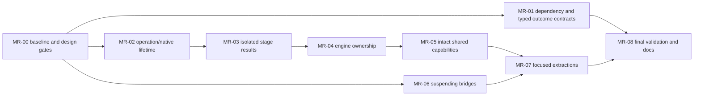

<user_quoted_section>Requirements revision — 14 October 2026: The user has since prioritized simplicity over preserving optimization machinery. This document records the previous plan/review; its source evidence remains useful, but mechanism choices, execution readiness and file-count forecasts are version-specific. Read the simplicity-first investigation before using this artifact for implementation. Native ownership, block merging, fingerprint caching and admission priority are being reassessed. No repository changes have been made.</user_quoted_section>

<user_quoted_section>Reader-policy update, October 14: The user's subsequent Step 1 reader rebuild supersedes this document wherever it requires separate manual/auto scheduling or preservation of same-page HTTP/inpaint overlap. Reader tap/viewport now use one queue and common runner; local preparation finishes before HTTP. Batch independence, store authority, quarantine and other correctness constraints remain. This is a planning change; implementation is not authorized or delivered.</user_quoted_section>

# Delivery rules

Return to the [master plan](..). Implement in an isolated worktree after implementation is separately authorized. Each package owns one reviewable behavioral or structural change, runs its required checks and records the baseline/treatment revision. No production work is authorized by this artifact.

Within the approved implementation run, routine fixes and prerequisite code may proceed without repeatedly asking permission. A discovered change to persistence schema, model behavior, scheduling guarantees or cancellation product semantics must be surfaced before expanding scope. Rebase shared seams serially; do not let several agents edit `TranslationPipeline`, `EngineLane` or `ChapterTranslationStore` concurrently.

The initialization subpackage of MR-07 additionally depends on its own lock/open/recovery prototype. Independent packages still obey the shared-file ownership table in [validation](../validation).

# MR-00 — Reproducible baseline and mechanism decisions

**Deliverables:** exact HEAD/worktree status; existing CI build/test outcome; fixture inventory; actual manual/Auto/batch dependency map; lock and bitmap ownership tables; the three impact exercises; unresolved design-gate record.

1. Record JDK/Gradle/Android variants, model manifest/weights/runtime versions, device/Android/storage provider and settings. Use existing CI tasks, not guessed task names.
2. Run relevant existing suites; label failures as baseline defects, environment blockers or introduced regressions. Never silently skip a failing affected test because it predates the change.
3. Build deterministic fake-native/provider/publication fixtures with latches: native is truly parked, recognition ready is separately visible, provider entry is counted, and publication can be interrupted at controlled points.
4. Map current native admission, engine rebuild mutex/native guard, store/page mutex, lease monitors, artifact open/publication locks, registry/opening and reader teardown locks. Include close/rebuild, memory reclamation, first-write bootstrap and download rekey callers.
5. Prototype the [two-milestone ownership contract](../ownership) in tests or an isolated diagnostic branch. Record the chosen continuous versus separate native admission strategy and measured queue/fairness consequences.
6. Inventory block IDs and actual metadata effects of every recognition/inpaint/provider path. Identify existing stage patches, result receipts and legacy-ID behavior before defining new DTOs.

**Exit:** reproducible baseline, confirmed contracts and testable gates; no invented latency attribution. Lack of device access blocks performance completion but does not require speculative replacement designs.

# MR-01 — Narrow dependency and outcome fixes

**Primary files:** the three shared helper files and their imports/tests; `TranslationExecutor`, rejection producers in pipeline/scheduler, `TranslationUiTruth`, `P5OutcomeProjectionTest`, existing CI/build test integration.

Deliver MR-01A helper relocation and MR-01B typed rejection as separate patches. Keep bodies unchanged for relocation; verify telemetry field names, frontier gap/contiguous-history semantics and normalization results. Define the baseline dependency allowlist before enforcing it. Add no module split or runtime optimization.

Typed rejection maps every real producer, including lease rejection, session rejection, already-running work and not-saved result. Update all consumers and fake executor fixtures in the same migration; raw diagnostics remain readable in details/logs. Test label/severity/retry/actions/accessibility independence from wording.

**Exit:** existing mode behavior preserved; forbidden-edge check demonstrably catches a violation; typed outcomes retain not-saved retry and batch-owner switching. Helper moves in active OCR files require the coordination protocol even when only imports change.

# MR-02 — Registered operation/native lifetime

**Primary files:** `NativeRunQuarantine`, `EngineLane`, `TranslationPipeline`, single-page phases and relevant runtime boundary fixtures. Backend algorithms remain unchanged.

1. Add the registered operation handle/result owner before task launch, including terminal exception observation and abandonment cleanup. Publish owned results into that slot inside the registered invocation and add its `NonCancellable` native-exit finalizer; do not depend on a discarded native return value. Retain the final-result-only native API for existing users during migration.
2. Implement the recommended recognition-ready milestone without returning native completion early. Hold admitted invocation through actual inpaint exit; no detached per-page scope survives outside the registry.
3. Add atomic result claim/abandon and test-only disposal accounting. Retain completed-but-available results while the request is still live; abandonment after native exit disposes them through the registered owner. Propagate cleanup ownership into the existing lazy publication borrow/completion path.
4. Migrate manual fresh and resume flows, preserving HTTP entry after OCR and before inpaint completion; then migrate Auto preparation and cancellation. Resume paths that do not need OCR still have registered inpaint lifetime.
5. Register/observe batch native work through the existing lane adapter while retaining chunk/overlap/resume decisions. Avoid nested admission when batch already owns the native lane.
6. Keep backend/native lifecycle guards. Validate close/rebuild/memory-release against captured retiring engine references; do not opportunistically split locks.

Deliver a focused publication-decision subpackage within MR-02: migrate `CleanedImagePublisher` commit/receipt handling so cancellation cannot authorize deletion solely from an exception. Capture accepted/live/durable/rejected disposition inside a narrow noncancellable decision window or equivalent authoritative receipt. Reconcile memory-first lazy publication separately, preserving prior-file retention and all original fences. Test cancellation before commit, after accepted mutation but before response, and during lazy hash/receipt publication. Do not postpone this gate until MR-05 if the new result owner depends on it.

If separate native admissions are selected, first deliver and test the engine-epoch borrow and private intermediate data contract in [ownership](../ownership). Stage-one release must not enable close, reclamation or scratch reuse to invalidate stage two.

**Exit:** all cancellation/timeout/handoff orderings pass, old committed display survives, and occupancy remains truthful until actual exit. Continuous admission requires contention/fairness measurement. Compiling a parented `async` is insufficient evidence.

**Rollback:** revert the entire lifetime/handoff slice and its caller adaptations together. Do not leave new owners consuming old raw Deferred results or remove cleanup instrumentation before safe disposal is demonstrated.

# MR-03 — Isolated stage inputs/results

**Primary files:** focused stage contracts, `PageTranslationOwnership`, provider adapter, `RenderColorEstimator` caller ownership and single-page/batch result joins.

1. Freeze recognition output after OCR evidence is established. Produce isolated inpaint and provider working copies using existing copy contracts; do not duplicate transient bitmaps through `detachedCopy`.
2. Create stable-key correlation for missing/duplicate legacy IDs as described in [capabilities](../capabilities). Sorting and retry must not mutate that identity map.
3. Inpainting returns cleaned output, status, revision/stamp, degradation and failure effects. Translation adapter returns text/partial/retry/failure outcomes; a coordinator applies them under fences. Final style calculation runs on immutable joined inputs at the existing render/join boundary. Audit all callers before retiring the fresh inpaint-time estimator and preserve any preparation/persistence style obligations at their equivalent boundary.
4. Retain mutating providers behind their private-draft adapter. Migrate Standard and contextual result application without changing prompts, parsing or batching; remove shared block/page aliases from concurrent tasks.
5. Measure copy/allocation cost. Retain mutable local geometry/layout work when it has a single owner; no universal immutable-model migration.

**Exit:** deterministic block/style association, equivalent stage metadata and output quality, no shared mutable concurrent stage access, and acceptable memory/copy evidence. Reject results from a changed OCR block set even if a page key matches.

# MR-04 — Recognition/inpainting capability and lifecycle ownership

**Primary files:** `PageRecognitionEngine`, ROI composition, existing `PageInpaintingEngine`/backends, `EngineLane`, pipeline callers and lifecycle tests. OCR/LiteRT integration gate required before editing shared files.

1. Expose recognition-only engine behavior; inspect and migrate every `recognize`/`inpaint` caller and implementation rather than removing methods blindly.
2. Make the existing inpainting implementation a first-class lane-owned collaborator or captured engine bundle member. Define exact ownership for neural/LiteRT/classical backends, shared detectors/planners and pools; avoid initializing duplicate sessions.
3. Split rebuild signatures by actual engine dependencies. An inpaint mode/model-only change should rebuild its responsible backend without unnecessary OCR rebuild when resources are truly independent. Shared resources still invalidate both through a documented relation.
4. Preserve backend guard/borrow lifetime during extraction. Any physical lock split is a separately validated step after native registration and teardown evidence.
5. Retain recognition output parity, fallback routing and neural availability semantics. Replace ROI casts used only for inpaint capability with the actual inpainting collaborator's availability contract.

**Exit:** inpaint backend replacement/configuration changes do not require editing unrelated OCR behavior; no duplicate session ownership, premature close or GPU-thread-affinity regression. Optional independence is proved, not inferred from separate Kotlin files.

# MR-05 — Remove nonsemantic callback chains

**Primary files:** `TranslationPipeline`, `BatchChapterTranslator`, `BatchLaneWorkers`, existing `CleanedPublication`/`PageStoreWriter`, stable recognition/inpaint/retry contracts and coexistence fixtures.

1. Inject intact shared capability references; preserve batch-native lane adapter and batch-owned registry/frontier/write-gate/render-join state.
2. Consolidate actually shared retry and publication behavior in its owner. Use explicit request/result values for stable operation inputs; do not carry scheduler policy into those requests.
3. Separate immutable run configuration from page-local outputs and cancellation. Group related configuration only when it represents one invariant; eliminate forwarding methods that add no policy.
4. Keep dynamic engine selection/rebuild coherent: use captured per-operation engine references after admission, not getters that can switch engines halfway through a run.
5. Update test harness factories to implement capability contracts; reuse contract fakes in both modes, retaining mode-specific behavior fixtures.
6. Delete expired forwarding adapters after both execution modes migrate. Repeat all three change-impact exercises and publish the before/after ledger.

**Exit:** no intermediary constructor-signature edits for the retry-input and publication-request extensions; no duplicated operation code introduced to make constructors smaller. At least the baseline's two pure forwarding layers disappear from those exercises.

# MR-06 — Suspending ordered bridges

Deliver the subpackages independently where possible:

- **MR-06A cancellation:** make `cancelRunningChapterForReplace` suspending and await both scheduler cancellation and transient-state cleanup before queue replacement. The cited caller already runs on IO via `launchNonCancellable`; the change removes carrier blocking, not a verified Main-thread freeze. Audit per-page/all-page callers before changing their public completion contract.
- **MR-06B fingerprints:** replace `LazySourceFingerprints`' blocking `Map.get` with a suspending identity-keyed resolver, while keeping `BatchExpectedFingerprints` as the existing synchronous configuration-evidence data class and `PageWorkPlanner` pure. Resolve the source hash for the current page at the worker/preflight boundary before a source-sensitive reuse decision, then pass a resolved value into the synchronous planner. Coalesce misses; do not await hashing in `ConcurrentHashMap.computeIfAbsent`, a planner getter or registry monitor. Cancelled subscribers must not lose another caller's needed result.

For whole-chapter metadata/resume views, unresolved source evidence is provisional and cannot authorize reuse or seed provider context. Recompute each authoritative row with resolved source evidence when it becomes eligible. Audit `BatchResumePlanner.buildBatchPagePlans`, legacy rekey, Standard workers and profile/context callers: a real prerequisite requiring predecessor/overlap-page verification must explicitly await only that required set before using it. Do not weaken source/context validation to claim laziness, and do not change a getter into eager chapter-wide hashing behind an adapter. Preserve genuinely required chapter-wide legacy identity/recovery work as a separately labeled prerequisite rather than claiming every cold chapter can avoid it.

- **MR-06C reader fallback:** provide a suspending ID-less document/open path using the existing owner registry. Keep or deprecate the sync compatibility seam only after caller inventory; downloaded ID-bearing pages already use a suspending path.

**Exit:** caller order remains deterministic, subscribers are bounded, no duplicate source work is introduced and affected UI-facing calls have verified dispatcher behavior. Test-only synchronous artifact opening may remain explicitly scoped.

# MR-07 — Store initialization and residual cohesion

## MR-07A: first durable initialization

`ensureArtifactStoreLocked` currently performs an IO blocking bridge within store synchronization. Merely making the helper `suspend` can propagate waits through locked mutation code or produce illegal suspension inside monitors.

Recommended transition: capture a store-owned initialization request/token under the page mutex; share one initialization task per canonical store/document identity; perform artifact open/load/bootstrap outside the page mutex and outside registry monitors; then reacquire the mutex to revalidate store identity, generation/defunct status and install once. A superseded result is not installed, and closing/discarding it follows the existing store/open ownership protocol.

Use the following target ordering for this initialization path. This is a specific migration contract, not a new total ordering for every persistence transaction:

| Lock / authority | Permitted tenure and order |
| --- | --- |
| Registry monitor | Brief lookup/task registration only; never wait for opening, initialization, file IO or native exit |
| Store page mutex: reservation | Capture immutable parent/file identity, current generation and initialization token; register task, then release before opening/exclusion waits |
| Canonical per-document opening/exclusion | Serialize initialization with active/probe open and download-rekey/document replacement for that exact identity; acquire outside the page mutex |
| `ARTIFACT_OPEN_LOCKS` mutex | Acquire once inside the document exclusion; open/load/bootstrap without recursive acquisition. Its mutex is non-reentrant |
| Store page mutex: installation | Under the initialization's still-valid document exclusion, take the mutex for short revalidation/install; no awaited file IO/native work inside this step |
| Public mutation | Await initialization without page mutex/open locks, then acquire the ordinary page mutex and recheck the original write fences |

No exposed writer may launch or await a new public initializer while its caller already holds that artifact opening lock. Ordinary open/bootstrap completes the existing artifact initialization before exposure. If an internal bootstrap path needs the same work, use an explicit lexical already-open context and an internal helper that does not acquire the lock again; passing a token is proof of that held scope, not permission to make the mutex reentrant or share it across unrelated tasks.

The initializer captures parent/file identity, store generation, initialization token and the relevant page-key/journal authority evidence. Reset, rekey, close or identity replacement invalidates its token before their transition proceeds. Install rechecks that evidence and defunct status and attaches the engine/manifest only to the still-current store; it must not replace the current live page map with stale disk pages. A stale initialized engine is discarded/closed through its resource owner and its waiting writes fail or retry against the current authority. The initializer may not repair mismatched fences by adopting a newer generation for an old request.

MR-00 must inventory every source caller that acquires artifact opening from page synchronization, and MR-07A must remove those reverse edges for the migrated initialization path. If that cannot be demonstrated, do not enable asynchronous initialization. Do not add an initialization side path that bypasses the loading plan's identity-scoped open/registry rules.

Keep the store as the only installer and write authority. Coalescing tasks do not own page state. Existing memory-only test stores remain memory-only; the documented synchronous compatibility opener remains clearly scoped. Gate this on first-write, close/rekey race, failed-open retry, journal/bootstrap and lock-order tests.

## MR-07B: conditional focused extractions

After MR-05, identify residual independent reasons to change. Preferred candidates are object construction outside active execution, store-open/rekey orchestration already adjacent to existing registry/coordinators, pure inpaint geometry using `InpaintBoxGeometry`, and internal journal/snapshot mechanics using existing writer/capture/snapshot/drain collaborators.

Extract only when the helper owns meaningful cohesive behavior and reduces interactions. `ChapterAttemptLedger`, `ActiveChapterStoreRegistry`, `TranslationRequestCoordinator`, `CleanedImagePublisher` and journal collaborators already exist. Extend/reuse them rather than introducing renamed duplicates. Keep lease map, generation checks and guarded mutation synchronized under store authority.

**Exit:** each chosen extraction has an exact responsibility, caller map and acceptance test; rejected candidates are recorded with reasons. No line-count target, schema migration or split authoritative state.

# MR-08 — Documentation, final gates and removal accounting

Update `docs/translation-architecture.md` and translation README with actual capability owners, native/task/bitmap lifetimes, exceptions, immutable stage boundaries and mode-specific handoffs. Remove the stale language-cycle note. Rename misleading phase owners only after shared stage behavior has moved and with OCR coordination.

Run the existing required CI checks, focused race/recovery suites, architecture/outcome contracts, change-isolation exercises and matched device comparisons. Remove temporary adapters/toggles unless an explicitly bounded compatibility need remains. Produce a final walkthrough with measurements, exact revisions, deferred limitations and recovery/rollback evidence.

# Checkpoints and rollback

Every phase ends at a tested commit that is reviewable on its own. Do not dual-run native inference or provider requests to compare behavior; replay captured stage results or deterministic fakes for parity tests. Avoid durable-schema changes so checkpoint rollback remains format-compatible.

Lifetime, result-contract and publication-owner changes roll back as coherent caller/callee slices. Never restore a known detached unowned path as a release fallback after identifying a resource-safety failure; stop that candidate release and fix forward or retain the preceding verified checkpoint. Rollback decisions preserve existing committed artifacts and resume/recovery state.
