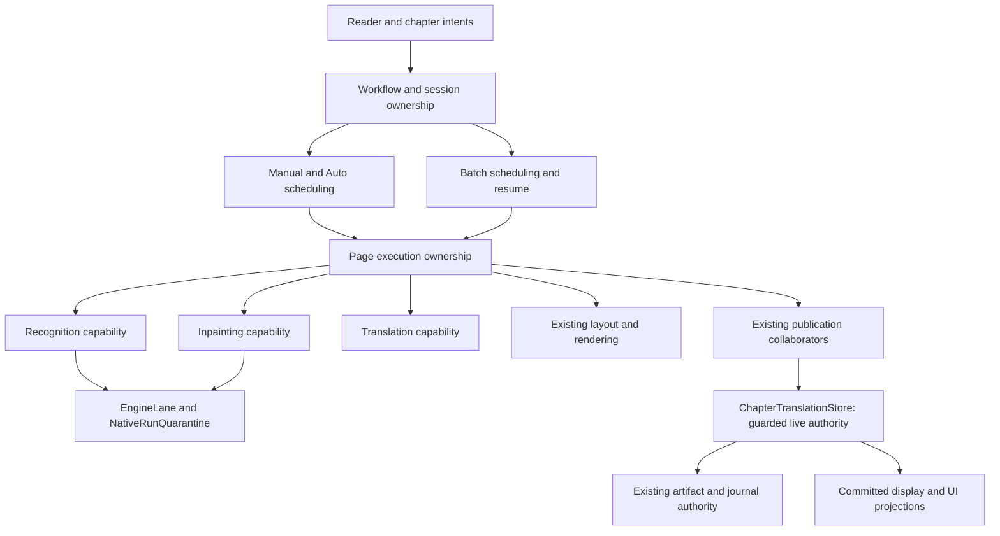

<user_quoted_section>Requirements revision — 14 October 2026: The user has since prioritized simplicity over preserving optimization machinery. This document records the previous plan/review; its source evidence remains useful, but mechanism choices, execution readiness and file-count forecasts are version-specific. Read the simplicity-first investigation before using this artifact for implementation. Native ownership, block merging, fingerprint caching and admission priority are being reassessed. No repository changes have been made.</user_quoted_section>

<user_quoted_section>Reader-policy update, October 14: The user's subsequent Step 1 reader rebuild supersedes this document wherever it requires separate manual/auto scheduling or preservation of same-page HTTP/inpaint overlap. Reader tap/viewport now use one queue and common runner; local preparation finishes before HTTP. Batch independence, store authority, quarantine and other correctness constraints remain. This is a planning change; implementation is not authorized or delivered.</user_quoted_section>

# Purpose and authority

Make localized translation-stage changes remain localized, and make request, native-task, mutable-data and bitmap ownership predictable. Preserve the subsystem's working correctness foundations and measured execution behavior.

The owner explicitly requested this plan after three independent agents verified the October 14 architecture report. **This authorizes planning only. Production code, repository documentation, build configuration, models and tests remain unchanged.** The baseline is `4de121bf7ed486e9f39b5a3f4f5c4288f439c8c8`; the working tree was clean during drafting. Builds, race tests and device measurements were not executed for this plan.

The [verification baseline](../maintainability-verification) takes precedence over unqualified claims in the original reviews. Recommendations below are proposed implementation decisions, not delivered code or user-approved runtime-policy changes. Named interfaces are illustrative; their responsibilities and acceptance gates matter more than the spelling.

**Status:** Planning complete; independently critiqued, revised and rechecked. The reviewer found no remaining blocking mechanism contradictions in the plan. This is specification review, not executed runtime validation or authorization to change production code. MR-00 prototypes/baselines and all phase-specific gates remain mandatory before the affected migrations. Unknown runtime costs are not silently treated as zero.

# Read the bounded documents

| Document | Contents |
| --- | --- |
| [Operation and resource ownership](ownership) | Request/native lifetimes, OCR-ready handoff, tracked inpainting, bitmap transfer, cancellation, teardown and timeout contracts |
| [Shared capabilities and package contracts](capabilities) | Recognition, inpainting, translation, publication, typed outcomes, stable identities and dependency enforcement |
| [Implementation phases and migration](implementation) | Work packages, dependency graph, file ownership, adapters, lock transitions, rollback and conditional extractions |
| [Validation, change isolation and coordination](validation) | Measurable maintainability targets, race/recovery matrix, device comparisons, CI, OCR/LiteRT coordination and release gates |
| [Independent critique](independent-review) | Completed cold review and adversarial recheck; no remaining blocking text contradictions |
| [Critique disposition](critique-response) | Supported corrections, source qualifications and remaining execution gates |
| [Dead-code and test-reliability preflight](preflight-purge) | Requested first cleanup: source-verified candidates, retained contracts and independent audits in progress; no deletion authorized or performed |

Independent reviewer `756b2134-1314-44c6-a094-c56d15e76d2b` delivered eight findings, then rechecked all five amended plan documents. Supported corrections are incorporated; the detailed disposition distinguishes original/static risks from target-design gates. The recheck confirms consistent finalizer/result-slot, color-estimation, fingerprint and admission-barrier contracts. Native lifetime, publication cancellation and store initialization remain high-risk implementation work even though their specification contradictions are resolved.

# Finding disposition and scope

| Finding | Verified disposition | Plan response |
| --- | --- | --- |
| F-01: callback coupling | Confirmed | Shared stage capabilities injected intact; eliminate nonsemantic forwarding and repeat three change-impact exercises |
| F-02: detached inpaint | Partly confirmed; ownership/admission gap | Registered operation and native lifetimes; deterministic disposal after request abandonment; preserve actual overlap |
| F-03: reverse dependencies | Confirmed | Relocate shared diagnostic/frontier helpers; enforce narrow source dependency rules in CI |
| F-04: string rejection | Confirmed | Typed execution reasons separate from diagnostic detail; preserve retry and owner-sensitive UI behavior |
| F-05: broad responsibilities | Partly confirmed | Extract composition and genuinely independent internals using existing collaborators; retain store mutation authority |
| F-06: recognition/inpaint overlap | Confirmed | Separate capabilities and backend lifecycle ownership after lifetime gates; keep protective synchronization |
| F-07: mutable stage objects | Partly confirmed | Owned working copies and stable-key result merges; incrementally isolate translator/provider mutations |
| F-08: projections | No demonstrated consolidation need | Preserve existing lifecycle, scheduling, display and UI roles; no new canonical state machine |
| F-09: synchronous bridges | Partly confirmed | Suspending ordered cancellation, suspending fingerprint lookup, explicit first-write initialization design |
| F-10: naming/docs | Partly confirmed | Update names/docs after ownership settles; no file-size quota or facade rename requirement |

The 5/10 rating is an orientation judgment. Completion is evaluated by actual edit propagation, protected behavior, explicit ownership and automated enforcement.

# Proposed architectural direction

This is an ownership diagram, not a sequential execution diagram or a class-per-box requirement. The timing and overlap diagrams are in [ownership](ownership). Scheduling selects, prioritizes and cancels work; stage capabilities execute bounded operations; the store decides whether results still have authority to mutate or commit.

# Preserved contracts

1. `ChapterTranslationStore` remains the authoritative process-local live page, lease, generation and guarded-mutation boundary. Extracted helpers use its authority and shared synchronization; they do not maintain competing page maps or independent write permission.
2. Source, generation, page-version, lease-token, candidate-generation, dependency-fingerprint and artifact-version checks remain applicable at their existing boundaries. Completing a stage does not reauthorize an abandoned operation.
3. Candidate/committed separation, atomic artifact document/manifest publication, acknowledged journal recovery, tombstones, resume eligibility and the last committed display result remain intact.
4. Native cancellation is not native completion. Admission, sessions, scratch buffers and input bitmaps remain owned until their actual readers have exited.
5. Manual HTTP overlaps same-page inpaint. Auto preparation of N+1 overlaps provider/render work for N, while each prepared reference remains durable and bitmap-free. Batch retains ordered context, resume and overlap policies.
6. Reader priority, prefetch capacity policy, provider budgets, retry limits, model weights and backend selection are preserved unless separately justified. Inpainting admission-accounting corrections must be measured for queue/fairness effects.
7. Durable schema and serialization are unchanged by default. Ephemeral stage/result types do not become artifact formats. A discovered schema change becomes a separately reviewed migration.

# Delivery sequence

| Phase | Result | Dependency | Risk |
| --- | --- | --- | --- |
| MR-00 | Executed baseline, behavioral fixtures, edit-propagation ledger and design-gate record | None | Low |
| MR-01 | Dependency checks and typed rejection semantics | MR-00; shared-file coordination | Low–Medium |
| MR-02 | Explicit registered operation/native/result lifetime with preserved handoffs | MR-00 lifetime prototype and race gates | High |
| MR-03 | Isolated concurrent stage inputs and stable-key result merges | MR-02 ownership; MR-00 identity inventory | Medium–High |
| MR-04 | Recognition/inpainting backend ownership separated behind useful capabilities | MR-02/03; OCR/LiteRT compatibility gate | High |
| MR-05 | Intact shared capabilities replace demonstrated callback forwarding | Stable contracts from MR-03/04 | Medium |
| MR-06 | Suspending ordered cancellation and coalesced fingerprints | MR-00; can proceed alongside unrelated work | Medium |
| MR-07 | First-write initialization and focused composition/internal extractions | MR-00 lock map; lifetime/capability stability | High for initialization; conditional for extractions |
| MR-08 | Current docs, final architecture tests, repeated impact exercises and device release evidence | Affected preceding phases | Medium |

MR-01 and MR-06 can ship independently after their own gates. MR-02 is the highest correctness priority; MR-05 is the principal maintainability payoff. Neither independence nor urgency permits two owners to edit the same shared files concurrently without an integration contract.

# Design gates that must remain visible

| Gate | Recommendation | Required resolution |
| --- | --- | --- |
| Native admission/handoff | One registered native sequence with a separate immutable OCR-ready milestone; retain admission through real inpaint exit | Prototype proves HTTP starts before inpaint completes; next native admission and teardown cannot pass active work. Measure fairness effects before production migration. |
| Bitmap result transfer | Registered result slot and native finalizer with atomic claim-or-abandon; completed outputs remain owned while provider is live | Both late-abandon and early-abandon orderings, publication-worker borrow and cleanup counters pass; no premature/double recycle or abandoned success bitmap. |
| Legacy block identity | Use existing durable IDs where valid; use operation-local identity bound to OCR evidence for missing IDs | Sorting, duplicate IDs, partial retry and resume tests prove deterministic merges without changing durable fingerprints. |
| First-write initialization | Store-owned asynchronous single-flight initialization outside the page mutex, followed by locked revalidation/install | Inventory all locked/synchronous callers; avoid recursive artifact-open locks and preserve journal/bootstrap atomicity. |
| Capability granularity | Reuse `CleanedPublication`, `CleanedImagePublisher`, `PageStoreWriter`, `PageWorkPlanner` and actual engine coordinators | Each interface removes demonstrated forwarding or shared mutation, and has an independent contract test. No generic stage-service bag. |
| Publication cancellation | Narrow commit-decision/internal receipt window; cleanup requires authoritative no-reference rejection | Accepted commit or live memory-first reference survives lost response; uncertain publication goes through fenced reconciliation rather than immediate deletion. |

These are engineering gates, not requests for additional user approval. If source verification or experiments invalidate the recommendation, update the plan before broad implementation. Do not silently replace it with a different scheduler, persistence authority or cancellation promise.

# Relation to existing work

The [loading performance plan](../loading-performance-plan) still owns chapter-list publication, status cache/probe coherence and progressive persisted-reader entry. This plan owns execution maintainability and operation contracts. They share sensitive store/opening/reader files; [validation](validation) defines their coordination rules. Progressive opening is not added to this refactor as an incidental simplification.

OCR algorithm tuning, Paddle batching/provider choice, LiteRT conversion, models/assets and hardware optimization remain owned by the separate [OCR](https://x.com/Agonyframe/status/2110190494781411358)/LiteRT initiative. This refactor may change engine seams after coordination; it does not authorize neural-model or output-quality changes.

# Completion definition

The refactor is complete when all in-scope contracts and migrations pass their phase gates, all three impact exercises show the targeted mechanical forwarding has disappeared, dependency/outcome checks run in existing CI, cancellation and recovery tests cover the critical orderings, and matched device evidence shows preserved output quality and no unexplained latency, throughput, memory or responsiveness regression. Conditional extractions must be delivered or explicitly rejected/deferred with reasons; a partially migrated adapter chain is not completion.

Record exact final revisions, executed checks, device configurations, results, deviations and rollback boundaries in a changeset walkthrough. No performance gain, new maintainability score or production readiness is claimed by this draft.
