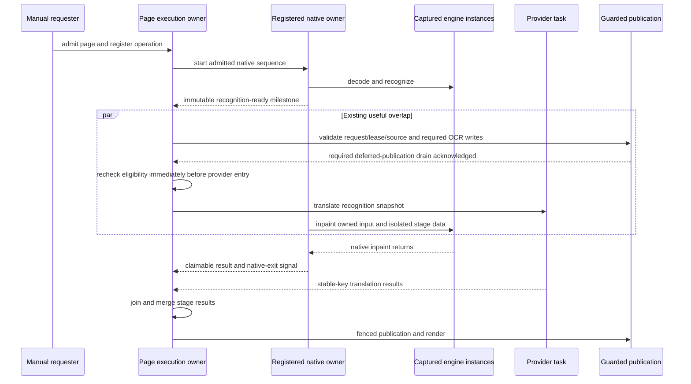

<user_quoted_section>Requirements revision — 14 October 2026: The user has since prioritized simplicity over preserving optimization machinery. This document records the previous plan/review; its source evidence remains useful, but mechanism choices, execution readiness and file-count forecasts are version-specific. Read the simplicity-first investigation before using this artifact for implementation. Native ownership, block merging, fingerprint caching and admission priority are being reassessed. No repository changes have been made.</user_quoted_section>

<user_quoted_section>Reader-policy update, October 14: The user's subsequent Step 1 reader rebuild supersedes this document wherever it requires separate manual/auto scheduling or preservation of same-page HTTP/inpaint overlap. Reader tap/viewport now use one queue and common runner; local preparation finishes before HTTP. Batch independence, store authority, quarantine and other correctness constraints remain. This is a planning change; implementation is not authorized or delivered.</user_quoted_section>

# Baseline and objective

Return to the [master plan](..). Source baseline: `4de121bf`. `SinglePageOnnxPhase.kt:1182` starts inpaint in an unparented scope. `NativeRunQuarantine.run` strips the requester Job, drains its registered invocation on cancellation, and can discard an invocation result containing the detached inpaint Deferred. Auto awaits that Deferred after native admission has ended (`TranslationPipeline.kt:956`); the manual HTTP/render tail attempts cancellation in `finally` (`:1068`). The ROI engine's `nativeGuard` is a coroutine `Mutex` protecting native use and teardown, not a substitute for page-operation ownership.

The goal is explicit lifetime and result ownership without converting native cancellation into a false exit signal or serializing HTTP behind inpaint. The following design is recommended for the prototype; implementation begins only after MR-00 proves the handoff and teardown contracts.

# Separate lifetimes

| Lifetime | Owner | Starts / ends | Authority |
| --- | --- | --- | --- |
| Request/session | Existing workflow and mode-specific scheduler | Admission / completed intent, abandonment or session replacement | Controls interest, priority and request cancellation; does not prove native exit |
| Page execution | Execution owner adjacent to `TranslationPipeline` / existing executor | Registered before task launch / all tasks and output transfers settled | Owns working results, child bookkeeping and publication eligibility; no independent durable state |
| Native invocation | Existing `NativeRunQuarantine` coordinated through `EngineLane` | Granted admission / actual registered native sequence exits | Owns native occupancy and exact captured engine references; survives requester abandonment only under this explicit contract |
| Engine epoch/session | `EngineLane` and engine lifecycle guard | Instance creation / all borrowers and native calls drained, then actual close | Prevents old close/rebuild from freeing replacement instances |
| Publication write | Existing store persistence worker and publication collaborators | Write accepted/queued / verification and commit or rollback settled | Holds bitmap borrow while encoding; validates existing store preconditions |
| Committed display | Existing store/artifact/display projection | Atomic promotion / subsequent valid committed replacement or explicit deletion | Candidate cancellation never invalidates the prior committed bundle |

Execution ownership does not add a durable page state machine. Its small ephemeral bookkeeping covers task registration, cancellation, completion and resource transfer only.

# Recommended two-milestone native operation

Extend the existing native admission mechanism additively; keep `run` for operations that need only a final result. A registered page operation exposes **recognition ready** independently of **native complete**. The native sequence decodes and recognizes, publishes a detached recognition value, then performs inpaint and returns its owned result. It retains native admission until that sequence actually exits.

The page operation handle is registered with the execution owner before acquisition/launch and returned independently of the native invocation's eventual result. Thus losing a coroutine return value cannot lose the only handle to work or its cleanup responsibility. Use the existing supervisor/native-run scope; do not create a fresh unrelated scope per page. The registered owner is responsible for observing terminal exceptions and settling cleanup even when no requester awaits the result.

### Native finalization and retained result slot

The registered entry must publish its output into the operation-owned result slot **inside the native invocation**, not only as the return value consumed by `NativeRunQuarantine.run`. A `NonCancellable` finalizer inside that invocation records actual native exit, releases operation-owned input/temporary resources after their readers exit, settles failure, and disposes an already-abandoned output before admission is released. Cleanup that fails is recorded and keeps the responsible resource owner visible; do not swallow it and report a clean drain. Persistent backend pools remain engine-owned, so this finalizer must not globally drain another operation's scratch state.

The result slot has mutually exclusive ownership states: producer-owned, available-to-the-registered-operation, claimed, abandoned-awaiting-native-exit, or disposed. Availability is not abandonment. If native completes while a live manual provider call is still running, retain the available result under the registered operation owner; **do not recycle every unclaimed bitmap at native exit**. If abandonment arrives after native exit, the operation owner atomically disposes the still-available output. If claim won first, execution/publication borrowers retain cleanup responsibility. An owner completion hook marks any otherwise undelivered slot abandoned so losing the requester continuation never loses disposal.

Only after the native finalizer has settled may admission be released. Operation registration ends after native exit plus output claim/abandon disposition and any outstanding tracked borrower acknowledgment; a successfully claimed result may outlive native admission for HTTP/render/encoding. Test all completion-before-abandonment and abandonment-before-completion orderings, including losing a dispatcher continuation at return.

Conceptual responsibilities, not a required API spelling:

```kotlin
interface PageNativeOperation {
    suspend fun awaitRecognition(): RecognitionStageResult
    suspend fun claimInpaintResult(): OwnedInpaintResult
    fun abandon(reason: OperationAbandonment)
    suspend fun awaitNativeExit()
}
```

`awaitRecognition` carries no mutable engine-owned page or bitmap. `claimInpaintResult` grants ownership once; abandonment and claim are atomic alternatives. Failure/no-op are typed results without a bitmap. The handle also records the page execution identity, source evidence, applicable write fences and captured engine epoch. Engines do not inspect store lease tables themselves.

Recognition-ready alone is not provider admission. Before starting HTTP, the page owner verifies the original request/lease/source eligibility and completes the same required OCR metadata/store/deferred-publication barriers as the baseline manual path. Those barriers run outside the native engine guard while registered inpaint may continue. Do not move an acknowledged write after a paid call merely to make the milestone appear faster. The handle/readiness prototype must trace these barriers explicitly.



In Auto, await native preparation and cleaned-file durability before sending the existing bitmap-free `PreparedPage`. The producer remains serial. The next page's preparation may overlap the prior prepared page's provider/render work. In batch, retain the current preflight, context, overlap and resume scheduling; migrate native task registration through an adapter rather than replacing its workers with this manual flow.

# Admission and timing implications

Today native admission can finish at OCR handoff even though ROI's guard still serializes inpaint against OCR and close. Tracking a contiguous OCR/inpaint sequence repairs occupancy but can change fairness against other native users. Do not describe it as performance-neutral before measurement.

MR-00 must test a competing manual/auto/batch native request. If contiguous admission causes unexplained priority/throughput regression, evaluate **separate registered recognition and inpaint admissions** using the existing priority policy. That alternative must register both tasks with the same page owner, prevent nested acquisition, retain all bitmap/session ownership between stages and account for queue wait separately. It is a design fallback, not permission to lift the lane floor or create parallel native sessions.

The separate-admission fallback is disabled until an explicit engine-epoch borrow protects the exact captured recognition/inpaint backend instances across the gap. That borrow prevents close/rebuild/native buffer reclamation from invalidating resources retained for stage two; it is not a second native permit. Acquire it with the registered operation before OCR, retain it through inpaint real exit or safe pre-entry abandonment, and release it in owned finalization. Close marks an epoch retiring, denies new borrows and awaits existing borrowers outside the page mutex. Newer instances are never closed by an old borrow's release.

The decoded input bitmap stays operation-owned across the gap. Copy any recognition output backed by temporary engine scratch before releasing stage-one admission; a session borrow must not accidentally allow scratch reuse to mutate another stage's retained data. Explicitly inventory GPU/thread affinity and pool reclamation. If these invariants cannot be met, retain contiguous admission; do not select the fallback only because its queue timings look better.

The operation must never acquire the same native admission recursively. Recognition/inpaint capabilities have a clearly internal already-admitted execution entry used by the native coordinator; scheduler-facing start methods own admission. Add a test detecting accidental nested acquisition rather than relying on names.

# Cancellation and deadline contracts

| Boundary | Required behavior |
| --- | --- |
| Before admission | Remove queued interest and settle operation bookkeeping; start no native call and allocate no decoded bitmap |
| During decode/OCR | Mark request abandoned; revoke result delivery/publication interest. Drain actual native execution according to existing quarantine semantics; do not recycle input or close captured sessions while used |
| Recognition-ready race | Recognition delivery wins only for a still-interested request; native owner remains registered either way. A late handoff must not launch a new paid provider call |
| During concurrent HTTP/inpaint | Preserve the mode's existing provider cancellation/drain policy. Mark inpaint result abandoned; active native work remains registered until exit |
| Native success after abandonment | Dispose the produced output deterministically once native readers exit; never require GC or a surviving requester to do it |
| Result claim versus cancellation | Exactly one owner wins. If claim wins, execution owner releases it after outstanding publication/render borrows settle; if abandonment wins, native owner releases it |
| Before guarded write | Revalidate the original applicable generation/lease/source/candidate evidence. Request abandonment rejects new publication attempts |
| During acknowledged publication | Store/artifact transaction semantics decide durable completion/rollback. Cancellation is not a license to delete an already committed image or an old committed bundle |
| Chapter replacement / close | Deny new publication and new borrows from retiring operation/epoch; await/drain registered native use before actual disposal; retain current cancellation acknowledgment ordering |

Request deadline, native result timer/stall telemetry, provider governor/deadline and render/publication limits remain separate. The new registration includes inpaint occupancy; preserve existing configured durations initially and explicitly label any extended coverage. A timeout must not free admission before native exit. Timed-out results are rejected and cleaned up even if native later succeeds.

Current quarantine cancellation can wait for native completion under `NonCancellable`. This plan does not promise immediate requester return. Any later proposal for prompt return must separate background draining from resource release and establish an explicit user-facing latency contract.

### Publication cancellation decision

`CleanedImagePublisher.publish` currently deletes `newName` if its suspending commit callback throws cancellation. Treat this as a contract risk, not a demonstrated corrupted-file incident. MR-02 must add a store-owned publication decision/receipt that survives requester continuation loss. For the recommended migration, execute the commit decision plus internal receipt recording in a narrowly scoped `NonCancellable` transaction window after normal authority checks; preserve all store fences and actual atomic publication ordering. Do not wrap recognition, native inference, HTTP, encoding or the whole pipeline in `NonCancellable`.

The commit receipt is recorded inside the transaction before returning through a cancellable dispatcher boundary. On cancellation or exception, cleanup may delete the new file only when that receipt/authoritative state proves it was not accepted or referenced by live/candidate/committed state. An uncertain result is retained for fenced reconciliation/recovery rather than deleted optimistically. A memory-first accepted pointer is distinct from durable completion but is still a file-reference obligation; its lazy-worker failure handling must reconcile the pointer before authorizing file cleanup. Recheck deletion eligibility under the same publication authority, not with an unrelated snapshot then delete.

Noncancellable does not mean infinitely safe or instant: measure commit/journal-lock wait, retain watchdog visibility and resolve first-write readiness outside this transaction where possible. Do not bypass cancellation eligibility by taking a fresh lease after a request was abandoned. Once a valid acknowledged transaction has begun, preserve its finish/rollback semantics and then propagate requester cancellation.

# Bitmap ownership and transfer

| Resource | Initial owner | Transfer / borrow | Final disposer |
| --- | --- | --- | --- |
| Decoded input bitmap | Registered native operation | Recognition and inpaint sequentially borrow it; provider receives metadata only | Native operation after all native readers exit, including failure/cancellation |
| Temporary crops, masks and direct buffers | Existing engine implementation | Internal bounded work; retain existing pool and cleanup semantics | Engine implementation after last use; lifecycle owner for persistent buffers |
| Cleaned output bitmap | Native operation result slot | Atomic claim into page execution owner, or abandon-and-dispose | Native owner if unclaimed; execution owner after all render/encoding borrows if claimed |
| Lazy JPEG encoder input | Claimed execution result | Explicit exclusive borrow by existing store write task | Execution result owner after task completion/drain; enqueue does not authorize recycling |
| Persisted cleaned image | Existing publication/artifact authority | Verified file/hash receipt, candidate commit and display promotion | Existing retained-file/retirement protocol, never bitmap cleanup |
| Prepared-page handoff | Existing `PreparedPage` contract | Durable identities only | Normal page/store lifecycle; it contains no bitmap |

Do not introduce general bitmap reference counting. Use a single owned result plus a narrowly scoped borrow/completion acknowledgment for the existing asynchronous encoder. If render and encode simultaneously read the same bitmap, the owner holds it until both acknowledgments settle. No borrow may escape its tracked task.

Every output slot has an explicit terminal path: claimed, failed/no-op, abandoned-and-disposed or transferred to a still-tracked borrower. Record test-only allocation/recycle counters and production diagnostic task counts. Recycle idempotence is not the correctness mechanism: prevent double ownership and premature recycle.

# Mutable data and fences

Recognition freezes the block/mask/detection values needed by parallel tasks, using existing published/detached contracts or a focused read-only stage representation. Inpainting runs on an isolated working copy including the entire mutable page data it uses; copying only the block list leaves page-level status and detector aliases.

Provider implementations may continue mutating **their own** local drafts during the compatibility phase. Final cleaned-background color estimation runs on joined immutable text/geometry at the render boundary, not against a concurrently changing `block.translation` during inpaint. Join typed stage outputs at the execution owner and merge by the same stable key and OCR evidence; HTTP sorting cannot change associations.

Use `PageStoreWriter`, store stage patches and `PatchPrecondition` for authoritative changes. Existing snapshots may need refreshing after the same operation's accepted stage update; do so through store-generated successor receipts while retaining operation lease/generation/source identity. Never refresh all preconditions after cancellation merely to make a late result eligible again.

# Lifecycle synchronization

Retain ROI/native backend guards during migration. Separating recognition and inpainting capabilities does not require immediate lock splitting. Close/rebuild captures exact instances, marks the epoch retiring, denies new borrows, drains registered operations and existing translator use, then frees only those instances.

The initial lifetime prototype must map current native admission, engine rebuild mutex, native guard, page/store mutex and publication/opening locks. Do not await publication/file I/O while holding a native guard, and do not await native drain while holding the page mutex. Audit shutdown, OOM reclamation, deferred retry, engine rebuild and `forceReleaseNativeBuffers`, not just normal close.

# Required prototype evidence

1. A manually parked inpaint call does not prevent the provider task entering after OCR-ready.
2. Native admission/occupancy and captured session lifetime remain active until the parked native call actually exits.
3. Cancelling before native return or before milestone pickup leaves a registered cleanup owner; late output is disposed exactly once.
4. Auto prepare publishes no reference before cleaned durability and never transfers a bitmap through its channel.
5. A lazy writer parked during encoding prevents premature recycle without blocking unrelated native work through a native guard.
6. Chapter switch, stale lease, reset and epoch replacement reject late commits; prior committed display survives.

Use [validation](../validation) for the full race matrix. Failure of these gates blocks MR-02 production migration, even if the prototype compiles.
