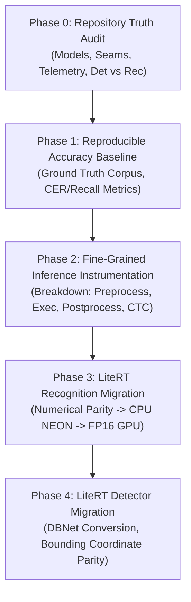

# PP-OCRv6 LiteRT Optimization Orchestration Specification

## Executive Summary

This specification governs the engineering lifecycle for migrating and optimizing the manga-specific PaddleOCR pipeline in TachiyomiATVibe from ONNX Runtime to Google LiteRT on Snapdragon 8 Gen 3 (Adreno 750 / Hexagon NPU / Oryon/Kryo CPU).

The core mission: **Optimize manga-specific PP-OCRv6 using LiteRT while strictly preserving recognition accuracy, coordinate fidelity, and architectural maintainability.**

## Architecture & Phased Roadmap

## Agent Topology & Roles

| Agent | Harness / Model | Role | Responsibilities |
| --- | --- | --- | --- |
| **Orchestrator** (Current) | `antigravity` / `gemini-3.8-flash` (high) | Engineering Orchestrator | Acceptance authority, contract specification, cross-agent reconciliation |
| **Agent A (Implementer)** (`eb862141-33bb-42d8-a4c7-aae8739b2455`) | `codex` / `gpt-6-luna` (max) | Senior Android / Mobile AI Optimization Engineer | Isolated implementation, benchmarking, micro-optimizations, evidence reporting |
| **Agent B (Researcher)** (`3b5fad3e-76fa-4a15-908f-c1621984864f`) | `antigravity` / `gemini-3.8-flash` (high) | Technical Researcher & Evidence Auditor | Documentation integrity, upstream verification, raw log audits, failure mode checks |

## Evidence Contract & Acceptance Criteria

1. **Observe → Hypothesize → Change → Measure → Compare → Retain or Revert**:
 Every experimental iteration must document hypothesis, file changes, reference baseline, experimental metrics, raw log locations, and explicit retain/revert recommendation.
2. **Quality Non-Negotiable**:
 Zero tolerance for accuracy regression. Character Error Rate (CER) and detection recall on the representative corpus must meet or exceed the reference baseline.
3. **Hardware Transparency**:
 A GPU or NPU speedup claim is invalid without verified delegate node execution logs confirming 100% (or documented) hardware graph partition.
4. **Missing Evidence is UNKNOWN**:
 No test is passed by assumption. Missing device benchmarks are marked pending verification.

## Artifact Directory & Status

- [Phase 0: Repository Truth Audit](../phase-0-truth-audit) — **COMPLETE**
- [Phase 1: Accuracy Baseline](../phase-1-accuracy-baseline) — **COMPLETE**
- [Phase 2: Inference Instrumentation](../phase-2-instrumentation) — **IN PROGRESS**
- [Phase 3: LiteRT Recognition Migration](../phase-3-litert-rec-migration) — **IN PROGRESS**
