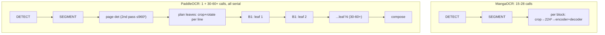

# PaddleOCR Pipeline Architecture Report

Scope: TachiyomiATVibe (`tachiyomiATVibe-inpainting-modes-redesign` @ `7d895216`), PaddleOCR v6 small vs MangaOCR live reading workloads (15–28 text blocks/page, observed `recognizePage` 1,500–2,140 ms).

All paths below are relative to `app/src/main/java/eu/kanade/translation/`.

## 1. The two pipelines, side by side

### MangaOCR path (baseline)

`RoiPageRecognitionEngine.analyze` → `!engine.prefersHorizontalText` branch (`engines/vision/ocr/RoiPageRecognitionEngine.kt:697-709`):

```
DETECT (sliding v4) → SEGMENT → for each text block (15-28):
    tight crop → 224×224 grayscale/resize/pad → 1 encoder run + autoregressive decode
```

- **One invocation per text block.** No page-level det pass, no line decomposition, no rotation, no padding copies (tight crops).
- Input is tiny and fixed: 3×224×224 (`engines/vision/ocr/MangaOcrEngine.kt:360-401`).
- CPU-only by design (`executionProviderLabel = "cpu"`, MangaOcrEngine.kt:36); buffers are pooled (`DirectBufferPool`).

### PaddleOCR path

`analyze` → `PaddlePageOcrCoordinator.recognizePage` (`engines/vision/ocr/PaddlePageOcrCoordinator.kt:202-338`):

```
DETECT (sliding v4) → SEGMENT
  → [2nd neural pass] page-level Paddle det: paddleDet.detectLines(full page, ≤960×960)   (coordinator:216-227)
  → per region: crop (+pad 12) → line extraction → per-line leaf construction
       cropBitmap + rotateCcw (Matrix rotation = full ARGB copy per vertical line)        (VerticalLineOcr.kt:200-282)
  → B1 sequential rec per leaf: 30-60+ calls of 3×48×640..1600 + 18,710-class CTC output
  → compose text per region
```

**Structural asymmetry:** Paddle's rec head is horizontal-line-only (`prefersHorizontalText = true`, `PaddleOcrV6SmallEngine.kt:39`), so every bubble is decomposed into per-det-line leaves. A 15–28-block page yields **30–60+ recognizer invocations vs MangaOCR's 15–28**, each with a much larger I/O contract (6 MB output tensor at width 640, 15 MB at 1600 — `T×C = 80×18,710` floats), plus a second full-page det model and per-leaf rotation copies. The design spec itself recorded the result: *"the default B1 path issues 15–25 sequential ORT calls and the OCR stage alone lands around 2 seconds per page"* (`docs/superpowers/specs/2026-10-09-dynamic-page-batching-design.md:12-14`).



## 2. Why `batches=N, batched=false batchSize=1 dynamic=false governorReason=b1_default`

Three independent gates, **all closed in production**:

### Gate 1 — the preference defaults to B1 (the `b1_default` reason)

`TranslationPreferences.paddleOcrRecognitionBatch()` defaults to `PaddleOcrRecognitionBatch.B1` (`domain/.../TranslationPreferences.kt:157-160`). `PaddleOcrDevicePolicy.resolveActivation` short-circuits any B1 request before every other check and returns `reason = "b1_default"` (`paddle/batch/PaddleOcrDevicePolicy.kt:44-51`). `dynamic=false` because the DYNAMIC tier was not selected.

### Gate 2 — even opting in is dead on release builds (device matrix is never populated)

`PaddleOcrBatchActivationPolicy.currentFromPreferences` calls `current(...)` **without a profile**, so `profile = PaddleOcrDeviceProfile.untested()` always (`paddle/batch/PaddleOcrBatchActivationPolicy.kt:29-58`). No production code constructs a real `PaddleOcrDeviceProfile` (grep: the only `PaddleOcrDeviceProfile(` call sites are its own file). Consequences of a user selecting B2/B4/DYNAMIC on a **release** build:

- `isConfirmed(combination) == false` → `emergency("combination_not_confirmed")` → **`forceCpuB1EmergencyFallback = true` + provider forced to CPU** (`PaddleOcrDevicePolicy.kt:52-71, 84-89`). Opting in is not just neutral — it downgrades the provider.
- Debug builds escape via `debugProvisionalOptIn = BuildConfig.DEBUG && requested != B1`.
- The default build variant also ships `PADDLE_BATCHING_STAGED=false, PADDLE_BATCHING_REQUESTED_BATCH=1` (`app/build.gradle.kts:36-37`; staged variants: `true/4`).

### Gate 3 — with B1 armed, the dispatcher never batches

`PaddlePageOcrBatchDispatcher` recognizes via `if (maxBatch <= 1) crops.map { engine.recognizeWithConf(it) }` (`PaddlePageOcrCoordinator.kt:352-358`), guarded by `batchCallMutex`. The planner still emits one "batch" per leaf (`PaddleOcrBatchPlanner.emit` at chunk 1), hence `batches=N` equals the leaf count.

### The governor is inert at B1

`PaddleOcrRollingP95HysteresisDowngradePolicy` is armed with `initial = maximum = B1`; `lower(B1) = B1` (`paddle/batch/PaddleOcrRollingP95HysteresisDowngradePolicy.kt:123-128`) so no decision ever changes state and `governorReason` stays `b1_default`. `queueWaitMs`/`admissionWaitMs` ≈ 0 because dispatch is a synchronous single-coroutine loop — **the queue never forms; it is a serial pipeline, not a contended queue**. Also: `batchLatencyBudgetMs` is never set anywhere (`PaddleOcrV6SmallEngine.kt:64` — grep confirms no setter), so the executor's latency-downgrade ladder is unarmed even in batch modes.

### Gate 4 — the LiteRT backend cannot batch at all

When LiteRT assets exist (`RoiPageRecognitionEngine.kt:301-342`), the recognizer runs LiteRT GPU — and `recognizeBucketBatch`'s LiteRT branch **loops `recognizeWithConf` per crop** (`PaddleOcrV6SmallEngine.kt:425-440`), each under `synchronized(liteRtLock)`. So even with DYNAMIC armed, a LiteRT device still executes leaf-by-leaf GPU invocations. The batch executor (`PaddleOcrV6BatchExecutor`) only serves the ONNX session.

## 3. Crop, pre-processing & allocation overhead (× 30–60 leaves)

Per-leaf cost stack, all serial:

| Step | Where | Cost |
| --- | --- | --- |
| Region crop (+pad) | `PaddlePageOcrCoordinator.planInitialRegion` :407-441 | 1–2 `Bitmap.createBitmap` ARGB copies per region |
| Leaf crop | `VerticalLineOcr.planDetColumns` :245-274 | 1 bitmap copy per det line |
| `rotateCcw` | `VerticalLineOcr.kt:504-508` | `Matrix.postRotate` → **another full ARGB_8888 alloc+copy per vertical leaf** |
| Rec resize | `PaddleOcrV6SmallEngine.preprocess` :511-532 | pooled bitmap, but a Canvas `drawBitmap` with FILTER_BITMAP per leaf |
| Pixel readout | :531-532 | `IntArray(w×48)` **fresh alloc** + full copy |
| NCHW normalize | :535-543 | `FloatArray(plane×3)` **fresh alloc** (~0.9 MB @1600w) + 3-plane Kotlin loop |
| Buffer write | :561 | `out.put(floats)` — second copy into the direct buffer |
| LiteRT I/O | `PaddleOcrV6LiteRtRunner.recognize` :684, :713 | `inBuf.writeFloat` + `outBuf.readFloat` full-tensor copies |
| CTC argmax | `PaddleCtcDecoder.argmaxWithProbs` | T×C = 80×18,710 = 1.5 M reads per leaf |

Net: **~3 copies + ~1 MB heap garbage per leaf → 30–60 MB garbage per page** → GC churn adds jitter to the 1.5–2.1 s. The det engine already reuses scratch arrays (`getScratchPixels`/`getScratchPlane`, `PaddleOcrV6DetEngine.kt:544-557`); the rec engine does not. Bitmap-level allocation is otherwise well pooled (`BitmapPool`), so the compounding cost is the *count* of leaves, not bitmap leaks.

## 4. End-to-end serialization (pipelining gaps)

1. `nativeGuard.withLock` holds DETECT+SEGMENT+OCR for the whole page (`RoiPageRecognitionEngine.kt:559`), and the vision lane is permit-serialized across pages — zero overlap between any two stages or pages, even though det/segment/OCR are independent sessions.
2. Inside `recognizePage`: page det → plan **all** regions → dispatch leaves serially → compose. CPU planning of region k+1 never overlaps GPU rec of region k (dispatch loop is `detections.forEachIndexed { ... submitPlan(...) }`, coordinator :229-250).
3. The unpadded re-read fallback is dead code: `needsUnpaddedReread` is hardwired `false` (coordinator :446) — no latency impact, but also a correctness trap to keep in mind.
4. LiteRT `MAX_RESIDENT_LITERT_RUNNERS = 1` (`PaddleOcrV6SmallEngine.kt:603`): mixed-width leaf streams (160/320/480/640/1600) evict and **recreate the GPU `CompiledModel` on every bucket switch** — delegate re-init per switch.

## 5. Recommendations (to cut page OCR latency ≥ 50%)

### P0 — Make DYNAMIC whole-page batching actually reachable (this alone halves the stage)

The plumbing already exists end-to-end (`PaddleOcrBatchPlanner` chunk function, `PaddleOcrV6BatchExecutor` B≤32 with halving ladder, buffer pool sized for it); it is only gated off.

1. **Populate the device matrix**: persist benchmark evidence (the `PaddleBenchmarkMatrix` harness already validates cells) into a `PaddleOcrDeviceProfile` and pass it in `PaddleOcrBatchActivationPolicy.currentFromPreferences` — or trust the staged flag on release instead of `emergency("combination_not_confirmed")`. Today the only reachable non-B1 path is a debug build.
2. **Default the preference to DYNAMIC** for `PADDLEOCR_V6_SMALL` on ≥5 GiB devices (ceiling 16 @640 per the RAM-tier math, `PaddleOcrDynamicPageBatchPolicy.defaultOutputBudgetBytesFor`), keeping B1 as the explicit user escape hatch.
3. **Implement LiteRT batched invoke**: allocate input/output `TensorBuffer`s at `[B,48,W,3]` / `[B,T,C]` for the 5 static width buckets (LiteRT static-shape models are natural batch candidates) and run all same-bucket leaves in one `model.run`; OR route batched buckets through the existing ONNX executor when dynamic is armed and keep LiteRT for B1 only. Without this, Gate 4 voids the whole feature on LiteRT devices.
4. Arm `batchLatencyBudgetMs` (e.g. 250 ms) so the executor's downgrade ladder is live.

Expected: a 20–40-leaf page drops from 20–40+ calls to **ceil(leaves/ceiling) ≈ 2–4 calls**; per the design doc's own model the OCR stage collapses toward per-call cost × chunk count → ~0.5–0.8 s from 1.5–2.1 s.

### P1 — Preprocessing (benefits every tier, incl. B1)

1. Reuse scratch `IntArray`/`FloatArray` in `PaddleOcrV6SmallEngine.preprocess` (mirror the det engine) or write NCHW directly into the pooled direct `FloatBuffer` from the pixel array, deleting the intermediate `FloatArray` copy.
2. Fold the 90° CCW rotation into the pixel-read loop (transposed read) instead of `rotateCcw`'s Matrix bitmap → removes one full ARGB alloc+copy per vertical leaf.
3. Hoist the `Paint(FILTER_BITMAP_FLAG)` to a field; hand region crops to the pool rather than fresh `createBitmap` where geometry allows.

### P2 — LiteRT runner management

Raise `MAX_RESIDENT_LITERT_RUNNERS` to cover the bucket set actually seen (≥2, ideally all 5; they share weights format and are small relative to session cost) and pre-warm 640/1600 at init to kill per-switch GPU delegate recreation.

### P3 — Scheduling / pipelining

1. **Plan/rec overlap**: drive `submitPlan` from a planning coroutine (producer) while the dispatcher drains (consumer); the planner's per-bucket queues + window guard already make this safe. First win: page det for page k+1 can run while page k's leaves recognize (separate sessions; needs a narrow refactor of `nativeGuard` scope to per-session, keeping the close-safety contract).
2. **Two concurrent B1 streams** (CPU/ONNX only): `OrtSession.run` is thread-safe and `inputPixelPool` already has `maxPoolSize = 2`; relax `batchCallMutex` to a 2-permit `Semaphore` when backend is CPU. Do this only if P0 stalls — batching dominates it.
3. Keep the P95 governor as-is; at B1 it is correctly inert, and once dynamic is on it caps chunks under thermal pressure by design.

### Non-recommendations

- Do not shard det or drop the page-det caching (`PaddleOcrV6DetEngine.detectLines` memoizes by bitmap ref, :437-464) — it runs once per page and is not the bottleneck.
- Do not remove per-line decomposition (accuracy contract, `docs/ocr-engine-notes.md`); batching is the correct equalizer for the invocation count, not coarser crops.

## 6. Latency model summary

For a 20-leaf page (typical 15–28 blocks):

| Path | Neural calls | Extra passes | Observed/predicted OCR stage |
| --- | --- | --- | --- |
| MangaOCR | 15–28 @ 224² | none | fast (baseline) |
| Paddle B1 (today) | 30–60+ @ 48×640/1600 | page det + rotate copies | **1.5–2.1 s** (telemetry ✓) |
| Paddle dynamic (P0) | 2–4 batched | page det | **~0.5–0.8 s** |
| P0 + P1 preprocessing | 2–4 batched | reduced copies | additional 10–20 % off CPU-side time |
