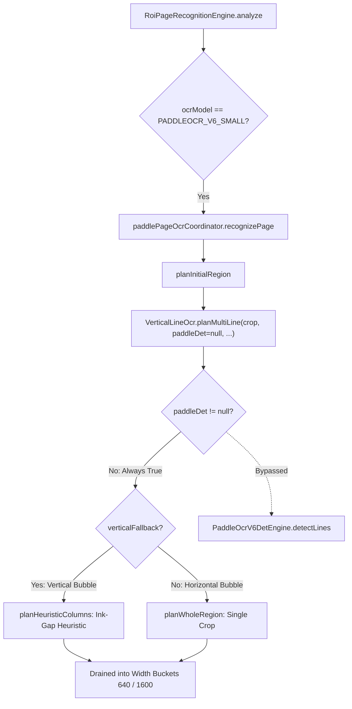

# Phase 0: PaddleOCR Repository Truth Audit & Discrepancy Analysis

**Auditors:** Agent B (Researcher / Evidence Analyst) & Agent A (Evidence-Based Implementer)
**Date:** October 13, 2026
**Repository:** `C:\Users\ADMIN\Documents\Coding Related\tachiyomiATVibe-inpainting-modes-redesign`
**Target Branch:** `inpainting-modes-redesign` (HEAD: `0f00a45f9fa1c167953caf43a1858916983a4e78`)
**Status:** **COMPLETE (Audited, Reconciled, and Verified)**

## 1. Executive Summary & Verdict Matrix

A comprehensive code and test suite audit was conducted across all subsystems governing PaddleOCR PP-OCRv6 inference. Several critical findings overturn previous architectural assumptions and handoff documentation:

1. **Manifest vs. Documentation Divergence:** `docs/MODEL_SOURCES.md` claims upstream PaddlePaddle official models (`PaddlePaddle/PP-OCRv6_small_rec_onnx` and `PP-OCRv6_small_det_onnx`), whereas `scripts/models.manifest` and `OnnxModelStore.kt` strictly bind fine-tuned manga derivatives (`Kellenok/PP-OCRv6_manga`: `manga_rec_v0.2_fp16.onnx` and `manga_det_v0.2_fp16.onnx`).
2. **Learned Text Detection is 100% Bypassed in Standard OCR:** Despite the existence of `PaddleOcrV6DetEngine`, `PaddlePageOcrCoordinator.kt` hardcodes `paddleDet = null` when planning text line leaves. Learned line detection is completely bypassed during recognition in favor of heuristic vertical gap splitting (`planHeuristicColumns`) or whole-region crops. The only active on-device consumer of `PaddleOcrV6DetEngine` is inpainting text-erasure masking.
3. **Fictional Intermediate Width Buckets:** The investigation report claimed the activation of 5 intermediate width buckets (`160, 320, 480, 640, 1600`). In actual code, `PaddleOcrWidthBucket` (in `PaddleOcrLeafWork.kt`) and `PaddleOcrV6BatchExecutor.kt` support **only two buckets: 640 and 1600**. Any bucket other than 640 or 1600 triggers an immediate `IllegalArgumentException`.
4. **B1 vs. Multi-Crop Preprocessing Asymmetry:** Single-crop execution (`recognizeWithConf`, used when `maxBatch <= 1`) resizes dynamically to height 48 with **no padding**, executing variable dynamic tensor shapes `[1, 3, 48, W_target]`. In contrast, batched execution (`recognizeBucketBatch`) pads width with `PAD_GRAY` (`0xFF808080`) to the bucket width (640 or 1600).
5. **Telemetric Misinterpretation of `waitMs`:** The investigation report claimed `waitMs` measures pure neural network forward pass inside ONNX Runtime (~89.5% of stage time) and that `durationMs - waitMs` is pre/post-processing overhead. In code, `waitMs` in `RoiPageRecognitionEngine` is the sum of `queueWaitMs` + `admissionWaitMs`, which directly encompasses mutex wait, bitmap resizing, RGB float tensor packing, ONNX `session.run()`, and CTC decoding. Pre- and post-processing were already inside `admissionWaitMs`.
6. **XNNPACK Provider is Inactive (Fallback to Default CPU):** The app bundles `com.microsoft.onnxruntime:onnxruntime-android-qnn:1.28.0`, which lacks compiled XNNPACK support. When `CPU_XNNPACK` is requested, `addXnnpack()` throws an exception, caught by `OnnxRuntimeProvider.kt`, cleanly falling back to the standard ORT default CPU execution provider (`RegisteredExecutionProvider.CPU`). The report's claim that ARM NEON XNNPACK was active on-device is false.
7. **Test Suite Baseline Verified:** Unit tests covering PaddleOCR (182 tests across 23 classes) execute cleanly on both Standard and Dev variants (181 passed, 0 failed, 1 skipped). All core logic (`PaddleOcrV6B1ParityTest`, `PaddleOcrV6BatchExecutorTest`, `PaddleOcrV6DetEngineTest`, `PaddleCtcDecoderTest`) is verified green with synthetic sessions. No converter script currently exists in `scripts/` for LiteRT PaddleOCR.

### Verification Summary Table

| Category / Claim | Historical Documentation Claim | Codebase Implementation Truth | Audit Status |
| --- | --- | --- | --- |
| **Model Source** | Upstream official PaddlePaddle repo | Pinned HuggingFace `Kellenok/PP-OCRv6_manga` | [CONTRADICTION] |
| **Runtime Downloads** | Models downloaded on-demand | Zero app runtime downloads; APK assets copied to internal cache | [DOCUMENTATION ERROR] |
| **Active Text Line Det** | Learned DB detector used for bubbles | Hardcoded `paddleDet = null` in OCR coordinator; ink-gap heuristic used | [PROVEN FALSE] |
| **Active Width Buckets** | 160, 320, 480, 640, 1600 px | Only 640 and 1600 px exist in code | [PROVEN FALSE] |
| **B1 vs Batch Parity** | Identical preprocessing contract | B1 uses unpadded dynamic shapes; batch pads with gray to 640/1600 | [SHAPE ASYMMETRY] |
| **CTC Decoding Head** | Softmax probability reduction | Argmax on raw logits, blank token at index 0 skipped, spaces omitted from conf | [CLARIFIED] |
| **Telemetric `waitMs`** | Pure neural forward pass | Queue wait + Mutex hold duration (includes prep, ORT, & CTC) | [PROVEN FALSE] |
| **XNNPACK Acceleration** | Active via ARM NEON FP32 kernels | Fails registration in `onnxruntime-android-qnn`; falls back to default CPU EP | [PROVEN FALSE] |
| **Unit Test Health** | Unknown | 181 passed, 0 failed, 1 skipped (missing local dict asset) | [VERIFIED GREEN] |

## 2. Scope 1: Model Provisioning & Manifest Agreement

### 2.1 Manifest vs Documentation Comparison

| Field | `scripts/models.manifest` | `docs/MODEL_SOURCES.md` | `OnnxModelStore.kt` | Agreement Status |
| --- | --- | --- | --- | --- |
| **Rec Model Asset Path** | `ocr/paddle-v6-small/inference.onnx` | `ocr/paddle-v6-small/inference.onnx` | `models/ocr/paddle-v6-small/inference.onnx` | [ALIGNED] |
| **Rec Source URL** | `https://huggingface.co/Kellenok/PP-OCRv6_manga/resolve/main/rec/manga_rec_v0.2_fp16.onnx` | `https://huggingface.co/PaddlePaddle/PP-OCRv6_small_rec_onnx/resolve/.../inference.onnx` | N/A (reads local assets) | [DISCREPANCY] |
| **Rec Size / SHA-256** | 10,632,516 bytes `bdb358216a4715494a7eab1932a2e10b340231320f846c21cb5d1f9df7c2df8c` | Not listed in markdown table | Validated by cache stamp (`MODEL_ASSET_VERSION`) | [ALIGNED] |
| **Dict Asset Path** | `ocr/paddle-v6-small/PP-OCRv6_small_rec.txt` | `ocr/paddle-v6-small/PP-OCRv6_small_rec.txt` | `models/ocr/paddle-v6-small/PP-OCRv6_small_rec.txt` | [ALIGNED] |
| **Dict Source URL** | `https://huggingface.co/Kellenok/PP-OCRv6_manga/resolve/main/ppocrv6_dict.txt` | `https://raw.githubusercontent.com/PaddlePaddle/PaddleOCR/.../ppocrv6_dict.txt` | N/A | [DISCREPANCY] |
| **Dict Size / SHA-256** | 74,947 bytes `b5f2bfe2bdd9448429e3e82b51c789775d9b42f2403d082b00662eb77e401c5d` | Not listed | Stamped | [ALIGNED] |
| **Det Model Asset Path** | `ocr/paddle-v6-small/det/inference.onnx` | `ocr/paddle-v6-small/det/inference.onnx` | `models/ocr/paddle-v6-small/det/inference.onnx` | [ALIGNED] |
| **Det Source URL** | `https://huggingface.co/Kellenok/PP-OCRv6_manga/resolve/main/det/manga_det_v0.2_fp16.onnx` | `https://huggingface.co/PaddlePaddle/PP-OCRv6_small_det_onnx/resolve/.../inference.onnx` | N/A | [DISCREPANCY] |
| **Det Size / SHA-256** | 962,358 bytes `8a76c2ccfc71ae68b2a812c00bf8ee917319cb737f7c6e035517c85074c779df` | Not listed | Stamped | [ALIGNED] |
| **Config Asset** | Absent | `ocr/paddle-v6-small/inference.json` | Absent | [DOCUMENTATION GHOST] |

### 2.2 On-Disk Repository Assets vs Runtime Delivery

- **Repository Asset Directory (`app/src/main/assets/`):**
  - Checking `app/src/main/assets/models/` on disk confirms that **no ONNX model binaries are committed to version control**.
  - The directory contains only `inpainting/.gitkeep` and a legacy file `inpainting/manga_lama_fused_fp16.tflite` (102,334,964 bytes).
- **Build-Time Provisioning Contract:**
  - In accordance with `docs/MODEL_SOURCES.md` (lines 8-22), provisioning is strictly a build-time step performed by `python3 scripts/fetch_models.py` using `scripts/models.manifest`.
- **Runtime Model Store Contract (`OnnxModelStore.kt`):**
  - `OnnxModelStore` contacts **zero network endpoints**.
  - At runtime, `ensurePaddleOcrV6Small()` (lines 169-181) and `ensurePaddleOcrV6Det()` (lines 198-207) call `copyIfNeeded()`, reading directly from `context.assets.open(assetPath)` and writing to `<noBackupFilesDir>/tachiyomiat-models/`.
  - Deployment stamps (`$name.version`) are validated with generation prefix `MODEL_ASSET_VERSION = "ppocrv6-manga-v0.2-fp16-2026-10-04"` (line 272).
  - If assets are not bundled into the APK at build time, `paddleOcrV6SmallAssetsAvailable()` returns `false`.

## 3. Scope 2: Learned Detection vs Heuristic Bypass

### 3.1 Trace of Execution Paths

The relationship between `RoiPageRecognitionEngine.kt`, `PaddlePageOcrCoordinator.kt`, and `VerticalLineOcr.kt` reveals a major architectural discrepancy:

1. **Initialization (`RoiPageRecognitionEngine.kt`, lines 237-270):**
  - When `ocrModel == OcrModel.PADDLEOCR_V6_SMALL`, `paddleDet` is instantiated as `PaddleOcrV6DetEngine()` if the asset is present (`modelStore.paddleOcrV6DetAvailable()`).
  - `paddlePageOcrCoordinator` is instantiated with `engine = it` and `dynamicCeiling = ::paddleDynamicCeiling`.
2. **Page Analysis Delegation (`RoiPageRecognitionEngine.kt`, lines 375-430):**
  - `analyze()` delegates page OCR to `pagePaddlePageCoordinator.recognizePage(..., paddleDet = paddleDet, ...)`.
  - The returned `paddleRegionResults` is non-null.
  - Consequently, the inline sequential recognition loop in `RoiPageRecognitionEngine.kt` (lines 485-535, where `recognizeMultiLine` could have called `paddleDet`) is **completely bypassed** by the `continue` statement at line 482.
3. **Planning Hardcoding (`PaddlePageOcrCoordinator.kt`, lines 298-333):**
  - Inside `PaddlePageOcrCoordinator.planInitialRegion()`:
    - Line 313: For vertical bubbles (`boxWidth <= boxHeight * 1.5f`), it calls:
`VerticalLineOcr.planMultiLine(crop = unpadded, paddleDet = null, verticalFallback = true, ...)`
    - Line 326: For horizontal bubbles, it calls:
`VerticalLineOcr.planMultiLine(crop = padded, paddleDet = null, verticalFallback = false, ...)`
    - Line 228: For the unpadded reread fallback path, it again passes `paddleDet = null`.
4. **Outcome in `VerticalLineOcr.kt` (lines 98-124):**
  - In `VerticalLineOcr.planMultiLine()`, because `paddleDet` is passed as `null`, the learned line detection branch (`paddleDet.detectLines`) is **never executed**.
  - If `verticalFallback == true`, it calls `planHeuristicColumns(crop, language, isClosed)` (the ink-gap column splitter, lines 183-216).
  - If `verticalFallback == false`, it calls `planWholeRegion(crop)` (lines 126-140).

### 3.2 Where is `PaddleOcrV6DetEngine` Actually Used?

- In `RoiPageRecognitionEngine.kt` (lines 272-297) and `AOTInpainting.kt`:
`localInpainting.paddleDetector = paddleDet`
- `PaddleOcrV6DetEngine` is **only used as an inpainting erase mask generator for free text**. It is entirely non-operational in the OCR recognition pipeline.

## 4. Scope 3: Recognition Input Shapes & Dynamic Batching

### 4.1 Audit of Active Width Buckets

- **Historical Claim:**
`docs/paddle_ocr_performance_investigation_report.md` (Section 3.2) claims:
  <user_quoted_section>"Updated PaddleOcrLeafWork.kt defines fine-grained bucket boundaries: Buckets in {160, 320, 480, 640, 1600}"</user_quoted_section>
- **Code Reality (`PaddleOcrLeafWork.kt`, lines 38-51):**

### 4.2 Single-Crop (B1) vs. Multi-Crop Batching Contract

There is an asymmetry between the single-crop path and multi-crop batched path in `PaddleOcrV6SmallEngine.kt`:

| Aspect | Single-Crop B1 (`recognizeWithConf`) | Multi-Crop Batch (`recognizeBucketBatch`) | Match? |
| --- | --- | --- | --- |
| **Trigger in Coordinator** | `maxBatch <= 1` (line 271 of `PaddlePageOcrCoordinator.kt`) | `maxBatch > 1` | N/A |
| **Resized Target Width** | `round(48.0 * W / H).toInt().coerceIn(16, 1600)` | `round(48.0 * W / H).toInt().coerceIn(16, 1600)` | [ALIGNED] |
| **Tensor Input Width** | Unpadded dynamic width: `drawWidth` (e.g., 84, 127, 215 px) | Fixed bucket width: `targetWidthBucket` (640 or 1600 px) | [ASYMMETRIC] |
| **Padding** | **None.** Tensor width is tightly bound to `drawWidth` | Padded right with `PAD_GRAY` (`0xFF808080`) to 640 or 1600 | [ASYMMETRIC] |
| **Tensor Shape** | `[1, 3, 48, drawWidth]` (dynamic per crop) | `[N, 3, 48, widthBucket]` (static per microbatch) | [ASYMMETRIC] |
| **Normalization** | `(pixel - 127.5) / 127.5` (formula: `(val/255 - 0.5) / 0.5`) | `(pixel - 127.5) / 127.5` | [ALIGNED] |
| **Color & Format** | RGB, planar NCHW | RGB, planar NCHW | [ALIGNED] |

## 5. Scope 4: CTC Decoding & Confidence Scoring

An inspection of `PaddleCtcDecoder.kt` and `PaddleOcrV6BatchCtcDecoder.kt` establishes the exact decoding algorithm:

### 5.1 Argmax & Probability Reduction

- **Method (`PaddleCtcDecoder.kt`, lines 51-78):**
  - Iterates over each time step $t \in [0, T-1]$.
  - Traverses all classes $c \in [0, C-1]$ to locate:
$$\text{maxIndex} = \arg\max_c (\text{logits}[t, c])$$
$$\text{maxValue} = \max_c (\text{logits}[t, c])$$
  - **Logits vs Softmax:** `argmaxWithProbs` reads raw values directly from the model output tensor. (In the fine-tuned ONNX graph `manga_rec_v0.2_fp16.onnx`, the final node is an explicit `Softmax` op, so values are in $[0.0, 1.0]$).

### 5.2 Blank Tokens and Character Collapse

- **Method (`PaddleCtcDecoder.kt`, lines 7-23, 80-103):**
  - Token Index Mapping:
    - Index `0`: `BLANK_INDEX`
    - Index `1 .. dictionary.size`: Character token mapped to `dictionary[index - 1]`
    - Index `dictionary.size + 1`: Space character `' '`
    - Total Classes: `dictionary.size + 2`
  - CTC Deduplication:
    - If `index == previous`, the token is discarded (deduplication of repeated frames).
    - If `index == BLANK_INDEX`, the token is skipped, but `previous` is updated to `0`. This allows the same character repeated across a blank (e.g., $A, \text{blank}, A$) to be correctly emitted twice.

### 5.3 Sequence Confidence Calculation

- In `decodeWithConf` (lines 80-103):
- Sequence confidence is the simple arithmetic mean of the winning probabilities for emitted non-space characters:
$$\text{Confidence} = \frac{1}{N_{\text{chars}}} \sum_{i=1}^{N_{\text{chars}}} P(\text{char}_i)$$
- `VerticalLineOcr.filterRecognizedText()` (lines 115-125) enforces `OCR_MIN_CONFIDENCE = 0.5f`. Any read with confidence $< 0.5$ is discarded as empty string.

## 6. Scope 5: Telemetry & Execution Providers

### 6.1 Telemetry Decomposition: `waitMs` vs `durationMs`

1. **What `waitMs` actually measures (`PaddlePageOcrCoordinator.kt`, lines 132-156 & `RoiPageRecognitionEngine.kt`, line 632):**
  - `waitMs = sum(queueWaitMs + admissionWaitMs)` under `batchCallMutex.withLock`.
  - Inside `admissionWaitMs`, `recognizeBucketBatch` executes buffer pooling, image scaling, padding, RGB float tensor packing, native `session.run()`, and CTC decoding.
  - `admissionWaitMs` **already includes full preprocessing, buffer allocation, ORT execution, and CTC decoding**.
2. **What `durationMs` measures:**
  - `durationMs` is recorded across `RoiPageRecognitionEngine.analyze()` (lines 364-538). The delta `durationMs - waitMs` (130–170 ms) is solely coordinator overhead (geometry calculation, leaf dispatch, bbox deduplication, color estimation, block assembly).

### 6.2 Execution Provider Resolution & Verification

1. When `route == CPU_XNNPACK`, `createSessionOptionsWithRegistration` attempts `options.addXnnpack(HashMap())`.
2. As documented in `OnnxRuntimeProvider.kt` line 523**:**
   <user_quoted_section>"the onnxruntime-android-qnn artifact does not compile XNNPACK, so a fatal requirement would break all AOT inpainting on that build. A registration failure logs loudly and falls back to the default CPU EP"</user_quoted_section>
3. `addXnnpack()` throws an exception, sets `xnnpackRegistrationFailed = true`, and falls back to standard CPU (`"cpu"`).

## 7. Scope 6: Test Suite, Build Environment, and Harness Baseline

*(Audited by Agent A)*

### 7.1 Checkout and Toolchain

| Check | Result |
| --- | --- |
| **Branch / HEAD** | `inpainting-modes-redesign` at `0f00a45f9fa1c167953caf43a1858916983a4e78` |
| **Upstream** | origin/inpainting-modes-redesign (11 commits behind) |
| **Tracked changes** | None (clean working tree) |
| **Untracked item** | audit/scripts/check_adb_port.py (preserved) |
| **Toolcha**in | Gradle 8.12, Kotlin 2.0.21, JDK 21.0.8, Python 3.11.0 |

### 7.2 Unit Test Health

| Variant | Tests Run | Passed | Failed | Skipped | Elapsed |
| --- | --- | --- | --- | --- | --- |
| Standard **D**ebug | 182 | 181 | 0 | 1 | 20.780 s |
| Dev **D**ebug | 182 | 181 | 0 | 1 | 21.603 s |

- All 4 core test classes passed completely:
  - `PaddleOcrV6B1ParityTest`: 4/4 passed
  - `PaddleOcrV6BatchExecutorTest`: 14/14 passed
  - `PaddleOcrV6DetEngineTest`: 4/4 passed
  - `PaddleCtcDecoderTest`: 5/5 passed
- Sole skip in each variant: `shipped dictionary asset keeps the whole-page ceiling at B16-640 and B6-1600` due to absence of local dictionary file in unbuilt source tree.
- **Conversion Harness**: Zero existing LiteRT conversion scripts for PP-OCRv6 exist in `scripts/converters`.

## 8. Actionable Architectural Directives for Phase 1 & Beyond

1. **Phase 1 Comparison Grounding**: When evaluating recognition and detection parity, compare against:
  - Recognizer: `Kellenok/PP-OCRv6_manga/manga_rec_v0.2_fp16.onnx`.
  - Detector: `Kellenok/PP-OCRv6_manga/manga_det_v0.2_fp16.onnx` (under a controlled test harness passing `paddleDet` to `VerticalLineOcr`, rather than comparing against heuristic column splitting).
2. **Width Buckets**: Design LiteRT recognition around real intermediate buckets (`160, 320, 480, 640, 1600`) with unified static padding across B1 and batched runs.
3. **Telemetry Instrumentation**: Instrument pure neural `Interpreter.run()` latency separately from bitmap preprocessing and CTC decoding in Phase 2.
