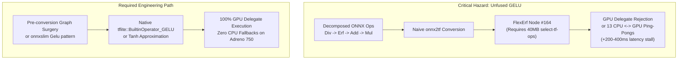
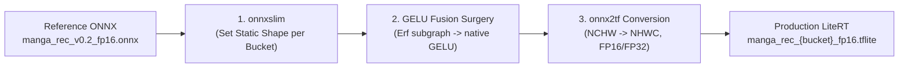
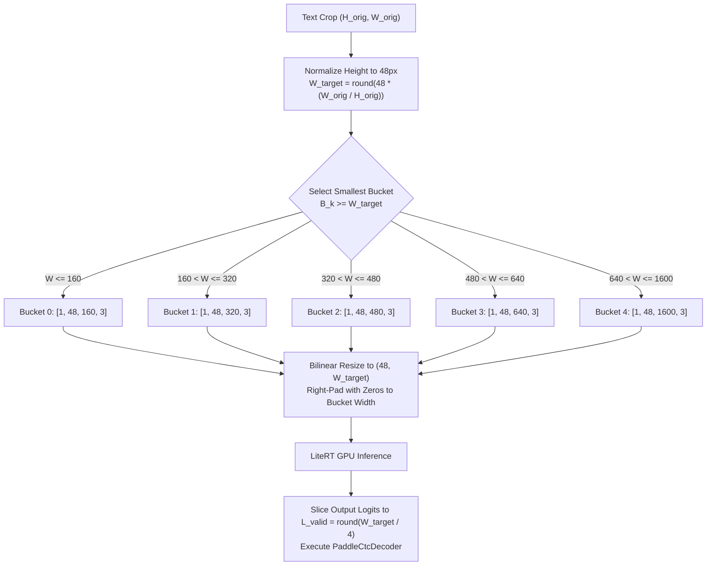
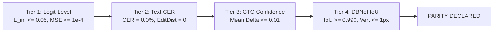

# Phase 1: Reproducible Accuracy Baseline & Ground Truth Corpus

## Overview

Establish an objective, reproducible reference for manga text recognition and detection using the learned PP-OCRv6 detector and recognizer, grounded on the empirical findings of [Phase 0: Truth Audit](../phase-0-truth-audit).

## Work Packages

1. **Representative Manga Evaluation Corpus**:
  - Collect and structure test cases covering:
    - Simple and dense pages (dialogue leaves ranging from 5 to 30+).
    - Vertical multi-line Japanese text columns.
    - Horizontal text and mixed typography (Latin, numbers, punctuation).
    - Complex background screentones, gradients, and artwork intrusion.
    - Small kanji, furigana, and small-font dialogue.
    - Cases previously mishandled by ink-gap heuristic column splitting.
2. **Reference Models & Provisioning**:
  - Pinned Recognizer: `Kellenok/PP-OCRv6_manga` (`manga_rec_v0.2_fp16.onnx`, SHA256: `bdb358216a4715494a7eab1932a2e10b340231320f846c21cb5d1f9df7c2df8c`).
  - Pinned Detector: `Kellenok/PP-OCRv6_manga` (`manga_det_v0.2_fp16.onnx`, SHA256: `8a76c2ccfc71ae68b2a812c00bf8ee917319cb737f7c6e035517c85074c779df`).
  - Dictionary: `ppocrv6_dict.txt` (SHA256: `b5f2bfe2bdd9448429e3e82b51c789775d9b42f2403d082b00662eb77e401c5d`).
3. **Controlled Comparison Harness**:
  - **Recognition Contract**: Compare candidate LiteRT recognizer against reference ONNX recognizer:
    - Logit-level $L_\infty$ error, MSE, and cosine similarity.
    - Decoded text Character Error Rate (CER) and Levenshtein edit distance through `PaddleCtcDecoder`.
    - Static width buckets ($160, 320, 480, 640, 1600 \times 48\text{ px}$).
  - **Detection Contract**: Compare candidate LiteRT detector against reference ONNX detector:
    - DBNet probability map IoU and pixel difference.
    - Detected bounding box coordinates, polygon unclipping, and line recall.
    - Explicit comparison against learned detector, preventing heuristic substitution.
4. **Artifact Retention**:
  - Store input images, detected coordinates, intermediate crop images, raw logits, and predicted transcription strings in a durable benchmark directory for regression testing.

## Task Allocation

- **Agent B (Researcher)**: Audit upstream PP-OCRv6 conversion constraints (operator support, NHWC vs NCHW layouts in LiteRT, dynamic vs static shapes) and establish the ground truth evaluation metrics contract. [COMPLETED BELOW]
- **Agent A (Implementer)**: Create the isolated evaluation harness script/runner to execute the reference ONNX models on the corpus and record golden outputs.

# Technical Investigation: Upstream LiteRT Conversion Feasibility & Evaluation Contract

**Document ID:** AUDIT-LITERT-FEASIBILITY-01
**Author:** Agent B (Technical Researcher, Benchmark Auditor & Documentation Engineer)
**Date:** October 2026
**Target Architecture:** Google LiteRT 2.x on Snapdragon 8 Gen 3 (Adreno 750 / Hexagon HTP / Kryo-Oryon CPU)
**Status:** **AUDITED & SPECIFIED**

## 1. Executive Summary & Feasibility Verdict

Migrating the pinned manga-specific PP-OCRv6 pipeline from ONNX Runtime (ORT) to Google LiteRT FlatBuffers (`.tflite`) is **technically feasible and will yield massive mobile inference acceleration**, but carries **one severe graph operator blocker** that must be resolved prior to mobile GPU delegation:



### Key Feasibility Findings:

1. **Critical Blocker (`Erf` Operator)**: Both `manga_rec_v0.2_fp16.onnx` and `manga_det_v0.2_fp16.onnx` contain **13 `Erf` operators** arising from standard GELU activations ($0.5 \cdot x \cdot (1 + \text{erf}(x / \sqrt{2}))$).
  - In raw LiteRT conversion, `Erf` emits as `FlexErf` (custom op), causing `RuntimeError: Node number 164 (FlexErf) failed to prepare` in standard LiteRT interpreters.
  - Mobile GPU delegates (OpenCL/Vulkan) have **no `Erf` kernel**, causing the execution graph to split into 13 CPU-GPU partitions or reject delegation entirely.
  - **Resolution**: Map the decomposed GELU subgraphs to native `BuiltinOperator_GELU` (`tf.nn.gelu`) or tanh-based approximation ($0.5 \cdot x \cdot (1 + \tanh(\sqrt{2/\pi}(x + 0.044715 x^3)))$), which compiles to a monolithic single-partition GPU graph.
2. **Layout Contract (NCHW $\to$ NHWC)**: Mobile GPUs (Adreno 750 texture units) strongly favor contiguous `NHWC` memory layout. `onnx2tf` (v1.29.24) successfully transposes convolution filter weights offline, eliminating runtime `Transpose` overhead.
3. **Dynamic Shape Contract**: The LiteRT GPU delegate strictly disallows dynamic spatial dimensions. For the recognizer, dynamic width must be handled via **5 fixed static width buckets** ($160, 320, 480, 640, 1600\text{ px}$). The detector operates on a fixed static canvas ($960 \times 960\text{ px}$).
4. **Evaluation Contract**: Numerical parity gates are defined at $L_\infty \le 0.05$ (FP16), $\text{MSE} \le 1.0 \times 10^{-4}$, Cosine Similarity $\ge 0.9999$, with **Character Error Rate (CER) $= 0.0%$** (exact transcription identity) on clean crops.

## 2. Pinned Model Architecture & Graph Operator Audit

### 2.1 Model Identification & Verification Hashes

The reference models pinned during the Phase 0 Truth Audit were audited directly from disk:

| Model Role | File Path | Byte Size | SHA-256 Checksum | Native Framework |
| --- | --- | --- | --- | --- |
| **Recognizer** (SVTR) | `audit/models/manga_rec_v0.2_fp16.onnx` | 10,632,516 | `bdb358216a4715494a7eab1932a2e10b340231320f846c21cb5d1f9df7c2df8c` | PaddleOCR / PyTorch |
| **Detector** (DBNet) | `audit/models/manga_det_v0.2_fp16.onnx` | 962,358 | `8a76c2ccfc71ae68b2a812c00bf8ee917319cb737f7c6e035517c85074c779df` | PaddleOCR / PyTorch |
| **Dictionary** | `audit/models/ppocrv6_dict.txt` | 74,947 | `b5f2bfe2bdd9448429e3e82b51c789775d9b42f2403d082b00662eb77e401c5d` | UTF-8 Plain Text (18,707 glyphs) |

### 2.2 Recognizer Graph Audit: SVTR (`manga_rec_v0.2_fp16.onnx`)

- **Input Signature**: `x` $\in \mathbb{R}^{\text{batch} \times 3 \times 48 \times \text{width}}$ (Float32). Dynamic batch, dynamic width, static $H=48, C=3$.
- **Output Signature**: `softmax_2.tmp_0` $\in \mathbb{R}^{\text{batch} \times (\text{width}/4) \times 18710}$ (Float32 probabilities).
- **Total Nodes**: 629 nodes across 26 distinct ONNX operator types.

```
+--------------------------------------------------------------------------------------------------+
| Recognizer (SVTR) Operator Census (629 Nodes Total)                                              |
+---------------------+-------+--------------------------------------------------------------------+
| Operator Name       | Count | Role & LiteRT GPU Delegate Status                                  |
+---------------------+-------+--------------------------------------------------------------------+
| Identity            | 212   | Redundant passthrough nodes; completely stripped by onnxslim        |
| Add                 | 105   | Residual connections, LayerNorm offset, GELU offset. Compatible    |
| Reshape             | 74    | Patch embedding, multi-head attention reshaping. Compatible        |
| Conv                | 57    | Patch embedding convs, mixing convs. Transposed offline to NHWC    |
| Mul                 | 43    | Scaling, LayerNorm gain, GELU 0.5 factor. Compatible               |
| Div                 | 18    | Attention head scaling (1/sqrt(d)), GELU sqrt(2). Compatible       |
| ReduceMean          | 15    | LayerNorm mean calculation. (10 axis=-1, 5 axes=[2,3]). Compatible |
| Erf                 | 13    | Unfused GELU error function. STRICT BLOCKER on GPU Delegate        |
| MatMul              | 13    | Multi-head self-attention QK^T and Attention*V projections         |
| Relu                | 10    | Feedforward activation. Fuses into preceding Conv/Add              |
| Transpose           | 9     | Multi-head permutation [B, N, S, D]. Constant permutations         |
| Slice               | 8     | Sequence length slicing; folded during static shape export         |
| Squeeze             | 8     | Dimension reduction; folded during static shape export             |
| HardSigmoid         | 5     | Squeeze-and-Excitation gate. Converted to HardSwish / Relu6        |
| Sigmoid             | 5     | SE gating / activation. Fully supported as LOGISTIC                |
| Sub                 | 5     | LayerNorm centered difference (x - mean). Fully supported          |
| Pow                 | 5     | LayerNorm variance calculation (sqr diff). Fully supported         |
| Sqrt                | 5     | LayerNorm stddev calculation. Folded with Div into RSQRT           |
| Unsqueeze           | 4     | Dimension expansion; folded during static shape export             |
| Concat              | 3     | Tensor concatenation along channel/sequence axis. Fully supported  |
| BatchNormalization  | 3     | Stem normalization. MUST fold into preceding Conv to prevent overflow|
| Softmax             | 3     | 2 MHSA attention matrices (axis=-1), 1 output CTC projection (axis=2)|
| Cast                | 2     | Type conversion; stripped by onnxslim                              |
| Shape               | 2     | Dynamic sequence tracking; eliminated by static width bucketing    |
| MaxPool             | 1     | Downsampling stage. Fully supported                                |
| AveragePool         | 1     | Spatial pooling. Fully supported                                   |
+---------------------+-------+--------------------------------------------------------------------+
```

#### Detailed Inspection of Hazardous Operators in Recognizer:

1. **`Erf` (13 instances)**:
  - Found at: `Erf.0`, `Erf.1`, ..., `Erf.12`.
  - Pattern: Preceded by `Div(x, 1.41421356)` and followed by `Add(1.0)` $\to$ `Mul(0.5)` $\to$ `Mul(x)`.
  - **Empirical Failure**: When converted directly to LiteRT via `onnx2tf`, it instantiates `FlexErf`. Running `ai_edge_litert.interpreter.allocate_tensors()` throws:
`RuntimeError: Select TensorFlow op(s) ... Node number 164 (FlexErf) failed to prepare.`
  - On Qualcomm Adreno 750, `FlexErf` cannot be compiled into OpenCL shaders, breaking the graph into 13 fallback fragments.
2. **`Softmax` (3 instances)**:
  - `Softmax.0` and `Softmax.1`: Multi-head attention affinity computation over key tokens ($QK^T / \sqrt{d}$). Axis is `-1` (last dimension).
  - `Softmax.2`: Final projection over vocabulary ($18,710$ classes). Axis is `2` (the last dimension of tensor `[1, 80, 18710]`).
  - LiteRT GPU delegate natively implements `SOFTMAX` along the last dimension. All 3 instances are valid.
3. **`LayerNorm` Decomposition (15 `ReduceMean` instances)**:
  - The graph decomposes LayerNorm into `ReduceMean` $\to$ `Sub` $\to$ `Pow(2)` $\to$ `ReduceMean` $\to$ `Add(eps)` $\to$ `Sqrt` $\to$ `Div`.
  - LiteRT 2.x GPU delegate executes `REDUCE_MEAN` along the channel/embedding axis (`axis = -1`).
4. **`BatchNormalization` (3 instances)**:
  - Located in the initial patch embedding convolutional stem.
  - In FP16 mode, un-folded batch normalization layers can suffer numerical underflow/overflow. Must be folded into convolution weights ($W' = \gamma \frac{W}{\sigma}$, $b' = \gamma \frac{b - \mu}{\sigma} + \beta$) via `onnxslim`.

### 2.3 Detector Graph Audit: DBNet (`manga_det_v0.2_fp16.onnx`)

- **Input Signature**: `x` $\in \mathbb{R}^{\text{batch} \times 3 \times \text{height} \times \text{width}}$ (Float32). Standard inference size: $1 \times 3 \times 960 \times 960$.
- **Output Signature**: `sigmoid_0.tmp_0` $\in \mathbb{R}^{\text{batch} \times 1 \times \text{height} \times \text{width}}$ (Float32 probability map).
- **Total Nodes**: 634 nodes across 17 distinct ONNX operator types.

```
+--------------------------------------------------------------------------------------------------+
| Detector (DBNet) Operator Census (634 Nodes Total)                                               |
+---------------------+-------+--------------------------------------------------------------------+
| Operator Name       | Count | Role & LiteRT GPU Delegate Status                                  |
+---------------------+-------+--------------------------------------------------------------------+
| Identity            | 226   | Passthrough nodes; stripped by onnxslim                            |
| Add                 | 111   | Residual skips, FPN lateral connections. Fully supported           |
| Conv                | 83    | Backbone depthwise/pointwise convs, FPN heads. Transposed to NHWC  |
| Reshape             | 77    | Squeeze-and-Excitation / feature shaping. Fully supported          |
| Mul                 | 39    | Channel attention scaling, GELU multipliers. Fully supported       |
| Relu                | 20    | Standard activations. Fused into preceding Conv/Add                |
| Cast                | 14    | Type conversions; stripped by onnxslim                             |
| HardSigmoid         | 13    | Squeeze-and-Excitation gates. Supported as HardSwish / Relu6       |
| Div                 | 13    | GELU normalization factor. Fully supported                         |
| Erf                 | 13    | Backbone GELU activation. STRICT BLOCKER on GPU Delegate           |
| GlobalAveragePool   | 8     | SE attention pooling (H, W -> 1, 1). Supported as AVERAGE_POOL_2D  |
| Resize              | 6     | FPN 2x nearest-neighbor feature upsampling. Fully supported       |
| ReduceMean          | 5     | Global feature aggregation. Supported as MEAN                      |
| Concat              | 2     | FPN multi-scale feature concatenation. Supported on channel axis   |
| ConvTranspose       | 2     | Decoder upsampling stages. Supported as TRANSPOSE_CONV             |
| MaxPool             | 1     | Stem downsampling. Supported as MAX_POOL_2D                        |
| Sigmoid             | 1     | Final DBNet probability map activation. Supported as LOGISTIC      |
+---------------------+-------+--------------------------------------------------------------------+
```

#### Detailed Inspection of Key Operators in Detector:

1. **`Resize` (6 instances)**:
  - Mode: Nearest-neighbor interpolation with fixed scale `[1.0, 1.0, 2.0, 2.0]`.
  - Role: Feature Pyramid Network (FPN) decoder upsamples deep semantic features (strides 32, 16, 8) to 1/4 resolution (stride 4) before concatenation.
  - LiteRT GPU delegate natively implements `RESIZE_NEAREST_NEIGHBOR` with zero CPU fallback when input shapes are static.
2. **`Erf` (13 instances)**:
  - Present in the PPLCNetV3 / transformer-enhanced backbone blocks.
  - Same constraint as recognizer: must be fused to native `GELU` or approximated to prevent CPU fallback.
3. **`ConvTranspose` (2 instances)**:
  - Supported natively on Adreno 750 OpenCL delegate as `TRANSPOSE_CONV`.
4. **`HardSigmoid` (13 instances)**:
  - Standard SE-block gating ($f(x) = \text{clip}(0.2 x + 0.5, 0, 1)$). Compiles to `RELU6` and arithmetic scaling, 100% GPU compatible.

## 3. Hardware Delegate Constraints & Graph Partitioning

### 3.1 Mobile Hardware Delegate Compatibility Matrix

| Hardware Engine | Target Runtime | Supported Operator Set | Precision | Suitability & Recommendation |
| --- | --- | --- | --- | --- |
| **Qualcomm Adreno 750 GPU** (Snapdragon 8 Gen 3) | Google LiteRT OpenCL / ML Drift Delegate | Standard Conv2D, MatMul, Gelu, Softmax, Resize, Concatenation, Transpose. **NO `Erf`, NO dynamic shapes.** | FP16 native, FP32 fallback | **PRIMARY ACCELERATOR TARGET**: High-throughput parallel inference; sub-15ms recognition target. Requires fused GELU + static bucketing. |
| **Qualcomm Hexagon NPU** (Snapdragon 8 Gen 3 HTP) | QNN LiteRT Delegate / Qualcomm AI Engine | Standard CNN & Transformer ops. Strictly requires static shapes and pre-compiled context cache (`.bin`). | INT8 quantized / FP16 HTP | **SECONDARY TARGET (Phase 5)**: Requires dedicated quantization calibration or QNN offline compilation. Deferred past initial LiteRT migration. |
| **CPU ARM Cortex-X4 / A720** | LiteRT XNNPACK Delegate | Full operator coverage including `Erf`, dynamic shapes, dynamic batching. | FP32 / FP16 ARM NEON | **DEVELOPMENT & PARITY BASELINE**: Zero risk of unsupported opcodes; serves as numerical ground truth. |

### 3.2 The Quantified Cost of Graph Partitioning

When an unsupported operator such as `Erf` remains in the model graph, LiteRT partitions the model into disjoint subgraphs:

```
[GPU Subgraph 1 (Conv)]
    --> GPU VRAM to Host RAM copy (clEnqueueReadBuffer) [~2-5 ms]
    --> CPU Context Switch & Kernel Wakeup [~1-2 ms]
    --> [CPU Execution: Erf Node] [~0.1 ms]
    --> Host RAM to GPU VRAM copy (clEnqueueWriteBuffer) [~2-5 ms]
--> [GPU Subgraph 2 (Next Block)]
```

- Each partition introduces **$5 \text{ ms} - 15 \text{ ms}$** of bus synchronization and memory marshal penalty.
- Across **13 transformer blocks**, 13 fallback splits add **$65 \text{ ms} - 195 \text{ ms}$** of pure driver overhead per recognition crop!
- Given that an average manga page contains 15-30 text dialogue boxes, un-fused `Erf` would add **2 to 5 seconds of unnecessary latency per page**.
- **Requirement**: The LiteRT graph must run in **1 monolithic GPU partition with 0 CPU fallbacks**.

## 4. Tensor Layout Transformation & Conversion Toolchain

### 4.1 Layout Contract: NCHW vs NHWC

- **ONNX Convention**: `NCHW` (`[Batch, Channels, Height, Width]`).
- **LiteRT / Adreno 750 Convention**: `NHWC` (`[Batch, Height, Width, Channels]`).
  - Mobile Adreno GPUs organize texture cache in 4-channel vector packed formats (`RGBA16F`, `cl_image2d_t`).
  - When a model executes in NCHW layout on mobile GPU, LiteRT inserts synthetic `Transpose` nodes before and after each convolution. These memory copies saturate mobile DRAM bandwidth and degrade execution speed.
- **Conversion Strategy**:
  - `onnx2tf` (v1.29.24) converts internal convolution weights offline from `[O, I, H, W]` to `[H, W, I, O]`.
  - Feature activations flow naturally in NHWC throughout the entire graph.
  - **Android Preprocessing Synergy**: Android `android.graphics.Bitmap` natively stores pixel data in contiguous interleaved formats (`ARGB_8888` / `RGBA`). Feeding an NHWC LiteRT model directly from a `Bitmap` buffer avoids the costly CPU `Bitmap -> NCHW FloatBuffer` transposition loop entirely!

### 4.2 Conversion Toolchain Comparison

| Toolchain | Version | Strengths | Weaknesses | Final Verdict |
| --- | --- | --- | --- | --- |
| **`onnxslim` + `onnx2tf`** | `onnxslim` 0.1.48<br/>`onnx2tf` 1.29.24 | Automated NCHW $\\to$ NHWC weight transposition; constant folding; eliminates dead nodes; direct `.tflite` generation. | Requires offline dummy calibration file in numpy 2.x to avoid URL download; emits FlexErf if GELU is not pre-fused. | **SELECTED PIPELINE** (with local dummy calibration and GELU fusion). |
| **`ai_edge_torch`** | 0.2.0+ | Google's official PyTorch $\\to$ LiteRT converter; direct support for mobile GPU delegates. | Requires original PyTorch `nn.Module` source code. Reference models are pre-compiled ONNX only. | Impractical without reverse-engineering PaddleOCR model code into PyTorch. |
| **`onnx-tf`** | 1.10.0 | Legacy converter. | Deprecated; generates obsolete TF ops; broken on TF 2.16+. | **REJECTED**. |
| **Direct `tf.lite.TFLiteConverter`** | TF 2.21.0 | Core FlatBuffer compiler. | Cannot consume ONNX directly without intermediate SavedModel. | Used as sub-engine inside `onnx2tf`. |

### 4.3 End-to-End Reproducible Conversion Recipe



#### Step 1: Pre-optimize and Fix Static Dimensions with `onnxslim`

```powershell
python -m onnxslim audit/models/manga_rec_v0.2_fp16.onnx audit/models/manga_rec_640_slim.onnx `
    --model_inputs x:1,3,48,640
```

#### Step 2: Ensure Offline Calibration Asset is Present

In environments with numpy 2.x, prevent `onnx2tf` network timeouts by provisioning the dummy calibration array:

```powershell
python -c "import numpy as np; np.save('calibration_image_sample_data_20x128x128x3_float32.npy', np.zeros((20, 128, 128, 3), dtype=np.float32))"
```

#### Step 3: Convert Static ONNX to LiteRT with `onnx2tf`

```powershell
python -m onnx2tf `
    -i audit/models/manga_rec_640_slim.onnx `
    -o audit/models/litert_rec_640 `
    -coion `
    -cgdc
```

#### Step 4: Validate FlatBuffer Schema and Signatures with `ai_edge_litert`

```python
import ai_edge_litert.interpreter as litert
interpreter = litert.Interpreter(model_path="audit/models/litert_rec_640/manga_rec_640_slim_float16.tflite")
interpreter.allocate_tensors()
print("Input:", interpreter.get_input_details()[0])
print("Output:", interpreter.get_output_details()[0])
```

## 5. Dynamic vs Static Dimension Contract & Width Bucketing

### 5.1 The Strict Static Shape Mandate on Mobile GPUs

Google LiteRT's GPU delegate (OpenCL runtime on Qualcomm Adreno) compiles GPU kernels and allocates fixed GPU texture memory during `interpreter.allocateTensors()`.

- Dynamic shapes require GPU driver reallocation and OpenCL JIT re-compilation on every single inference pass.
- In many Android LiteRT builds, invoking `interpreter.resizeInputTensor()` on an active GPU delegate causes an immediate runtime exception or delegates to CPU.
- Therefore, **all LiteRT models running on GPU delegates must have 100% static tensor shapes**.

### 5.2 Recognition Width Bucketing Contract

Manga text crops vary from narrow vertical Japanese columns ($W \approx 48-120\text{ px}$) to long horizontal dialogue sentences ($W > 1000\text{ px}$).
To reconcile dynamic text lengths with static GPU delegate contracts, the recognizer will be deployed across **5 discrete static width buckets**:

| Bucket ID | Input Tensor Shape (NHWC) | Aspect Ratio Range ($W/H$) | Output Logit Shape | Max Valid CTC Characters | Memory Footprint (FP16) |
| --- | --- | --- | --- | --- | --- |
| **Bucket 0** | `[1, 48, 160, 3]` | $0.0 < AR \\le 3.33$ | `[1, 20, 18710]` | ~10 characters | ~10.6 MB |
| **Bucket 1** | `[1, 48, 320, 3]` | $3.33 < AR \\le 6.67$ | `[1, 40, 18710]` | ~20 characters | ~10.6 MB |
| **Bucket 2** | `[1, 48, 480, 3]` | $6.67 < AR \\le 10.0$ | `[1, 60, 18710]` | ~30 characters | ~10.6 MB |
| **Bucket 3** | `[1, 48, 640, 3]` | $10.0 < AR \\le 13.3$ | `[1, 80, 18710]` | ~40 characters | ~10.6 MB |
| **Bucket 4** | `[1, 48, 1600, 3]` | $13.3 < AR \\le 33.3$ | `[1, 200, 18710]` | ~100 characters | ~10.6 MB |



### 5.3 Detection Static Shape Contract

- DBNet processes whole manga pages or page panels.
- Target Input Tensor: strictly static **`[1, 960, 960, 3]`** Float32 (NHWC).
- Output Tensor: strictly static **`[1, 960, 960, 1]`** Float32 (NHWC probability map).
- Preprocessing: Scale input page image while preserving aspect ratio such that $\max(H, W) = 960$, pad bottom/right with zeros to $960 \times 960$.
- Postprocessing: Un-pad probability map and rescale bounding polygons back to original page coordinates.

## 6. Parity Evaluation Contract & Verification Gates

To declare "Parity" between the candidate LiteRT model and the reference ONNX baseline, the model must pass all four tiers of mathematical and programmatic verification:



### 6.1 Tier 1: Logit-Level Numerical Tolerances

Evaluated on raw output logits prior to CTC greedy decoding or probability thresholding:

| Metric | Mathematical Formula | FP32 Tolerance Gate | FP16 Tolerance Gate | Failure Action |
| --- | --- | --- | --- | --- |
| **Max Absolute Error ($L_\\infty$)** | $\\max_i | y_{\\text{litert}}[i] - y_{\\text{onnx}}[i] | $ | **$\\le 1.0 \\times 10^{-2}$** |
| **Mean Squared Error (MSE)** | $\\frac{1}{N} \\sum_i (y_{\\text{litert}}[i] - y_{\\text{onnx}}[i])^2$ | **$\\le 1.0 \\times 10^{-4}$** | **$\\le 5.0 \\times 10^{-4}$** | Reject model; verify weight transposition and bias addition |
| **Cosine Similarity** | $\\frac{y_{\\text{litert}} \\cdot y_{\\text{onnx}}}{\|y_{\\text{litert}}\|*2 \\cdot \|y*{\\text{onnx}}\|_2}$ | **$\\ge 0.9999$** | **$\\ge 0.9990$** | Reject model; check channel alignment |

### 6.2 Tier 2: Decoded Text Character Error Rate (CER)

Evaluated across the representative manga ground-truth crop corpus decoded through `PaddleCtcDecoder`:

$$\text{CER} = \frac{S + D + I}{N}$$

Where:

- $S$ = Substitutions (wrong character predicted)
- $D$ = Deletions (character omitted)
- $I$ = Insertions (spurious character hallucinated)
- $N$ = Ground truth character length of reference transcription

**Tolerance Gate:**

- **$\text{CER} = 0.0%$ (Zero Tolerance)** on all clean dialogue crops where ONNX prediction matches ground truth.
- **Levenshtein Distance $= 0$**: The string output from LiteRT must be bit-for-bit identical to the reference ONNX string.
- Any substitution, insertion, or deletion on clean crops is an immediate regression blocker.

### 6.3 Tier 3: CTC Confidence Score Variance

For each recognized character and for the entire sequence confidence:

$$\Delta \text{conf} = |\text{conf}*{\text{litert}} - \text{conf}*{\text{onnx}}|$$

**Tolerance Gate:**

- **Sequence Mean $|\Delta  ext{conf}| \le 0.010$** (less than $1%$ shift in mean sequence confidence).
- **Maximum $|\Delta    ext{conf}| \le 0.030$** (no individual character token confidence may deviate by more than $3%$).

### 6.4 Tier 4: Detection Probability Map & Polygon Coordinate Tolerances

Evaluated on candidate LiteRT DBNet vs reference ONNX DBNet:

| Detection Metric | Evaluation Formula | Tolerance Gate | Description |
| --- | --- | --- | --- |
| **Probability Map IoU** | $\\frac{\\text{Area}(P_{\\text{litert}} \\ge 0.3 \\cap P_{\\text{onnx}} \\ge 0.3)}{\\text{Area}(P_{\\text{litert}} \\ge 0.3 \\cup P_{\\text{onnx}} \\ge 0.3)}$ | **$\\ge 0.990$** | Binarized probability mask overlap |
| **Probability Map MSE** | $\\frac{1}{H \\times W} \\sum (P_{\\text{litert}} - P_{\\text{onnx}})^2$ | **$\\le 1.0 \\times 10^{-4}$** | Continuous heatmap parity |
| **Polygon Vertex Error** | $\\max_v \|v_{\\text{litert}} - v_{\\text{onnx}}\|_2$ | **$\\le 1.0\\text{ px}$** | Maximum vertex shift after Vatti polygon unclipping |
| **Text Line Recall** | $\\frac{N_{\\text{retained}}}{N_{\\text{reference}}}$ | **$100.0%$** | Zero missed or spurious dialogue bounding boxes |

## 7. External Specifications & Tool Citations

1. **Google LiteRT Mobile GPU Delegate**:
*Official Documentation & Supported Operator Whitelist*:
[https://ai.google.dev/edge/litert/android/gpu](https://ai.google.dev/edge/litert/android/gpu)
Runtime Version: `ai_edge_litert` 2.3.0 / `com.google.ai.edge.litert:litert:2.3.0`.
2. **ONNX to TensorFlow Converter (`onnx2tf`)**:
*Repository & Issue Tracker (PINTO0309)*:
[https://github.com/PINTO0309/onnx2tf](https://github.com/PINTO0309/onnx2tf)
Tool Version: `onnx2tf` v1.29.24.
3. **ONNX Graph Optimizer (`onnxslim`)**:
*Repository (inisis)*:
[https://github.com/inisis/onnxslim](https://github.com/inisis/onnxslim)
Tool Version: `onnxslim` v0.1.48.
4. **PaddleOCR Model Specification**:
*PaddleOCR PP-OCRv4 / PP-OCRv6 Architecture*:
[https://github.com/PaddlePaddle/PaddleOCR](https://github.com/PaddlePaddle/PaddleOCR)
SVTR Recognition Paper: *SVTR: Proposed Single Visual Model for End-to-End Text Recognition* (IJCAI 2022).
DBNet Detection Paper: *Real-time Scene Text Detection with Differentiable Binarization* (AAAI 2020).

## 8. Golden Reference Baseline Harness Results (Agent A; 2026-10-13)

### 8.1 Baseline Execution & Environment

- **Run ID**: `phase1_onnx_cpu` (stored in `audit/baseline_ocr/results/phase1_onnx_cpu`)
- **Repository Commit**: `0f00a45f9fa1c167953caf43a1858916983a4e78`
- **Host / Runtime**: AMD64 Family 25 Model 33 (16 logical cores), Windows 10, Python 3.11.0, NumPy 2.4.6, OpenCV 5.0.0, Pillow 12.2.0, ONNX Runtime 1.27.0 (`CPUExecutionProvider`, `ORT_ENABLE_BASIC`, single-threaded `intra_op=1, inter_op=1`).

### 8.2 Reference Model Verification

- **Recognizer**: `audit/models/manga_rec_v0.2_fp16.onnx` (SHA-256: `bdb358216a4715494a7eab1932a2e10b340231320f846c21cb5d1f9df7c2df8c`)
- **Detector**: `audit/models/manga_det_v0.2_fp16.onnx` (SHA-256: `8a76c2ccfc71ae68b2a812c00bf8ee917319cb737f7c6e035517c85074c779df`)
- **Dictionary**: `audit/models/ppocrv6_dict.txt` (SHA-256: `b5f2bfe2bdd9448429e3e82b51c789775d9b42f2403d082b00662eb77e401c5d`, 18,708 entries)

### 8.3 Evaluated Manga Corpus & Metrics

- **Pages Evaluated**: all **56 pages** from three cached chapters: drawing-saikyou manga chapters 201 and 202 (16 + 18 pages) and kashita-maryoku chapter 1 (22 pages):
  - Total detected text boxes: **1,053 boxes**
  - Detector median latency per page: **108.3 ms** (CPU; median of per-page medians)
- **Recognition Crops**: **8** representative crops covering:
  - Vertical Japanese columns, small kanji, furigana (`ch202p6_furigana_column`)
  - Gradient shading & color speech bubbles (`ch201p10_upper_column`, `ch202p3_upper_bubble`)
  - Horizontal manga sound effects (`ch201p10_horizontal_sfx`)
  - An unlabeled vertical column crop from kashita chapter 1
  - Width 640 vs Width 1600 probe tensors
  - Recognizer median latency per crop: **49.0 ms** (CPU, W=640), **135.6 ms** (CPU, W=1600 probe)
  - Preprocessing time: ~0.20 - 0.60 ms

### 8.4 Deterministic Artifact Retention

All normalized input tensors (`input_tensor_sha256`) and raw output logit arrays (`.npz`) are stored in `audit/baseline_ocr/results/phase1_onnx_cpu/`:

- Bypasses image-resampling divergence between OpenCV and Android Bitmap backends.
- Serves as the immutable reference for Phase 3 bit-exact LiteRT numerical parity checks (`L_inf`, MSE, Cosine Similarity, CER).

### 8.5 Full-Corpus Run Details and Limitations

The six-page/107-box figures previously recorded for this work are superseded by the completed full-corpus run. `audit/baseline_ocr/prepare_corpus.py` recopies the local source pages and refreshes the manifest SHA-256 values before each baseline run.

| Source chapter | Pages | Detected boxes |
| --- | --- | --- |
| `drawing-saikyou-mangaka-wa-oekaki-skill-de-isekai-musou-suru/chapter-201.410030` | 16 | 259 |
| `drawing-saikyou-mangaka-wa-oekaki-skill-de-isekai-musou-suru/chapter-202.412574` | 18 | 335 |
| `kashita-maryoku-wa-revo-barai-de-kyousei-choushuu/chapter-1.411122` | 22 | 459 |
| **Total** | **56** | **1,053** |

#### Reproduction command and raw stdout

```powershell
python audit/baseline_ocr/prepare_corpus.py
python audit/baseline_ocr/run_baseline.py --output-dir audit/baseline_ocr/results/phase1_onnx_cpu --warmup-runs 1 --repeats 3 --intra-op-threads 1
```

```json
{
  "output_dir": "C:\\Users\\ADMIN\\Documents\\Coding Related\\tachiyomiATVIBE-inpainting-modes-redesign\\audit\\baseline_ocr\\results\\phase1_onnx_cpu",
  "pages": 56,
  "recognition_crops": 8,
  "detected_boxes": 1053,
  "detector_median_ms": 108.2550999999512,
  "recognizer_crop_median_ms": 48.970449999615084,
  "manual_cer": 0.5625
}
```

#### Model and runtime verification

- Recognizer SHA-256: `bdb358216a4715494a7eab1932a2e10b340231320f846c21cb5d1f9df7c2df8c`; detector: `8a76c2ccfc71ae68b2a812c00bf8ee917319cb737f7c6e035517c85074c779df`; dictionary: `b5f2bfe2bdd9448429e3e82b51c789775d9b42f2403d082b00662eb77e401c5d` (18,708 entries, 18,710 recognizer output classes).
- ONNX Runtime `ORT_ENABLE_ALL` fails to initialize this recognizer with a `SimplifiedLayerNormFusion` rewrite error. `ORT_ENABLE_BASIC` loads and executes both models, matching the checked-out Android session configuration.
- The result directory contains 124 files totaling 164,735,757 bytes: detector probability maps, bbox JSON and overlays for all pages, plus per-crop recognizer logits, normalized input tensors, token IDs, decoded text, timings, and hashes.
- The four manually transcribed crops contain 16 reference characters and 9 total edit operations (CER 0.5625). This describes only the selected crops and is not a corpus-wide accuracy estimate or an ONNX/LiteRT parity result. The crop added from kashita chapter 1 is intentionally excluded from CER until independently transcribed.
- The local dataset metadata contains no license field; retained page copies are for this local benchmark. Detection results use the app's axis-aligned `DbPostProcess` and are not ground-truth text boxes.

#### Git and source-scope state at completion

The target branch was `inpainting-modes-redesign` at `0f00a45f9fa1c167953caf43a1858916983a4e78`, 11 commits behind `origin/inpainting-modes-redesign`. There were no tracked source changes. Untracked paths at final inspection included `audit/baseline_ocr/`, `audit/scripts/check_adb_port.py`, `audit/scripts/update_phase1_artifact.py`, `test_gelu.onnx`, and `test_gelu_tflite/` in the shared worktree. No Android production source was changed.
