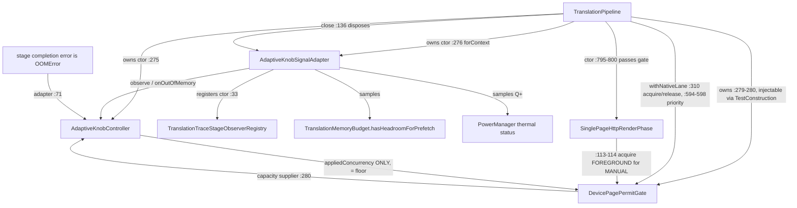

# Audit method and base

Base `architecture-cleanup` @ `1c1d247e`; worktree clean except the user's report. READ-ONLY: no source/test/config edits, no builds/tests, no device/provider contact. Evidence = direct file reads + repo-wide reference search over all `.kt` (main, test, testDebug), plus `.md/.xml/.pro/.json/.gradle` scans (no resource/config/keep-rule references to any adaptive symbol; the only "adaptive" hits are unrelated `adaptive-icon` resources and the user report).

# Floor-pinning, verified at the current commit

`AdaptiveKnobController.appliedConcurrency` was `get() = floor` (AdaptiveKnobController.kt:80) — an instance property pinned to the floor (not a compile-time constant), with the KDoc declaring the E20b flip would remove the pin. The **sole consumer of any controller output outside the experiment itself** was the gate capacity lambda at TranslationPipeline.kt:280 (`capacity = { adaptiveKnobController.appliedConcurrency }`). `computedConcurrency`, `anchorFor`, `validAnchorSampleCount`, `KnobSignals`, `KnobSignalSnapshot`, and `DeviceStageObservation` had **no consumers outside the experiment** (adapter + tests only). This is a full output-reachability audit, not a grep-count argument: no production admission, priority, render, or telemetry path read any computed value. (Line references are to base `1c1d247e`; the controller/adapter files were subsequently deleted by the retirement slice.)

# Consumer / ownership graph

Live (non-experiment) consumers that constrain any cleanup:

| Consumer | Use | Verdict |
| --- | --- | --- |
| `TranslationPipeline.withNativeLane` (:300-330) | gate.acquire → engines (NativeRunQuarantine inside EngineLane) → permit.release in finally; null permit → typed onTimeout | Load-bearing admission |
| `TranslationPipeline` priority selection (:594-598) + `SinglePageHttpRenderPhase` (:113-114) | `PageWriteOrigin.MANUAL` → FOREGROUND, else BACKGROUND | Foreground/reader priority |
| `SinglePageHttpRenderPhase` release/reacquire protocol | permit released while parked on provider, reacquired before render | Render reacquisition contract |
| `RenderPermitReacquisitionTest` (coexistence) | END-TO-END contract test of that boundary through the real pipeline + registry observer | Live test — gate is load-bearing |
| `TranslationCoexistenceHarness` (:462, :668) | builds its own `DevicePagePermitGate()` and injects via `TestConstruction` — the whole coexistence suite runs real gate admission | Live test infrastructure |
| `DeviceStageNormalization` | sourcePixels/textVolume/regionArea consumed by 5 external files — TranslationPipeline:1424, SinglePageOnnxPhase:197, SinglePageHttpRenderPhase ×5, BatchRenderJoin:232/243, RoiPageRecognitionEngine:980 — plus the declaring file itself (6 search hits) | Live telemetry denominators — NOT knob machinery despite living in `pipeline/adaptive/` |
| `RollingAutoCoordinator` (:84) | memory admission gate reads `TranslationMemoryBudget.hasHeadroomForPrefetch` directly | Independent of the adapter |

# Fixed capacity, injection and lifecycle semantics

- **Gate capacity** is a `() -> Int` supplier; class default `{ AdaptiveKnobController.DEFAULT_FLOOR }` (=1); production pipeline supplies `{ controller.appliedConcurrency }` (also 1 while pinned); `capacityLimit` coerces ≥1. Test injection exists in exactly two forms: pipeline `TestConstruction.devicePagePermitGate` (nullable, harness uses it) and direct `DevicePagePermitGate(capacity=…)` in unit tests.
- **Controller** is constructed only as `AdaptiveKnobController()` (all defaults) in production; floor=1, ceiling=4, window 8, quorum 5, cold-start 3.
- **Event-subscription lifecycle**: the adapter was the trio's only global registration (`TranslationTraceStageObserverRegistry.register` at ctor, `Closeable`); disposed at TranslationPipeline.close() (:136) which also cancels the native scope. No leak path found; registry is shared diagnostics infrastructure used by other observers/tests and stays regardless. `NativeRunQuarantine` is constructed/owned by TranslationPipeline and passed to EngineLane; it has no adaptive coupling.

# Required diagnostic vs computed-only fields

- REQUIRED (produced and consumed regardless of the experiment; must survive): stage-span duration/outcome/normalizationUnits (incl. `setNormalizationUnits`), stage/lane/provider taxonomy, `RENDER_PERMIT_WAIT`/`RENDER` stage events, lane tokens (`enterLane(NATIVE)` in withNativeLane), `TranslationMemoryBudget` admission, device thermal state, `DeviceStageNormalization` units.
- COMPUTED-ONLY (exist solely to feed `controller.observe` / controller state; disposable with it): the adapter's private `stageStarts`/`activePageStageCounts`/durability counters, `KnobSignalSnapshot`, `DeviceStageObservation` (incl. `activeDevicePages`), anchors/quorum/cold-start state, `computedConcurrency`, and the OOM→`onOutOfMemory` reset (computed-only effect; production OOM safety lives in NativeRunQuarantine/EngineLane/BitmapPool — untouched).
- Cancellation & permit-release invariants (KEEP): NonCancellable waiter cleanup, single-release `Permit.markReleased`, FIFO-with-priority grant, foreground wait-cap no-leak, release-while-remote/reacquire-before-render.

# Keep / delete / replace / defer manifest

| Item | Verdict |
| --- | --- |
| `DeviceStageNormalization.kt` | **KEEP** — live telemetry denominators, 6 production consumers |
| `DevicePagePermitGate.kt` + `DevicePermitPriority` | **KEEP** — live admission/priority/render-reacquisition gate; pinned by live tests |
| Gate default capacity lambda → controller constant | **REPLACE** with in-file `const val DEFAULT_CAPACITY = 1` if the controller retires (semantics identical while pinned) |
| `AdaptiveKnobController.kt` (computed machinery, anchors, cold-start, OOM reset, `appliedConcurrency` pin) | **DELETE candidate** (bounded) or **DEFER** — decision gate: is the E20b adaptive flip still on the roadmap? |
| `AdaptiveKnobSignalAdapter.kt` (sole purpose: feed `controller.observe`) | **DELETE with the controller**; its removal removes one global observer registration and nothing else |
| `KnobSignals`, `KnobSignalSnapshot`, `DeviceStageObservation`, `DeviceActiveStage` | **DELETE with the controller** (experiment-only types; the stage→device-stage mapping knowledge is consumed by nothing else) |
| `TranslationPipeline.kt` :275-276 fields, :136 dispose, :280 lambda | **DELETE/inline with the controller** (≈6 lines) |
| `AdaptiveKnobControllerTest` tests 1, 2, 10-14 | **KEEP** — live gate/pipeline admission, normalization contract, priority, wait-cap, cancellation, reacquisition, FIFO-at-floor |
| `AdaptiveKnobControllerTest` tests 3-9 + helpers `warmedController`/`observe`/`observation`/`record` | **DELETE** with the experiment (pure computed-math + adapter plumbing tests) |

# Test classification (AdaptiveKnobControllerTest, 14 tests, 507 lines)

| Test | Kind |
| --- | --- |
| `pipeline native attachment immediately acquires an idle floor permit` | LIVE — real pipeline admission + gate counters |
| `source bounds update normalization without resetting trace duration` | LIVE — E3 span measurement contract (knob-independent) |
| `floor samples exclude the cold start and revise a median window` | PURE experiment |
| `higher concurrency can back off but never revises the floor anchor` | PURE experiment |
| `thermal and memory pressure back off without contaminating anchors` | PURE experiment (validity inputs) |
| `durability interference does not move the device knob` | PURE experiment |
| `out of memory resets the computed knob to floor` | ADAPTER+experiment (OOM forwarding) |
| `trace adapter ignores remote work and rejects a durability-contaminated sample` | ADAPTER mapping |
| `durability span completing after run terminal clears its active signal` | ADAPTER accounting |
| `foreground permit jumps queued background work` | LIVE gate priority |
| `foreground wait cap expires without leaking its queued waiter` | LIVE gate boundary |
| `cancelled waiter is removed and permit release remains usable` | LIVE cancellation invariant |
| `remote work releases and later reacquires a device permit` | LIVE reacquisition protocol |
| `background-only traffic keeps fifo order at pinned floor` | LIVE FIFO (its controller warm-up block is experiment scaffolding; replaceable with constant capacity) |

# Proposed bounded implementation scope (if retirement is approved)

- **Main** (2 files deleted, 2 files edited): delete `AdaptiveKnobController.kt` (170 ln) + `AdaptiveKnobSignalAdapter.kt` (167 ln); `DevicePagePermitGate.kt` default → `{ DEFAULT_CAPACITY }` + const; `TranslationPipeline.kt` −≈6 lines (2 fields, 1 dispose line, capacity lambda → `{ DevicePagePermitGate.DEFAULT_CAPACITY }`; gate/priority imports stay). Forecast: main translation scope 286→284 sources (282 .kt + 2 .java), net ≈ −340 ln.
- **Tests** (no new files; cohesive rename): `AdaptiveKnobControllerTest` → `DevicePagePermitGateTest` (git rename, same path dir), 507→≈300 ln, **14→7 tests (−7)**; kept test 14's controller warm-up replaced by a constant-capacity gate. Test file count unchanged (315 .kt on disk).
- **Selectors**: baseline + post `--tests "eu.kanade.translation.pipeline.adaptive.*"` and `--tests "eu.kanade.translation.coexistence.RenderPermitReacquisitionTest"` plus two harness-based canaries (`QueueSteeringProviderGovernorTest`, one `BatchAttemptLedger*` test) with fresh compile; final DevDebug + StandardDebug of the adaptive package + the named live classes. Every harness-based coexistence test constructs the real pipeline, so the package-wide baseline is the honest guard before any commit.
- **Risks**: pipeline construction changes for every harness-based test (one fewer global observer); behavioral risk is low — the adapter's outputs are provably consumed by nothing else — but the coexistence suite is the regression surface. No resource/keep-rule/proguard edges exist for any deleted symbol (verified).

# Justified DEFER alternative

If the coordinator confirms E20b (the adaptive flip) is still a planned milestone, the correct verdict is **DEFER the whole experiment package as-is**: the floor pin is deliberate staging (KDoc at controller :49-56, :79-80), the machinery is self-contained (~337 main + ~245 experiment-test lines), and deleting it now would discard the E20a correctness proof and force re-creation at E20b. The ticket's own warning stands: computed-output dormancy alone did not justify deletion — the audit above is what isolates a genuinely bounded retirement. Decision requested: **retire per manifest** vs **defer pending E20b roadmap**.
