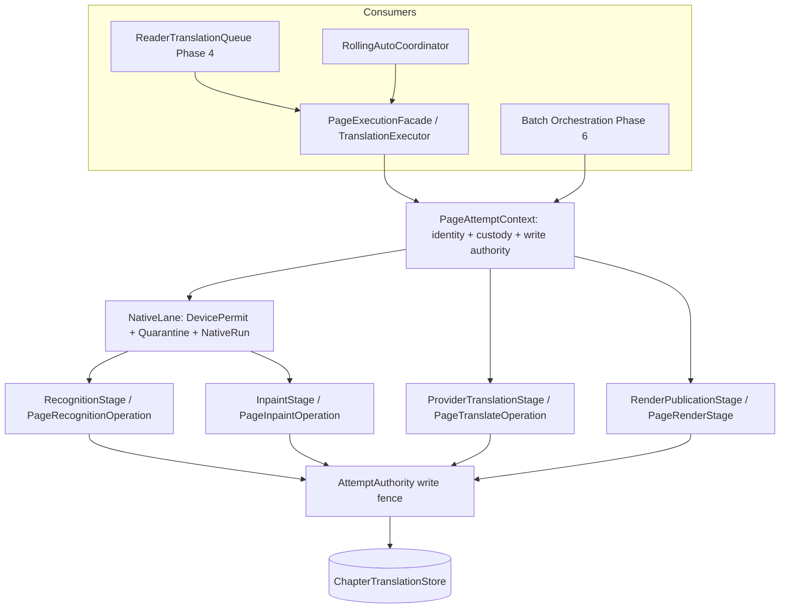

# Authority and source baseline

This audit maps **Phase 5** of the TachiyomiATVibe architecture cleanup per the master roadmap (`docs/architecture-cleanup/artifacts/translation-simplicity-investigation/phases/index.md`). It synthesizes the findings of the Phase 5 shared processing auditor (`agent 397a5b93`) and cross-phase seams auditor (`agent f7d4d45e`).

Phase 5 addresses the massive forwarding layers across `TranslationPipeline.kt`, `BatchChapterTranslator.kt`, and `BatchLaneWorkers.kt` without building mega-interfaces or breaking native resource boundaries.

---

## 1. Core architecture findings

### 1.1 Duplication and forwarding inventory
1. **Forwarding-only constructor params**:
   - `BatchChapterTranslator`: 24 constructor arguments, **21 function-typed** forwarders.
   - `BatchLaneWorkers`: 39 constructor arguments, **12 function-typed** forwarders.
   - `SinglePageHttpRenderPhase`: 9-argument `retryInpaintDownscaledFn` lambda forwarding to `SinglePageOnnxPhase`.
2. **Duplicated wrapper methods**:
   - `persistCleanedBitmap`, `loadPersistedCleanedBitmap`, `deleteRetiredCleanedFile`, `preflightInpaintGate`, and `persistPageWithOomRecovery` repeated across 3-5 classes with identical delegation bodies.
3. **Behavioral duplication**:
   - **Provider translation block**: duplicated between `SinglePageHttpRenderPhase.translateSinglePageHttpOnly` and `BatchLaneWorkers.translatorWorker` standard path (chunk context assembly, token estimation, sorter, validator, failure classification).
   - **Recognition catch taxonomy**: duplicated between `SinglePageOnnxPhase.analyzePage` and `processSinglePage`.
   - **Inpainting invocation**: wrapped independently in 4 places with slightly divergent outcome mappings.
   - **Native lane wrapper chain**: 4 wrappers + 2 anonymous `NativeLaneRunner` adapters before reaching `EngineLane` and `NativeRunQuarantine`.

---

## 2. Target Design: Cohesive Capability Owners

Rather than one large `PipelineCapabilities` mega-interface, Phase 5 introduces four focused capability owners and one uniform execution context:



### 2.1 The Contracts

```kotlin
interface PageAttemptContext {
    val manga: Manga
    val chapter: Chapter
    val source: HttpSource
    val pageKey: String
    val store: ChapterTranslationStore
    val write: AttemptAuthority
    val sourceCustody: SourceBitmapCustody
    val cleaned: CleanedOwner
    val deferred: DeferredPagePublications
    val stageListener: TranslationStageListener?
}

interface NativeLane {
    suspend fun <T> run(
        ctx: PageAttemptContext,
        priority: DevicePermitPriority,
        timeoutMs: Long,
        onTimeout: suspend () -> Unit,
        block: suspend () -> T,
    ): T?
}

interface RecognitionStage {
    suspend fun recognize(ctx: PageAttemptContext, streamFn: (() -> InputStream)?, force: Boolean): RecognitionResult
}

interface InpaintStage {
    suspend fun inpaint(ctx: PageAttemptContext, draft: PageTranslation): InpaintResult
}

interface ProviderTranslationStage {
    suspend fun translate(ctx: PageAttemptContext, draft: PageTranslation): TranslationCompletionOutcome
}

interface RenderPublicationStage {
    suspend fun renderAndPublish(ctx: PageAttemptContext, draft: PageTranslation): TranslationCompletionOutcome
}
```

---

## 3. Preserved Invariants and Native Lifecycle Fences

1. **NativeRunQuarantine**: remains the sole authority for physical native exit before permits/resources are freed.
2. **CleanedOwner**: sole-recycler and borrow-counting lifecycle for cleaned bitmaps across inpaint and render.
3. **AttemptAuthority**: first-terminal-wins, attempt-fenced writes, cancellation suppression.
4. **Handoff purity**: durable identifiers only across boundaries (`PreparedPage`); bitmaps stay inside custody owners.
5. **No scheduler merger**: Reader scheduling (`ReaderTranslationQueue`) and Batch scheduling remain strictly decoupled.

---

## 4. Phase 5 Execution Slice Plan

| Slice | Focus | Deliverables & Acceptance Gate |
|---|---|---|
| **S0** | **OCR/LiteRT Boundary Review** | Read-only audit of `RoiPageRecognitionEngine`, `PaddlePageOcrCoordinator`, and `LiteRTMangaInpaintingEngine`. Establishes safe engine-role boundaries. Gate: Written review accepted. |
| **S1** | **PageTranslateOperation** | Extract shared provider translation block for single-page and batch standard lane. Parameterize retry policy and publication channel. Gate: Provider tests green; identical failure taxonomy; AI envelope untouched. |
| **S2** | **PageInpaintOperation** | Encapsulate inpainting execution, downscaled retry, and typed `InpaintResult`. Remove the 9-arg `retryInpaintDownscaledFn`. Gate: Inpaint retry edits owner and true callers only. |
| **S3** | **PageRecognitionOperation** | Unify `analyzePage` and `processSinglePage` failure handling and post-OCR stamping. Gate: OCR metadata exercise touches model + operation only. |
| **S4** | **Guarded Publication Contract** | Cleaned image publication request/receipt contract replacing 10-arg `persistCleanedBitmap` wrappers. Gate: Cleaned persistence tests green. |
| **S5** | **Batch Rewiring** | Inject capability objects into `BatchChapterTranslator` and `BatchLaneWorkers`. Delete 33 function-typed constructor forwarders and duplicate `NativeLaneRunner`s. Gate: Batch suites green in StandardDebug and DevDebug. |
| **S6** | **Consolidation & Gate Demos** | Execute OCR metadata, retry-input, and publication-rule change isolation exercises to prove reduced edit footprint. Spotless + scoped verification. |
