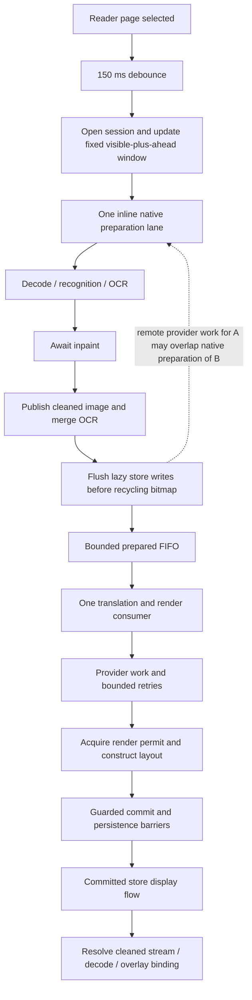

# Audit baseline and limits

Reviewed on 2026-10-14 at `4de121bf`, branch `inpainting-modes-redesign`. A fresh `git fetch origin` succeeded; `git rev-list --left-right --count HEAD...origin/main` returned `0 0`; the worktree was clean. No pull or production changes were needed.

This is a read-only source investigation. Existing regression tests were inspected, not executed. No device session, latency measurement, build, instrumentation change, commit, or push was performed. Source behavior is separated below from proposals and device hypotheses. Child agents C and D resumed on the requested GLM 5.3 Flash/max configuration and both delivered durable reports. This follow-up incorporates the orchestrator's source checks and qualifications; unresolved child estimates/proposals are not accepted findings.

Paths below are relative to the repository. Line references apply to this revision.

# Verified execution and display dependencies

For local-compute translators a shared semaphore serializes preparation and translation (`RollingAutoCoordinator.kt:423`, `:550`, `:897`). Remote work can overlap preparation of a different page. Neither mode overlaps translation with inpainting of the same page at this prepared boundary. **Permit scope differs from preparation-loop scope:** `withNativeLane` closes at `TranslationPipeline.kt:927`; deferred publication, fresh inpaint await, cleaned persistence and prepared-page flush follow at `:939-1000`, outside that native permit/quarantine block. They still block the one producer's next preparation. Full-channel send similarly blocks the producer, not necessarily a held native permit. Native permits, leases, quarantine, generation/version checks, and committed display authority must remain intact.

Waits and handoffs: reader debounce (`ReaderTranslationController.kt:375-425`); native lane admission and inline preparation (`RollingAutoCoordinator.kt:843-928`); cleaned publication (`TranslationPipeline.kt:965-1000`); lazy store drain (`PreparedPageBoundary.kt:78-88`); bounded channel send and FIFO pickup (`RollingAutoCoordinator.kt:963`, `:512-516`); provider/governor work (`SinglePageHttpRenderPhase.kt:494-591`); render permit (`:731`); flush before guarded commit and after publication (`:956-1060`); reader store resolution on IO, followed by stream attachment (`ReaderTranslationController.kt:1606-1656`); holder image load (`PagerPageHolder.kt:281`, `WebtoonPageHolder.kt:299`). These are dependency locations, not measured contributions.

# Findings in proposed engineering priority

## V1 — Prepared pages outside the new window remain ahead of visible work

**Classification:** verified scheduling policy; suspected user-visible inefficiency. **Confidence:** high for behavior, unmeasured for latency. **Effort:** medium. **Recommendation:** isolated prototype after a deterministic regression.

The prepared channel is FIFO with one consumer (`RollingAutoCoordinator.kt:425-429`, `:512`). `updateWindow` advances the window version without replacing the generation for ordinary same-session navigation (`:240-248`). `isWorkCurrent` validates generation, chapter identity, session key, and store identity, but not the latest target set or visible anchor (`:1099-1104`). `evictObsolete` also retains pages in `translateAdmitted`, including work only queued for translation (`:1082`).

**Trigger:** hold translation of page 0; let pages 1 and 2 enter the prepared queue; jump to page 8 in the same chapter/session; release page 0. Pages 1 and 2 still pass the current-work test and receive provider/render work before newly prepared page 8. Preparation already in progress also finishes inline before the producer can reconcile the new anchor. This is deliberate retention of admitted work, but it can spend reader wait time on unseen pages and issue paid requests that have not yet started.

**Smallest credible change:** distinguish queued prepared work from an already-started provider call. Re-evaluate queued work against the latest desired window at pickup; retire its transient admission and trace bookkeeping when obsolete, retaining reusable durable OCR/cleaned artifacts. Prefer the current visible page among eligible prepared work. Let an already-started paid request drain with existing guards.

**Expected benefit:** avoids remaining queue service for obsolete prepared pages; gain depends on queue occupancy and provider/render duration. No millisecond estimate is established. **Risk:** starving backward navigation, mishandling queue retirement, duplicate requests, losing generation/lease fences. **Validation:** gated fake executor, queue pages then jump anchor, assert obsolete pages do not start new provider calls, visible page is next, already-started call commits once, and return navigation reuses valid artifacts.

## V2 — Failed pages consume fixed ahead-window positions

**Classification:** verified policy gap relative to the requested skip-ahead behavior. **Confidence:** high. **Effort:** medium. **Recommendation:** define target replacement policy, then prototype.

Ordinary failures already allow later pages **inside the current window** to proceed. `isAdmissible` excludes failed and provider-paused slots (`RollingAutoCoordinator.kt:1027-1032`); ordinary thrown translation errors are caught per page (`:652-658`), and the loop continues. Existing tests explicitly assert prepare failure on p0 followed by successful p1 (`RollingAutoCoordinatorTest.kt:259-271`) and thrown translation failure on p0 followed by successful p1 (`:570-584`). A blanket claim that every failed page stalls Auto is unsupported.

The ahead target remains a count of page positions, not successful or serviceable targets (`AutoWindowState.kt:AutoWindowBounds`, `RollingAutoCoordinator.kt:1046-1067`). Reader configuration clamps that count to 1–5 (`ReaderTranslationController.kt:431`), default 2 (`TranslationPreferences.kt:113`). If ahead pages n+1 and n+2 fail, the coordinator does not replace them with n+3 and n+4 while the reader stays on n. This can drain useful prefetch capacity without a coroutine deadlock.

**Smallest credible change:** preserve the visible slot and scan forward within a bounded horizon until the configured number of useful ahead targets is found. Exclude terminally failed or still-paused pages from replacement capacity; keep them visibly failed/deferred, never mark them Ready. Avoid expanding endlessly during a provider-wide outage. Keep source-unavailable and memory deferral distinct from terminal failure. A selected-target list needs corresponding snapshot semantics; the current `AutoWindowBounds` contiguous range and available-target counters cannot silently retain their old meaning.

**Retry:** no immediate fresh provider budget after failure; preserve attempt ledger, eligibility timestamps, manual retry, and a bounded external retry policy. Only `reconcile()` releases matured provider pauses (`RollingAutoCoordinator.kt:275-278`, `:746-755`); plain completion pokes do not. Do not make a global authentication/rate failure trigger unbounded speculative requests.

**Expected benefit:** keeps useful work ahead despite failed positions; no throughput gain measured. **Risk:** extra provider spend, changes to contextual ordering, snapshot counts, missing source streams, memory pressure. **Validation:** fail two adjacent pages, verify farther targets progress without retrying them in a tight loop; chapter-end clamp; provider-wide outage; recovery; backward navigation; manual retry and committed display retention. Cross-page `PageWorkPlanner.planChapter` dependency propagation (`PageWorkPlanner.kt:135-188`) belongs to the batch chapter planner and is not evidence that rolling Auto inherently blocks behind failed predecessors.

## V3 — Available cleaned images are withheld until translation and rendering are ready

**Classification:** verified publication policy; suspected contributor to perceived swap delay. **Confidence:** high for dependency, unmeasured for cost. **Effort:** medium/high. **Recommendation:** prototype clean-image preview before changing pipeline order.

`PageTranslationView.displayImageName` is `cleanedImageName.takeIf { isTranslationDisplayReady }` (`PageTranslationState.kt:20-21`). Readiness requires cleaned-image-ready or original fallback, translation READY/PARTIAL, render READY, and nonblank translated blocks (`PageDisplayProjection.kt:86-90`). `attachTranslatedStreamIfWarm` resolves a stream only through `displayImageName` (`ReaderTranslationController.kt:297-307`). Thus `tier2Finished` and `wantsToShowOverlay` look like separate controller branches (`:1653-1659`) but are both indirectly gated by full readiness.

Fresh Auto prepares, awaits inpaint, and publishes durable cleaned data before calling translation (`TranslationPipeline.kt:965-1000`, `:1069`). The cleaned JPEG can already exist while the reader continues showing the original through provider and render work. This supports the reported behavior but does not prove how many seconds are caused by the gate versus model execution, provider delay, persistence, hydration, or decode.

**Smallest credible experiment:** an explicit clean-preview state can expose a current-revision, durably published cleaned base before translated text is ready. Overlay remains gated by valid layout and translation. Preserve a previous committed translated result during refresh; do not replace it with a half-finished candidate. This changes what the user sees (temporarily blank bubbles), so compare it against the existing original-until-complete policy.

`originalImageFallback` is a storage-failure policy, not a scheduling shortcut: `markOriginalImageFallback` marks inpaint/render READY to keep translated blocks usable after cleaned publication fails (`CleanedPublication.kt:510-522`). Simply setting that boolean earlier cannot accelerate provider admission, and may falsely claim rendered/layout readiness. Translation-first overlap is a larger mechanism change requiring image ownership, layout/color inputs, fences, cancellation, and memory experiments.

**Expected benefit:** clean preview can appear earlier by the remaining provider/render tail; output quality and time-to-readable-text are not automatically improved. **Validation:** timestamps for cleaned durable commit, translation completion, layout completion, stream attachment and first frame; fresh vs already committed chapters; cold/warm hydration; pager/webtoon; fallback and write failure; refresh failure retaining old output.

## V4 — Auto preparation drains lazy persistence before provider handoff

**Classification:** verified required ownership barrier; suspected cost. **Confidence:** high for barrier, unknown for latency. **Effort:** medium/high. **Recommendation:** measure before redesign.

`publishPreparedPageFromOcr` flushes an active lazy store before recycling the source cleaned bitmap (`PreparedPageBoundary.kt:78-88`). This is an Auto-path barrier, not exclusively a batch finding. The translation lane then requires a cleaned artifact name (`TranslationPipeline.kt:1124-1128`). Serialization/encoding/store drains can therefore delay provider admission as well as image publication.

Do not remove the flush while the queued writer still owns the bitmap. Instrument the barrier, pending writes, JPEG/sidecar completion and handoff with matched page IDs first. If material, evaluate a per-page durability join or immutable buffer ownership transfer; retain atomic publication and release correctness. Benefit is reduced admission wait only if unrelated writes actually occupy the drain. Validate write failure, bitmap lifetime, cancellation, crash recovery, and competing manual ownership.

## V5 — Drain timeout exits the sole translation consumer

**Classification:** source-supported conditional liveness concern, not established cause of the reported failures. **Confidence:** high for exceptional control flow, medium/low for production reachability. **Effort:** low/medium. **Recommendation:** add a focused liveness regression before assigning severity.

The consumer catches `TimeoutCancellationException` and rethrows it (`RollingAutoCoordinator.kt:637-644`). It is launched once without a restart/health guard (`:429`). Cancellation of a child does not cancel its parent merely because it is cancellation; see [Kotlin's exception handling documentation](https://kotlinlang.org/docs/exception-handling.html). Consequently, if this timeout occurs while the producer generation remains live, the producer may keep running, fill the channel, then suspend forever with no consumer. `updateWindow` can keep observing that producer job as active rather than restart it.

**Important bound:** normal production HTTP/render work is enclosed by a 120 s `withTimeoutOrNull`, converts expiry to IOException, and is handled by the per-page continuation path (`TranslationPipeline.kt:174`, `:1179-1190`). The outer drain is 210 s (`RollingAutoCoordinator.kt:1398`). Therefore ordinary HTTP timeout is not sufficient evidence of this drain-timeout failure. Local-compute gate wait occurs inside the 210 s drain before the inner pipeline timeout; slow/uncooperative cleanup or an escaping cancellation requires investigation. Existing drain trace test cancels the whole coordinator before expiry and asserts telemetry, not continuing later pages in a live window (`RollingAutoCoordinatorTraceTest.kt:302-327`).

**Validation:** injected short drain grace, live generation, stalled p0, pending p1/p2; assert later provider work eventually runs or the whole coordinator transitions to an explicit restartable stopped state. Keep the cancellation attempt unresolved per ledger semantics and preserve quarantine. Distinguish real parent cancellation from a contained per-page deadline. Do not just swallow all CancellationExceptions.

## V6 — Legacy Paddle provider probes precede successful LiteRT selection

**Classification:** source-supported avoidable setup for nondefault saved QNN provider choices; latency unmeasured. **Confidence:** high. **Effort:** low/medium. **Recommendation:** prototype lazy fallback-only resolution; coordinate with the OCR owner.

`RoiPageRecognitionEngine.initialize` resolves the Paddle provider at `:242-243` before checking LiteRT assets and trying LiteRT initialization at `:302-346`. GPU compute selection allows the saved legacy QNN choice through (`:488-499`). `PaddleOcrSessionFactory.resolve` performs QNN resolution/probes for that choice (`PaddleOcrSessionFactory.kt:69-102`). It caches failed resolutions, not successful ones (`:85-88`), so successful probes can recur across recognition-engine rebuilds even when the requested neural sessions ultimately use LiteRT.

Default legacy provider CPU skips probes, and successful LiteRT with CPU compute selection takes that cheap path too. This finding is conditional on saved QNN selection and does not explain every cold reader load.

**Additional verified dependency (Agent D follow-up):** `paddleProvider.requested` feeds `PaddleOcrBatchActivationPolicy.currentFromPreferences` before LiteRT initialization (`RoiPageRecognitionEngine.kt:287-295`). Its activation sets the rolling governor and the coordinator's validated batch size (`:291-293`, `:390-393`). The pure policy checks staged build flags, requested provider, confirmation matrix and thermal severity (`paddle/batch/PaddleOcrDevicePolicy.kt:44-88`); debug provisional opt-in can retain a requested non-B1 batch. Therefore replacing the resolution with null can change batch size even when LiteRT succeeds. The emergency policy's CPU label does not by itself prove that LiteRT inference switches to CPU: the ONNX provider configuration is consumed by fallback, while LiteRT's GPU choice still comes from the new compute-device selection (`:310`, `:325`).

**Refined minimal change:** separate the cheap requested-provider enum from native probe/session resolution. Supply the same requested enum to the existing batch policy; resolve native ONNX routing lazily only if fallback is invoked. Preserve shared recognizer/detector route resolution and failure safety. Model-driven replacement of that policy is separate work with the OCR owner. Validate LiteRT success with zero QNN probes and unchanged batch activation across B1/B2/B4/dynamic and debug/release build flags; LiteRT failure with correctly labeled ONNX fallback; repeated rebuilds; CPU/GPU preference changes; fallback parity. Instrument initialization and probe duration before promising a speedup.

## V7 — Detached inpaint work does not inherit the correlated trace context

**Classification:** verified missing context propagation; observability/cancellation concern. **Confidence:** high for scope construction. **Effort:** medium. **Recommendation:** include in measurement repair before trusting stage attribution.

Fresh inpaint runs in `CoroutineScope(Dispatchers.Default).async` (`SinglePageOnnxPhase.kt:1182`), a separate scope whose context does not include the parent's `TranslationTraceElement`. Trace lookup uses thread-local state installed by that element, and `beginStage` returns a no-op when no run is installed (`TranslationTrace.kt:1276-1280`, `:1303-1313`). Consequently fresh detached inpaint is not reliably attributed to the page run. The resume path instead invokes inpaint inline under its parent's trace (`SinglePageOnnxPhase.kt:555-562`), where wrapper and engine INPAINT spans can both emit. The old claim that nested inpaint spans always double-count every path is too broad: fresh and resumed paths need separate verification.

The async call also uses independent Job ownership; parent cancellation is not automatically a cancellation of this work. In fresh Auto preparation, the detached job is awaited after `withNativeLane` has returned (`TranslationPipeline.kt:927`, `:956-963`). The 90 s native timer therefore does not directly bound this later await, and the 210 s consumer drain applies only after prepared handoff. A stalled detached inpaint can keep the preparation loop waiting without either of those deadlines applying; actual native hangs were not reproduced. Root has not demonstrated device corruption or a speedup from changing it. Restore explicit lifetime, deadline/drain ownership and trace attribution while preserving native quarantine and actual intended overlap; do not add a cancelling timer and recycle buffers while native work still runs. A fake delayed engine should check parent cancellation, native exit/quarantine, bitmap lifetime, and exactly matched per-page trace identity. Inspect actual LiteRT runtime telemetry for CPU/GPU execution rather than treating the wrapper's hardcoded CPU label (`SinglePageOnnxPhase.kt:1198`) as execution proof.

## V8 — External reconciliation can repeatedly reopen eligible provider-paused pages

**Classification:** verified retry-policy boundary; suspected provider spend/latency concern. **Confidence:** high for reopening, unmeasured for user impact. **Effort:** medium. **Recommendation:** bounded session retry policy independent of crash-recovery ledger.

Paused provider outcomes with no future retry timestamp use `RETRY_AT_NEXT_RECONCILE` (`RollingAutoCoordinator.kt:719-751`). Reader window updates explicitly call `reconcileAutoWindow` (`ReaderTranslationController.kt:464`); other external reconciliations can also release those pauses. The durable ledger caps **unresolved interrupted attempts**, not all completed failed calls: completed calls clear entries/counters (`ChapterAttemptLedger.kt:106-122`), and startup reconciliation increments unresolved counts (`:130-139`). A still-desired page without display-ready output can therefore get a fresh retry admission on repeated external signals without a separate session failure cap.

This does not establish an unbounded tight loop: internal completion pokes deliberately do not release pauses. Forward navigation removes pages behind the visible anchor, the desired set excludes display-ready pages, and provider-supplied retry timestamps still apply. Nor does a translation-only retry necessarily repeat OCR/inpainting; the resume branch reuses valid native results (`SinglePageOnnxPhase.kt:364-437`). Agent C's general claim of paying 5–6 s of native work on every page turn is withdrawn.

**Proposal:** retain provider retry timestamps and per-request retry budgets; add bounded per-session cooldown/attempt accounting for completed provider failures that remain non-display-ready. Never retry a background failed page ahead of a newly visible page merely because a wake arrived. A generic `Failed(retryable=true)` slot currently remains excluded while in the window; that is existing deliberate skip behavior tested by `RollingAutoCoordinatorTest.kt:570-584`, not proof of a deadlocked chapter. Clarify manual retry and background retry semantics rather than indiscriminately rearming all failures. **Validation:** repeated reconciliations while a failed page remains desired; positive/zero translated blocks; future retry timestamps; forward eviction; manual retry; provider-wide outage; no fresh budget on internal completion; no changes to crash-streak ledger guarantees.

## V9 — Translation-only Auto resume re-encodes an existing cleaned image

**Classification:** verified repeated decode/publication on the matching resume branch; suspected avoidable work and image degradation. **Confidence:** high for data flow, unmeasured for cost/quality. **Effort:** medium. **Recommendation:** high-priority isolated reuse prototype.

When the work plan reuses OCR and inpaint but needs translation, `SinglePageOnnxPhase.kt:364-437` loads the persisted cleaned bitmap, puts it back in `adjustedResume.cleanedBitmap`, resets translation state and returns a new phase result. `prepareSinglePage` then passes that result through `persistOnnxCleanedImage` (`TranslationPipeline.kt:965-992`). A non-null bitmap on a lazy store invokes `persistLazyCleanedBitmap` (`CleanedPublication.kt:243-256`), generates a new cleaned filename (`:306`), enqueues JPEG/hash/sidecar writing (`:346-364`), and joins it before bitmap recycling at the prepared boundary. No reuse shortcut preserves the already valid cleaned file in that path.

**Trigger:** start with valid persisted OCR/cleaned evidence and translation still needed; resume Auto without changing source, OCR, inpaint model/stamp or geometry. This can occur after a provider failure with no display-ready output, or another eligible translation-only resume. It does not cover every retry: render-only resume has its own path, and changed evidence correctly requires recomputation.

**Smallest credible change:** build the lightweight PreparedPage from validated existing OCR/cleaned artifact metadata without loading and re-publishing its bitmap. Keep generation/version/fingerprint/lease fences and image identity/existence validation; the translation/render path can load pixels if actually needed. Avoid conflating artifact reuse with skipping changed input validation.

**Expected benefit:** removes a cleaned-image decode, encode, hash/sidecar publication and associated drain from a matching resume. Re-encoding a decoded JPEG is not guaranteed pixel-equivalent, so repeated retries may also change the cleaned base; actual degradation is unmeasured. **Risk:** stale or missing artifact acceptance, changed stamps, orphan deletion, concurrent refresh, bitmap ownership. **Validation:** same cleaned filename and content hash after translation-only retry; no cleaned writer/encoder invocation; missing file or mismatched identity forces recovery; unchanged block geometry; repeated retries; committed-display retention; competing manual lease; cancellation and restart recovery.

## Cross-agent proposals not accepted as written

- Requiring the foreground to become Ready before any ahead preparation would suppress useful remote overlap and can block ahead work permanently when the visible page fails. Prefer latest-window priority and queued-work freshness, while retaining overlap and ordinary failure skip.
- A window version change alone is not enough to discard a page still inside the latest desired set. Use current desired membership and durable reuse evidence; preserve already-started paid-call drain.
- Inpainting an offscreen bitmap does not erase source text in the original image. An overlay-on-original preview can still produce double text even when `inpaintStatus == READY`. Treat clean-base preview and text-on-original preview as separate visual policies; neither may lie about committed/layout readiness.
- Auto render currently requests BACKGROUND priority (`SinglePageHttpRenderPhase.kt:113-115`), whose permit wait suspends until grant/cancellation (`DevicePagePermitGate.kt:71-74`). The null-return permit-starvation branch primarily describes FOREGROUND's bounded wait. Auto's outer 120 s HTTP/render deadline can still expire during permit wait, but a specific Auto render-pause loop is not established by the null branch alone.
- A 100–400 ms JPEG decode, sub-second UI swap, 5–6 s retry, or a dominant lag stage is not measured by this source review. Do not promote those estimates to findings.
- Timeout cancellation of the sole consumer does not necessarily kill the producer or permit a new `updateWindow` to restart it while the old producer remains active. V5's conditional stranded-producer analysis remains the accepted scope.

# Target tuning and settings boundaries

The reader target count (default 2, clamped 1–5) differs from prepared FIFO capacity (2/4/6 by memory tier: `TranslationMemoryBudget.kt:40-43`). Increasing FIFO capacity does not inherently enlarge the desired window or fix throughput. If sustained service is slower than reading, extra prefetch only postpones backlog; it cannot restore steady-state capacity. First measure arrival-to-readable latency, queue waits, useful ahead count and obsolete work under representative page turning. Preserve foreground memory bypass and hard decode guards (`RollingAutoCoordinator.kt:784-822`). Consider adaptive depth only after freshness and failure replacement.

Agent D's [settings inventory and removal map](../settings-investigation) is delivered. Root verified the following boundaries against source:

| Control | Verified state | Audit recommendation |
| --- | --- | --- |
| `translation_onnx_ep`, `translation_experimental_qnn` | Accessors at `TranslationPreferences.kt:140`, `:186`; repository Kotlin search found no callers | Remove dead accessors; stored unused values can remain inert |
| OCR model, inpaint model/mode/fallback, new GPU/CPU compute choice | Live model/runtime selection | Keep |
| Legacy Paddle ONNX provider | Read by `EngineLane.kt:341`, `:565`, and `RoiPageRecognitionEngine.kt:494`; passed to ONNX fallback at `:314-319`, `:346-352`, and batch activation at `:287-295` even on LiteRT | Remove confusing UI under model-driven policy, then deliberately define fallback routing and batch-policy input; this is still load-bearing, not dead |
| Global hardware accelerator and device discovery | Live `HardwareDiscoveryEngine.kt:222` read; vision route at `RoiPageRecognitionEngine.kt:255` and ONNX session/fallback consumers | Separate user selector removal from capability/probe deletion; retained vision/fallback routes still need their checks |
| Vision GPU toggle | Live detector, panel and segmentation routing at `RoiPageRecognitionEngine.kt:250-273` | Decide CPU pinning explicitly before deleting; default OFF does not prove that users with it ON have equivalent behavior |
| Inpaint hardware override / legacy ONNX initializer | Production ROI constructors at `:449`, `:998` do not call coordinator `initialize`; LiteRT engine and delegates perform selected neural work | Candidate dead routing chain, but keep region routing, classical fallback and model delegates; remove only after complete call-site/test accounting |

The source audit supports simplifying user configuration. It does not establish that silently changing saved QNN users to CPU has no effect or that every capability probe is redundant. UI-only removal leaves existing preference reads active; hiding controls alone does not make those preferences inert. Do not interfere with the other OCR orchestrator's conversion work.

# Evidence correction for round 1

The earlier claim that the historical 17.3 s wall was definitively solved as human reading cadence, and that the governor never throttles, exceeds currently verified evidence. Rolling Auto run tracing starts at native admission (`RollingAutoCoordinator.kt:851-861`), not automatically at page visibility. A schedule-wide wall, per-run wall, and reader arrival wait are different scopes. A low correlation or one request per page does not identify missing time or prove no throttling. Treat the historical gap, governor contribution, contention percentages and persistence time bands as unresolved until matched traces establish them. `criticalPathMs` is currently formatted directly from `wallMs` (`TranslationPipelineDiagnostics.kt:885`), so it cannot independently validate a dependency critical path. These corrections supersede stronger wording in earlier reports.

# Immediate recommendation

Prioritize deterministic tests for obsolete prepared work, failed-target replacement and bounded provider retry reopening, plus artifact reuse on translation-only Auto resume. Then run a measured clean-preview experiment. Retain ordinary per-page failure continuation already present. Measure Auto's prepared-page flush and actual first-frame publication before removing barriers or changing model concurrency. Include detached inpaint lifetime/deadline coverage in the diagnostic pass, and investigate the exceptional consumer-timeout case with the production 120/210 s bounds documented.

This report establishes behavior and actionable experiment designs; it does not claim measured speedups or a device-level reproduction.
