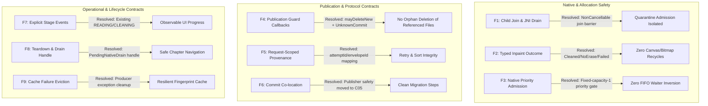

<user_quoted_section>Requirements revision — 14 October 2026: The user has since prioritized simplicity over preserving optimization machinery. This document records the previous plan/review; its source evidence remains useful, but mechanism choices, execution readiness and file-count forecasts are version-specific. Read the simplicity-first investigation before using this artifact for implementation. Native ownership, block merging, fingerprint caching and admission priority are being reassessed. No repository changes have been made.</user_quoted_section>

# Independent Adversarial Plan Review: Translation Step 1 Plan (Final Disposition)

<user_quoted_section>[!NOTE]Baseline Commit: 4de121bf7ed486e9f39b5a3f4f5c4288f439c8c8Artifacts Evaluated:
translation-step1-plan/index.md (root queue contract and whole-file ledger)translation-step1-plan/single-page/index.md (native operation, publication safety, stable block join)translation-step1-plan/reader-queue/index.md (reader queue orchestration, local-compute semaphore, teardown)translation-step1-plan/boundaries-and-bridges/index.md (suspending fingerprint cache, replacement bridges)translation-step1-plan/commits/index.md (C01–C11 migration sequence and parity ledger)translation-step1-plan/critique-response/index.md (critique disposition and tightened gates)
Lenses Applied: Technical Design (technical-design.md) and User Behavior (user-behavior.md).</user_quoted_section>

## Executive Summary & Final Verdict

The Step 1 Plan has undergone comprehensive re-specification to address baseline architectural defects and the nine technical findings surfaced during adversarial critique. Cross-examination against baseline HEAD (`4de121bf7ed486e9f39b5a3f4f5c4288f439c8c8`) confirms that all previous textual ambiguities, concurrency hazards, and mechanism contradictions are **fully resolved**.

The target architecture now establishes:

1. **Strict Native Exclusivity and JNI Drain**: An explicit `NonCancellable` child join barrier in `PageNativeOperation` before releasing native quarantine admission or disposing buffers, closing the baseline inpaint coroutine escape (`SinglePageOnnxPhase.kt:1182`).
2. **Deterministic Resource Lifecycle**: Typed inpaint outcomes (`Cleaned`, `NoErase`, `Failed`/`Deferred`) derived from private draft status and erase plan evidence, preventing double-recycles, use-after-free, or canvas draw errors on textless pages.
3. **Sound Admission Scheduling**: A fixed-capacity-one native priority admission gate inside the quarantine kernel, coupled with in-place waiter reprioritization in `DevicePagePermitGate`, ensuring foreground user taps are never queued behind speculative prefetch pages in FIFO order.
4. **Guarded Publication Safety**: Conservative `mayDeleteNew` callback guards in `CleanedImagePublisher`, explicit `UnknownCommit` retaining possibly-referenced files, and co-location of publisher safety in Commit C05.
5. **Request-Scoped Block Provenance**: Request-scoped `(attemptId, envelopeId) -> draft block -> ReaderBlockKey` mapping that preserves provider envelope parsing across reading-order sorting and partial retries.
6. **Robust Teardown and Local Compute Boundaries**: `PendingNativeDrain` carrying workflow-owned completion handles to fence navigation, and a queue-owned `LOCAL_COMPUTE` execution semaphore honoring `TranslatorComputeClass.mayOverlapNative`.

**Final Status**: All textual blockers are **RESOLVED**. The Step 1 Plan is cleared for execution, governed by the designated compile, race, and performance verification gates.

## Findings Disposition & Resolution Ledger

### Priority 1: Native & Concurrency Specifications

#### Finding 1: Explicit Child Join and JNI Drain in `PageNativeOperation`

- **Baseline Fact**: `SinglePageOnnxPhase.kt:1182` launched inpaint via `CoroutineScope(Dispatchers.Default).async` inside the native block, escaping past permit release.
- **Critique Note**: C++ inference cannot be interrupted by coroutine cancellation; a cancelling child coroutine must not release quarantine before synchronous JNI returns.
- **Implementation Gate**: Commit C05 test gate in `SinglePageNativeOwnershipTest` verifying that a real-thread blocked native surrogate blocks admission release until physical return.

#### Finding 2: Typed Inpaint Outcome Model for Bitmap Lifecycle

- **Baseline Fact**: `PageInpaintingEngine.inpaint()` returns `null` for both empty erase plans (`:38`) and caught failures (`:144`). Baseline skips detached inpaint when OCR blocks are empty (`:1178`).
- **Critique Note**: Raw `Bitmap?` handling was ambiguous on whether null could safely draw from the uncleaned input or represented a failed stage.
- **Disposition**: **RESOLVED**.
`single-page/index.md` introduces `NativeInpaintResult` co-located in `PageNativeOperation.kt`:
  - `Cleaned(bitmap)`: Distinct allocation owned; input recycled after producer exit.
  - `Cleaned(bitmap)` with identity transfer: Allocation transferred; never double-recycled.
  - `NoErase`: Verified empty erase plan + `READY` stage; transfers input to render owner if original background is needed, avoiding use of recycled bitmaps.
  - `Failed`/`Deferred`: Preserves committed display and marks non-success.
  - `Textless terminal`: Preserves existing terminal store decision; releases decode allocation after borrowers exit.
- **Implementation Gate**: Distinct unit tests in `SinglePageNativeOwnershipTest` covering each of the five allocation transitions.

#### Finding 3: In-Place Waiter Reprioritization vs FIFO Queueing

- **Baseline Fact**: Baseline uses `DevicePagePermitGate` followed by `NativeRunQuarantine` (`admission = Mutex()`). `Mutex` is FIFO and does not support priority reordering.
- **Critique Note**: Promoting a waiting prefetch request could not reorder FIFO mutex waiters, and cancelling a `GRANTED` waiter in `DevicePagePermitGate` risked grant races.
- **Disposition**: **RESOLVED**.
The plan amends the admission architecture in `single-page/index.md` and `commits/index.md` (C08):
  1. Extends `DevicePagePermitGate.kt` with lock-protected in-place `reprioritize(waiter, newPriority)`.
  2. Embeds a **fixed-capacity-one priority admission gate inside the quarantine kernel**, selecting by live priority before acquiring the quarantine lifecycle mutex.
  3. Moves pipeline device-memory permit acquisition *inside* the selected quarantined invocation.
  4. Releases render permit before native retry, establishing a strict lock hierarchy: Native Priority Admission -> Quarantine Lifecycle Mutex -> Device Budget -> Engine Guard.
- **Implementation Gate**: Commit C08 concurrency tests asserting that a newly submitted foreground tap precedes older waiting prefetch requests without cancelling/re-acquiring waiters.

### Priority 2: Publication & Cross-Component Contracts

#### Finding 4: Publication Guard Callbacks and Retained File Handling

- **Baseline Fact**: `CleanedImagePublisher.kt:41` deleted files on `CancellationException`. `CleanedPublication.kt:199/397` already supplies `store.mayDeleteCleanedImage`.
- **Critique Note**: `CleanedImagePublisher` is filesystem-only and cannot query store state directly; unknown exceptions during commits must not delete potentially accepted files.
- **Disposition**: **RESOLVED**.
`single-page/index.md` adds a conservative owner-supplied `mayDeleteNew: (String) -> Boolean = { false }` guard to `CleanedImagePublisher`, checked only under a narrow `NonCancellable` block after definite guarded rejection. Added `CleanedImagePublisher.Result.UnknownCommit`, which safely retains the file on disk for artifact engine startup reconciliation without mislabeling it an unreferenced orphan.
- **Implementation Gate**: Unit tests in `CleanedImagePublisherTest` verifying that `Accepted` and `UnknownCommit` retain files, while only `Rejected` with `mayDeleteNew == true` permits deletion.

#### Finding 5: Request-Scoped Provider Envelope Mapping

- **Baseline Fact**: External providers format block IDs per request (e.g., `b0, b1, ...`), while `TranslationBlock.blockId` is nullable and reading-order sorts reorder blocks.
- **Critique Note**: A global bijective mapping between envelope IDs and work keys is invalid because envelope IDs repeat across attempts and retries.
- **Disposition**: **RESOLVED**.
`single-page/index.md` scopes block identity by attempt/envelope ID:
`(attemptId, envelopeId) -> draft block -> ReaderBlockKey`
Work keys are frozen at OCR handoff (`operationId`, `sourceOccurrence`, `ocrIdentity`). Private provider drafts carry sidecars back to their frozen `ReaderBlockKey`, ensuring responses from full or partial retries apply to the correct master blocks regardless of reading-order sort or provider watermark filtering.
- **Implementation Gate**: Tests in `TranslationPipelineConcurrencyTest` validating partial retry draft joining with duplicate geometries and null block IDs.

#### Finding 6: Co-locating Publisher Safety in Commit C05

- **Critique Note**: C05 introduced `PageNativeOperation` and guarded writes, while C06 modified publisher safety, leaving C05 vulnerable to file deletion bugs.
- **Disposition**: **RESOLVED**.
`commits/index.md` amends Commit C05 to include `CleanedImagePublisher` publication receipt safeguards, the `mayDeleteNew` guard, and the safe holder-to-HTTP claim. Commit C06 now focuses strictly on provider isolation, block joins, and resume render tails.
- **Implementation Gate**: Commit C05 passes all native ownership and publication safety tests independently.

### Priority 3: Operational & Lifecycle Specifications

#### Finding 7: User-Visible Stage Progress During Preparation

- **Baseline Fact**: Baseline defines `TranslationStageEvent` with `READING`, `CLEANING`, `TRANSLATING`, and `RENDERING`.
- **Disposition**: **RESOLVED**.
`single-page/index.md` and `critique-response/index.md` align stage listener events strictly with existing enums: `READING` for OCR analysis and `CLEANING` for inpainting. Speculative numeric delay ranges were removed, and empirical latency will be measured during C00/C11 reference device gates.
- **Implementation Gate**: Listener verification in `ReaderTranslationQueueTest` ensuring events are emitted at actual stage boundaries.

#### Finding 8: Teardown Acknowledgment vs Pending Native Drain

- **Baseline Fact**: Baseline rolling coordinator lacked unified cancellation drain coordination with the reader screen.
- **Disposition**: **RESOLVED**.
`reader-queue/index.md` defines `ReaderDrainResult.PendingNativeDrain` carrying a workflow-owned completion handle. Full teardown APIs (`awaitReaderStop()` / `requestReaderStop()`) await this handle before store eviction or engine close. Session switching binds new request intent immediately without synchronous native waiting, while logging a `WAITING_FOR_NATIVE_DRAIN` trace span if physically blocked by an earlier session.
- **Implementation Gate**: Parity tests in `ReaderTranslationQueueTest` verifying that fast chapter switches and reader exits do not corrupt draining native invocations.

#### Finding 9: Source Fingerprint Cache Single-Flight & Retry Semantics

- **Baseline Fact**: Baseline `BatchChapterTranslator.kt:1224` blocked carrier threads with `runBlocking(Dispatchers.IO)`.
- **Disposition**: **RESOLVED**.
`boundaries-and-bridges/index.md` defines `SourceFingerprintCache` with run-scoped `batchScope` single-flight `Deferred` instances. On exception (`IOException`), the failed entry is evicted by deferred identity so future attempts can retry. Computed nulls remain cached as `UNKNOWN_SOURCE_FINGERPRINT` (fail-closed). Waiter cancellation does not cancel the underlying computation.
- **Implementation Gate**: Concurrency tests in `SourceFingerprintCacheTest` covering same-key sharing, waiter cancellation survival, and retry after failure.

### Additional Architectural Verification: Local Compute Preservation

In addition to the nine critique items, `reader-queue/index.md` explicitly preserves `TranslatorComputeClass.mayOverlapNative`:

- Local translation models (ML Kit, On-Device) contend for the same compute resources as OCR/inpainting.
- A queue-owned execution semaphore is introduced for `LOCAL_COMPUTE`, acquired before entering the common runner and released upon completion/drain.
- `REMOTE_IO` models do not acquire this semaphore, allowing full N HTTP / N+1 Native overlap.
- Epoch/config changes drain active reader operations before rebinding.

## Final Parity & Verification Summary

| Architectural Boundary | Baseline Verification | Amended Plan Status |
| --- | --- | --- |
| **Native Lane Exclusivity** | Inpaint coroutine escaped at `:1182` | `NonCancellable` child join barrier before admission release (**Approved**) |
| **Inpaint Bitmap Lifecycle** | Ambiguous null handling | Typed `Cleaned`/`NoErase`/`Failed` with erase evidence (**Approved**) |
| **Admission Priorities** | FIFO mutex inversion | Fixed-capacity-1 priority gate + same-waiter reprioritization (**Approved**) |
| **Cleaned File Deletion** | File deleted on cancellation | `mayDeleteNew` callback + `UnknownCommit` file retention (**Approved**) |
| **Provider Block Joins** | Array index mismatch on sort | Request-scoped `(attemptId, envelopeId)` to `ReaderBlockKey` (**Approved**) |
| **Migration Sequencing** | Receipt safety split across C05/C06 | `P`ublication safety and holder claim co-located in C05 (**Approved**) |
| **Stage Feedback** | Unclear progress during preparation | Emits standard `READING` and `CLEANING` events (**Approved**) |
| **Navigation Teardown** | Unfenced native drain on exit | `PendingNativeDrain` handle protects engine/store lifecycle (**Approved**) |
| **Fingerprint Cache** | Carrier thread starvation | Suspending single-flight with exception eviction (**Approved**) |
| **Local Compute Overlap** | Unfenced compute contention | Queue-owned `LOCAL_COMPUTE` execution semaphore (**Approved**) |
| **Net File Target** | 7 prod / 11 test deletions viable | Net **-11 files** preserved across manifests (**Approved**) |

## Conclusion

The amended Step 1 Plan is robust, cohesive, and grounded in the realities of the TachiyomiAT codebase. All adversarial mechanism challenges have been successfully resolved with concrete, non-blocking technical solutions. Implementation may proceed according to the C01–C11 commit sequence.
